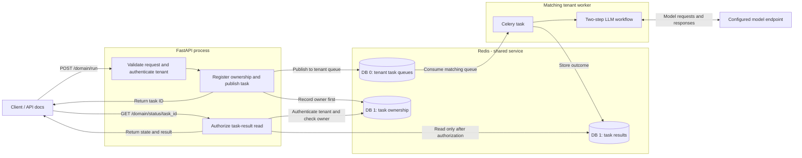
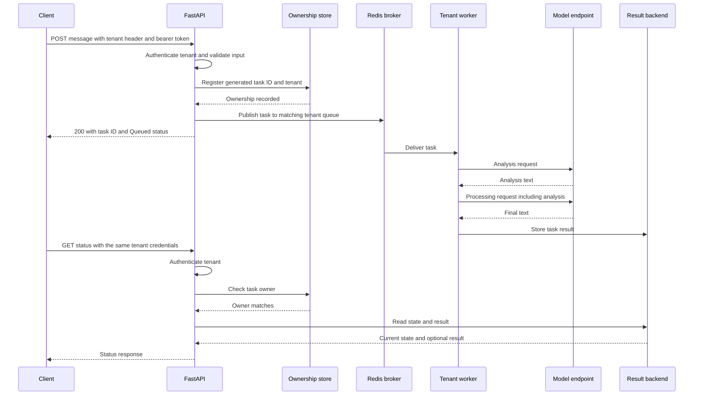
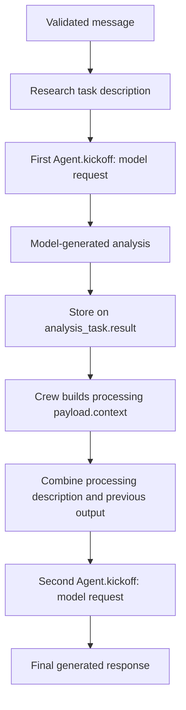
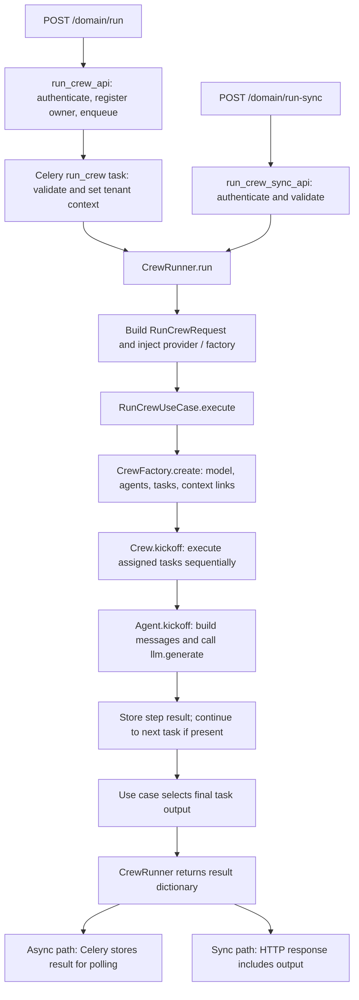
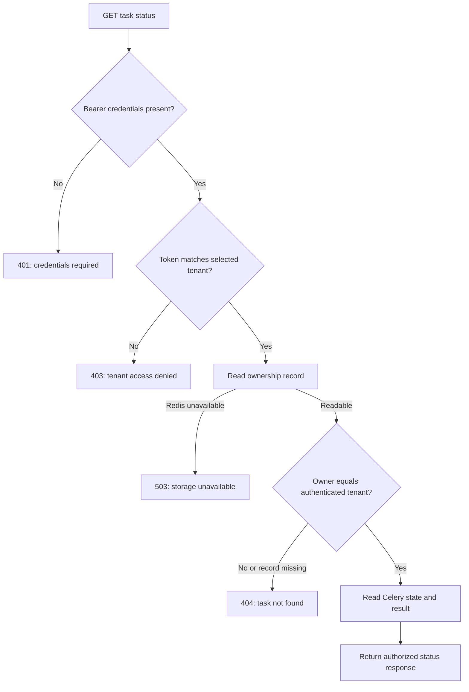

# CrewOS

A Python foundation for building an AI agent orchestration platform. Currently it executes a fixed two-step LLM workflow: analysis followed by processing. Tool-using agent loops, durable workflow checkpoints, approvals, and multi-agent evaluation are planned, not implemented capabilities.

## Contents

- [Current behavior](#current-behavior)
- [Architecture and workflow](#architecture)
- [Tech stack](#tech-stack)
- [Project structure](#project-structure)
- [Design decisions](#key-design-decisions)
- [Local setup](#local-setup)
- [Configuration reference](#configuration-reference)
- [Docker Compose](#docker-compose)
- [API reference](#api-reference)
- [Security and isolation](#security-and-isolation)
- [Retries, timeouts, and delivery guarantees](#retries-timeouts-and-delivery-guarantees)
- [Tests and verification](#tests)
- [Kubernetes](#kubernetes)
- [Troubleshooting](#troubleshooting)
- [Implemented versus planned](#implemented-versus-planned)
- [Contributing and documentation](#contributing-and-documentation)

## Current behavior

- FastAPI validates nonblank string messages before execution.
- `POST /domain/run` returns a generated task ID and routes work to `crewai.<tenant_id>` (prefix configurable).
- Celery executes the workflow outside the API request. Previous-step output is included in the next model request.
- The API records task ownership in Redis before dispatch and checks ownership before reading results. Unknown and unauthorized task IDs both return 404.
- A bearer token configured for the selected tenant is required on execution and status endpoints. Headers alone do not grant access. This is tenant-level API-token authentication, not user RBAC or SSO.
- `POST /domain/run-sync` executes immediately and returns `task_id`, `status`, and `output`; `sync_run` is a response label, not a pollable background task ID.
- Provider connection errors, HTTP 429, and HTTP 5xx receive bounded retries with backoff and jitter. Credential/input errors do not. Unsupported or excessive Retry-After values stop retries rather than retrying early.
- Model-client automatic retries are disabled; Celery owns inference retries. Generation may repeat on retry; no external write tools exist yet.
- HTTP logs include method, path, claimed tenant header, server request ID, duration, and status. The logged header is not an authenticated identity. Application code does not print raw prompts or model output.

## Architecture

The diagrams below describe the **current implementation**. GitHub renders fenced Mermaid blocks as diagrams; editors without Mermaid support display their source. The explanations remain alongside the diagrams.




The API and workers can run as separate processes. Slow model calls occupy a worker rather than holding open the task-submission request. Redis databases separate broker and result namespaces; they are not independent security boundaries.

### Background request sequence



This shows the successful path. Worker execution and client polling are asynchronous; a poll may arrive while work is queued or running, and fast work may finish before the submission response reaches the client. Failure paths are documented below.

### Why polling?

The submission endpoint answers “your work was accepted” with a task ID. The client can later ask whether it finished. This is useful when work takes longer than an interactive request should wait, or when users need to navigate away and return.

Polling is a design choice, not a requirement imposed by LLMs. Streaming, server-sent events, or other long-lived connections can also be appropriate. Poll at a reasonable interval and stop on terminal states; aggressive polling adds unnecessary API and Redis load.

### Agent pipeline: what actually runs today




`CrewFactory` assigns an agent to each task and sets `processing_task.context = [analysis_task]`. `Crew.kickoff()` runs tasks sequentially, stores each result, and prepares downstream context. `Agent.kickoff()` explicitly includes that context in the outgoing model message.

That last step matters: a value stored in a Python dictionary is not automatically visible to the model. Our regression test inspects the second model request to verify that previous output crosses the request boundary.

Today these are named LLM processing stages in a predefined workflow. The model does not yet select tools, delegate work, or choose arbitrary next steps. A second model call also cannot independently verify the first call's claims unless supplied with adequate evidence.

### Function flow through the application



The two final branches are alternatives selected by the entrypoint; a single execution does not return through both paths. `CrewRunner` constructs the provider, and the use case asks the factory to assemble the workflow. The named layers make responsibilities easier to inspect; they do not add autonomous tool selection.

## Tech stack

| Component | Technology | Responsibility |
|---|---|---|
| HTTP API | FastAPI | Request validation, authentication, submission, and polling |
| Validation/configuration | Pydantic and Pydantic Settings | Typed contracts and environment settings |
| Background execution | Celery | Deliver work to matching workers and handle bounded retries |
| Broker and result storage | Redis | Queue messages, result values, and task ownership |
| Model integration | LangChain OpenAI-compatible chat adapter | Send messages to a configured model endpoint |
| Local model option | Ollama | Serve a model on local/container infrastructure |
| Packaging | Poetry | Dependencies, lockfile, package, and console entrypoints |
| Containers | Docker and Compose | Reproducible local service setup |
| Cluster manifests | Kubernetes YAML | Describe optional deployment resources |
| Verification | pytest, coverage, Kubernetes schema validation | Behavioral and configuration regressions |

CrewOS uses its own small `Agent`, `Task`, and `Crew` classes. The unused CrewAI package was removed; the project name does not imply that the CrewAI framework runs the current workflow.

## Project structure

```text
crewos/
  api/
    middleware/          # HTTP logging and request-ID generation
    routes.py            # Submission, synchronous execution, status, and health
    schemas.py           # Typed request and response contracts
  application/
    dtos/                # Values passed across application boundaries
    interfaces/          # Model-provider abstraction
    use_cases/           # Workflow execution use case
  core/
    config.py            # Environment settings
    tenant.py            # Tenant authentication, queue naming, execution context
    worker.py            # Celery worker entrypoint
  domain/
    entities/            # Agent, Task, and sequential Crew
    factories/           # Assemble the current two-task workflow
  infrastructure/
    celery_app.py        # Broker/backend and execution configuration
    task_ownership.py    # Redis-backed task ownership
    logging.py           # JSON log formatting
    memory/              # Future memory implementation; currently a placeholder
  services/
    crew_runner.py       # Wires the model provider and application use case
  third_party/llm/        # Model-service adapter
  utils/retry.py         # Transient-error classification and retry delays
  workers/crew_task.py   # Background workflow task

tests/                   # Unit, API, deployment-schema, and opt-in integration tests
k8s/                     # Base resources and optional tenant workers
```

The layers separate HTTP handling, application execution, workflow objects, and external integrations. This is an organizational boundary, not a claim that the domain has no library dependencies: its current message construction uses LangChain message types.

## Key design decisions

1. **Queue slow work.** The API submits work while Celery handles model latency. A busy worker can still create queue delays, so async submission does not guarantee fast completion.
2. **Authenticate before trusting tenant scope.** A header selects a tenant; its matching configured token authorizes tenant-level access. Individual-user permissions and SSO remain future work.
3. **Record ownership before publication.** Result reads require a matching ownership record. If publication has an uncertain outcome, retain that record rather than assuming nothing was queued.
4. **Use explicit task context.** Downstream model inputs are constructed deliberately and tested at the outgoing-message boundary.
5. **Centralize queue naming.** API and worker derive the same name from a validated tenant ID. Separate queues do not remove contention on shared dependencies.
6. **Give one layer the retry policy.** Celery retries selected transient inference errors; the model client does not silently multiply those attempts. Retries may repeat generation and incur additional cost.
7. **Keep a synchronous debugging path.** It bypasses Celery and returns generated output immediately. It shares authentication and validation but does not create a pollable task.
8. **Test behavior as well as line execution.** Earlier mocks passed despite omitted context and a broken sync response. Tests now inspect actual message contents, meaningful runner results, and access boundaries.

## Local setup

### 1. Prerequisites

- Python 3.11 or 3.12. The Poetry constraint is `>=3.11,<=3.13`; use one of the verified versions rather than interpreting that constraint as support for every 3.13 patch release.
- Poetry for installing the package and its development dependencies.
- A running Redis instance.
- An OpenAI-compatible chat-completions endpoint, such as Ollama. Models and their weights are not bundled in this repository.
- Docker with Compose for the containerized option; a cluster and `kubectl` only for the optional Kubernetes path.

There is no required frontend. FastAPI's interactive API documentation is available at `http://localhost:8000/docs` after startup. Authentication still applies when invoking protected endpoints there.

### 2. Install and configure

Work from the repository root. If you have not cloned the project:

```bash
git clone https://github.com/khushal075/crewos.git
cd crewos
```


Requires Python 3.11 or 3.12, Poetry, Redis, and access to a compatible model endpoint. Install dependencies and create an untracked configuration:

```bash
poetry install --with dev
cp .env.local.example .env.local
```

Replace `TENANT_API_KEYS` with a JSON mapping of tenant IDs to long random bearer tokens. Generate a token with `python -c "import secrets; print(secrets.token_urlsafe(32))"`. Do not commit it. `.env.local` overrides the legacy `k8crew.env`; process environment overrides both. No tokens configured means tenant requests are denied.

The example file uses `http://ollama:11434/v1`, a Compose service address. For processes running directly on your host, change it to `http://localhost:11434/v1`.

Example local settings (keep your configured `TENANT_API_KEYS` mapping in the file too):

```text
REDIS_BROKER_URL=redis://localhost:6379/0
REDIS_RESULT_BACKEND=redis://localhost:6379/1
LLM_BASE_URL=http://localhost:11434/v1
LLM_MODEL=llama3
TENANT_ID=1
CELERY_QUEUE_NAME=crewai
```

### 3. Start dependencies

If you manage Redis locally, start it according to your installation. For a foreground development process:

```bash
redis-server
```

In another terminal, start Ollama if it is not already running:

```bash
ollama serve
```

Pull a model in a separate terminal:

```bash
ollama pull llama3
```

The configured `LLM_MODEL` must match the model name available at your endpoint. Model inference speed and memory requirements depend on the model and your hardware; CPU and GPU performance differ significantly.

### 4. Start API and worker

Use separate terminals, both from the repository root:

```bash
poetry run dev
```

```bash
poetry run worker --tenant-id 1
```

`dev` starts Uvicorn with reload for local development. The container starts Uvicorn without reload. The worker is a separate process; starting the API does not start a worker.

### 5. Check the API

```bash
curl http://localhost:8000/health
```

Expected response:

```json
{"status": "ok"}
```

This checks API liveness only. Then submit an authenticated task and poll it to exercise the queue, worker, and model path.


Start another worker with `--tenant-id tenant_b` only when that tenant has a configured token and submitted work. The API and worker use the same queue-name function. Dedicated queues route workloads but do not isolate shared Redis or model capacity.

## Configuration reference

Settings are defined in `crewos/core/config.py` and loaded when the process imports the application. Restart the relevant processes after configuration changes.

Priority, highest first: **process environment -> `.env.local` -> legacy `k8crew.env` -> code defaults**. Run local commands from the repository root so relative environment-file paths resolve as expected. Unknown environment-file keys are ignored; spelling mistakes can therefore leave a setting at its default.

| Setting | Code default | Meaning |
|---|---|---|
| `APP_NAME` | `crewai_platform` | Configuration metadata; the current FastAPI title is defined separately in `main.py` |
| `REDIS_BROKER_URL` | Empty | Redis URL for Celery task delivery; configure before running workers |
| `REDIS_RESULT_BACKEND` | Empty | Redis URL for task results and ownership storage |
| `TENANT_API_KEYS` | `{}` | JSON object mapping a tenant ID to its bearer token; empty configuration authorizes nobody |
| `TENANT_PERMISSIONS` | `{}` | JSON object mapping authenticated tenants to lists of tool-action permissions; absent assignments yield an empty permission set |
| `TENANT_ID` | `1` | Default tenant consumed by a worker; overridden by `--tenant-id` |
| `CELERY_QUEUE_NAME` | `crewai` | Queue prefix; effective queue is `<prefix>.<tenant>` |
| `CELERY_CONCURRENCY` | `10` | Worker execution slots; the example configuration and Kubernetes ConfigMap use `2` |
| `LLM_BASE_URL` | Empty | Compatible API base URL, usually ending in `/v1` |
| `LLM_MODEL` | `llama3` | Model identifier sent to the configured endpoint |
| `API_KEY` | Empty | Credential for the model provider; adapter substitutes `dummy` when empty for local compatible services |
| `LLM_TIMEOUT` | `30` seconds | Model-client request timeout; allowed range is greater than zero through 120 |
| `LLM_MAX_RETRIES` | `3` | Maximum additional Celery attempts after retryable failures; allowed range is 0–5 |
| `TASK_OWNER_TTL` | `86400` seconds | Ownership-record lifetime from registration; minimum 10800 |
| `TASK_RESULT_TTL` | `3600` seconds | Result retention after completion; allowed range 60–3600 |
| `TASK_QUEUE_TTL` | `3600` seconds | Initial submitted-job expiry; allowed range 60–3600 |
| `LOGGING_LEVEL` | `INFO` | Application logger level; worker command currently sets Celery log level to `info` |
| `DEFAULT_TENANT_ID` | `1` | Legacy setting; it does not authorize a tenant or replace the required request header |

A tenant mapping might have this shape; these are placeholders, not usable secrets:

```dotenv
TENANT_API_KEYS={"1":"YOUR_FIRST_RANDOM_TOKEN","tenant_b":"YOUR_SECOND_RANDOM_TOKEN"}
```

The tenant ID is case-sensitive and must contain 1–64 letters, digits, underscores, or hyphens. Use different strong random tokens for different tenants. Rotation currently requires updating configuration and restarting API processes; there is no token-management UI or overlapping-key rotation mechanism.

`SecretStr` masks the configured tokens in ordinary object representations; it does not encrypt their storage or transport. Keep configuration private and use HTTPS for remote clients.

## Docker Compose

Create `.env.local` first. Set `LLM_BASE_URL=http://ollama:11434/v1` when using the optional model container:

```bash
docker compose --profile local-model up --build -d
docker compose exec ollama ollama pull llama3
```

For a separately hosted model, configure its URL and use `docker compose up --build -d`. The Redis URLs are overridden with Compose service addresses. Redis is not published to the host and uses AOF persistence. The API binds to localhost. For remote access, add TLS and deployment-specific access controls.

The image installs the real `crewos` package and console entrypoints, runs as a non-root user, and starts Uvicorn without development reload. Workers let Celery manage shutdown signals. Time limits and late acknowledgment do not guarantee exactly-once execution or crash-safe workflow resumption.

## API reference

### Endpoints and request contract

| Method | Endpoint | Purpose | Credentials |
|---|---|---|---|
| `GET` | `/health` | API liveness | Not required |
| `POST` | `/domain/run` | Submit background work | Tenant header and bearer token |
| `GET` | `/domain/status/{task_id}` | Read owned task state/result | Tenant header and bearer token |
| `POST` | `/domain/run-sync` | Run immediately for debugging | Tenant header and bearer token |

```json
{
  "agent_type": "research",
  "input": {
    "message": "Explain why webhook deliveries can fail."
  }
}
```

`input.message` is required, must be a string, and must contain a non-whitespace character. Its original formatting is preserved by API validation. Additional fields within `input` are preserved. There is currently no request-size or token-budget enforcement, so callers should keep messages bounded.

`agent_type` defaults to `research`, but the current crew factory always builds the same research-plus-processing workflow. It is not yet a validated selector for different runtime graphs. Role, goal, expected-output, and tool attributes are not guarantees of execution capabilities: the current model request is driven by task descriptions and explicit context. Additional input fields survive request validation and queue serialization, but the current use case reconstructs the task payload from `message` and `agent_type`. Those other fields are not automatically forwarded to the model.

### Submit background work

Use your configured token; the value below is a placeholder:

```bash
curl -X POST http://localhost:8000/domain/run \
  -H 'Authorization: Bearer YOUR_TENANT_TOKEN' \
  -H 'X-Tenant-ID: 1' \
  -H 'Content-Type: application/json' \
  -d '{"input":{"message":"Explain why webhook deliveries can fail."}}'
```

Poll `/domain/status/<task_id>` with the same two headers. Use `/domain/run-sync` with the same JSON and headers for immediate execution. `/health` is unauthenticated liveness, not a guarantee that Redis or the model is ready. Missing bearer tokens return 401; invalid tenant credentials return 403; invalid message payloads return 422. Storage unavailability fails closed.

Task ownership lasts 24 hours by default; results expire one hour after completion and queued jobs expire after one hour. An expired result may appear PENDING while ownership remains. Unknown/unowned IDs never expose backend data. Keep Redis private; ownership records and result data share its trust boundary. Ambiguous broker-publish failures retain ownership and return an error; do not assume an enqueue error means execution never happened. An outbox and richer durable run states are future work.

### Response and polling examples

A successful submission returns a generated identifier:

```json
{"task_id": "<generated-task-id>", "status": "Queued"}
```

Use that identifier with the same tenant credentials:

```bash
TASK_ID='paste-the-returned-task-id-here'
curl "http://localhost:8000/domain/status/$TASK_ID" \
  -H 'Authorization: Bearer YOUR_TENANT_TOKEN' \
  -H 'X-Tenant-ID: 1'
```

Typical states are `PENDING`, `STARTED`, `RETRY`, `SUCCESS`, and `FAILURE`; expired queued work can be `REVOKED`. On success, `result` contains the workflow result, including its output. On failure, the API returns an error category and a generic message rather than the raw provider exception.

For synchronous debugging:

```bash
curl -X POST http://localhost:8000/domain/run-sync \
  -H 'Authorization: Bearer YOUR_TENANT_TOKEN' \
  -H 'X-Tenant-ID: 1' \
  -H 'Content-Type: application/json' \
  -d '{"input":{"message":"Explain a webhook delivery failure."}}'
```

```json
{"task_id": "sync_run", "status": "Completed", "output": "<generated answer>"}
```

### HTTP errors and request correlation

| Status | Meaning in this application |
|---|---|
| `200` | Submission accepted, synchronous execution completed, or status read succeeded; inspect the returned task state |
| `401` | Missing or unsupported bearer credentials when other required request fields are present |
| `403` | Unknown tenant, invalid token, or invalid configured tenant identifier |
| `404` | No task ownership record accessible to that tenant; unknown and cross-tenant IDs use the same response |
| `422` | Request validation failure, such as a missing tenant header or invalid message; validation/dependency ordering can affect which invalid field is reported first |
| `400` | A synchronous application execution raises `ValueError`; the current route maps it to a client error |
| `503` | Redis ownership/state access is unavailable during the protected operations |
| `500` | Enqueue failure, synchronous execution failure, or unavailable/unserializable task result |

A background task can fail while status polling still returns HTTP 200: the HTTP read succeeded, but the body contains `"status": "FAILURE"`. Clients must handle both transport errors and task states.

Responses include a server-generated `X-Request-ID`. The HTTP log records that same identifier after inner middleware runs. Client-supplied request IDs are not adopted. Request IDs correlate HTTP events; background worker logs use the Celery task ID. There is not yet a complete distributed tracing system linking every HTTP/model/tool operation.

## Security and isolation

The request header chooses a tenant, and a matching configured bearer token authenticates tenant-level access. That token grants access to the tenant's execution endpoints and owned tasks; it does not identify an individual recruiter, operator, or role.

Task IDs are generated by the API. Before publication, Redis stores an ownership record using a namespaced hash of the task ID, `SET ... NX`, and an expiry. `NX` prevents overwriting an existing owner. Hashing the ID is a key-naming choice, not encryption or an authorization check. The status route checks ownership before creating/reading the Celery result.

Workers consume a configured queue and set a temporary `ContextVar` tenant value while running the workflow. Context storage and queue names do not independently establish permission. The broker is a trusted internal component: a caller with direct broker access can bypass HTTP authentication. Redis database numbers do not isolate tenants.

Application code no longer prints raw task context or generated output. That does not prove all dependency, server, or exception logs are free of sensitive content. Review logging and provider data-handling behavior before processing real information.

CORS is configured for `http://localhost:5173` as a possible development frontend. It is a browser control, not authentication. There is currently no user RBAC, SSO, rate-limiting gateway, prompt-injection enforcement system, approval flow, or isolation of individual users within a tenant. Keep the demo local or add the controls required by its deployment environment.

### Protected task-result lookup



This illustrates the authorization decision with an otherwise valid request. A missing required tenant header can instead produce HTTP 422. Errors reading or serializing backend results follow the API error handling described above. Ownership mismatch stops execution before the result backend is consulted.

## Retries, timeouts, and delivery guarantees

The worker classifies model failures:

| Failure | Current behavior |
|---|---|
| OpenAI-client connection error, including its timeout subtype | Eligible for a bounded Celery retry |
| HTTP 429 or 5xx surfaced as an OpenAI API status error | Eligible for a bounded Celery retry |
| Authentication/permission errors and other 4xx | No automatic inference retry |
| Invalid internal message or payload | Reject before model execution |
| Other exception | Record failure category and propagate |

Without `Retry-After`, delay is randomized between zero and `min(30, 2 ** retry_number)` seconds. With defaults, three retries allow up to four workflow attempts, not four individual model calls. Each retry starts the two-step workflow again; a successful first call may repeat if the second failed.

`Retry-After` is accepted only as a numeric number of seconds from 0 through 60. Unsupported values, HTTP-date values, or larger waits stop automatic retries; the worker does not retry earlier than that header requests. There is no global circuit breaker or provider fallback yet.

SDK-level retries are disabled. Background retry policy belongs to Celery; synchronous debugging calls do not get that task-level retry loop. The model-client timeout is not a single deadline covering queue wait, both calls, and every retry.

Workers use one prefetched task per concurrency slot, late acknowledgment, a 240-second soft time limit, and a 270-second hard time limit. Support and shutdown behavior depend on Celery's pool and platform. The broker visibility timeout is 3600 seconds. Compose and worker manifests allow 300 seconds for graceful shutdown, but forced termination, host failure, or an in-flight remote request can still create uncertainty.

Late acknowledgment does not guarantee task redelivery under every worker-loss scenario. There are no durable per-step checkpoints, cancellation API, external-action idempotency mechanism, or exactly-once guarantee. These are agent-runtime roadmap items. Queue expiry is not a guarantee that started work stops at the expiry time.

## Tests

```bash
poetry run pytest tests --cov=crewos --cov-report=term-missing
```

The CI coverage threshold remains unchanged at 70%; project practice targets overall coverage above 80%. The opt-in integration test requires a dedicated test Redis and must run in a fresh process with URLs set before imports:

```bash
CREWOS_TEST_REDIS_URL=redis://localhost:6379/0 \
REDIS_BROKER_URL=redis://localhost:6379/0 \
REDIS_RESULT_BACKEND=redis://localhost:6379/1 \
poetry run pytest tests/test_queue_integration.py -q
```

It runs real Celery workers sequentially against separate tenant queues, uses a fake inference runner, checks that A's worker leaves B's job pending, and verifies result ownership. It does not benchmark real model output quality. Kubernetes YAML is schema-checked against Kubernetes 1.31; schema validation is not proof of a successful cluster deployment.

## Kubernetes

### Scope and prerequisites

These manifests are a deployment starting point, not a complete production environment. They have been schema-validated against Kubernetes 1.31. Cluster scheduling, image availability, storage provisioning, network access, and model inference must be checked in your environment.

### Example deployment order

Build the image, then load it into your local cluster or publish it to a registry and update deployment image references:

```bash
docker build -t crewai-crewos:local .
kubectl apply -f k8s/base/namespace.yaml
kubectl apply -f k8s/base/configmap.yaml
kubectl apply -f k8s/base/secret.yaml
```

Configure real tenant tokens through your deployment's secret-management process. The committed empty mapping is deliberately unusable. Apply the backing services and application:

```bash
kubectl apply -f k8s/base/redis/
kubectl apply -f k8s/base/ollama/
kubectl apply -f k8s/base/api/
kubectl apply -f k8s/base/worker/
kubectl -n crewai rollout status deployment/crewai-api
kubectl -n crewai get deployments,pods,services,pvc
```

The Ollama manifest requests 7 GiB and permits up to 10 GiB of memory. Check your cluster's available resources. Pull the exact model configured in the ConfigMap:

```bash
kubectl -n crewai exec deployment/crewai-ollama -- \
  ollama pull llama3:8b-instruct-q4_K_M
```

Model availability is an external prerequisite. The Ollama deployment currently has no persistent model volume, so a replacement pod can require another pull. Use external inference or add suitable model storage if that is required by your deployment.

For a basic local API check, port-forward rather than relying on an ingress controller:

```bash
kubectl -n crewai port-forward service/crewai-api 8000:8000
```

The example ingress is controller-specific and includes path-rewrite patterns; its acceptance and behavior require validation with the chosen controller. It is not part of the verified live deployment path. In particular, do not expose its Ollama route publicly without a separate security design.

Optional tenant workers:

```bash
kubectl apply -f k8s/tenants/tenant-a.yaml
kubectl apply -f k8s/tenants/tenant-b.yaml
```

Those workers consume `tenant_a` and `tenant_b`; add their credentials to the API configuration if clients will submit work for them. The separate `k8s/workers/worker-deployment.yaml` is an optional worker for tenant `default`, not a prerequisite for the base tenant `1`.


Build/tag `crewai-crewos:local` and make that image available to the cluster. Apply namespace, configuration, secrets, Redis PVC/deployment/service, API resources, and desired worker manifests. Configure `TENANT_API_KEYS` in the `crewai-secret` Secret; its committed empty mapping denies all tenants. Never commit real credentials. A persistent-volume provisioner and ingress controller are environment prerequisites. The base worker serves tenant `1`; optional tenant manifests set their own explicit `TENANT_ID`. This repository does not provision TLS, SSO, Redis high availability, or network policies.

## Troubleshooting

| Symptom | What to check |
|---|---|
| Import error or missing `dev`/`worker` command | Run `poetry install --with dev` from the repository root and confirm the selected Python version |
| HTTP 401 | Supply `Authorization: Bearer <token>`; the tenant header alone is insufficient |
| HTTP 403 | Check exact tenant spelling, configured token mapping, and whether API processes restarted after changes |
| HTTP 422 | Read `detail` for the field location; `input.message` must be a nonblank string and `X-Tenant-ID` is required |
| HTTP 404 for a task | Use the original tenant credentials and returned ID; missing/expired ownership and other-tenant tasks share this response |
| Task remains PENDING | Confirm a worker is consuming the exact prefix/tenant queue, broker settings match, and model work is not waiting behind other tasks; expired result data can also appear PENDING |
| Task becomes FAILURE | Inspect task-ID-correlated worker failure categories; check model availability, credentials, configured model name, and timeouts |
| Redis unavailable or HTTP 503 | Verify broker/backend URLs, Redis readiness, and network reachability; the ownership check deliberately blocks access when storage is unavailable |
| Host process cannot resolve `ollama` or `redis` | Use `localhost` for host-managed services; Compose service names resolve inside the Compose network |
| Container cannot reach a host model using `localhost` | Container localhost refers to that container; configure an address reachable from Docker, such as `host.docker.internal` where supported |
| Compose services start but model calls fail | Wait for Ollama to become ready and pull the exact configured model; Compose does not currently health-gate model readiness |
| Many rate-limit retries | Reduce concurrency and inspect provider quotas; adding workers can increase overload |
| Kubernetes pods remain Pending | Check events, image availability, node capacity, and whether the Redis PVC has bound |
| Integration test is skipped | Set all three documented Redis variables in a fresh process and use an isolated test instance |

Useful commands:

```bash
docker compose ps
docker compose logs --tail=100 backend worker redis
poetry run worker --help
poetry check --lock
```

Review logs before sharing them: third-party logs can contain data or connection details even when application payload printing is disabled.

## First tool contract: agent-task status input

`crewos/application/dtos/agent_task_status.py` defines `GetAgentTaskStatusInput`, the input contract for the planned read-only `get_agent_task_status` tool. This first tool concerns CrewOS task execution, not webhook delivery. It is not registered with the model or connected to a lookup yet.

```json
{"agent_task_id": "agent_task_123"}
```

`agent_task_id` identifies a task execution, not the configured agent or an individual HTTP request. The sample identifier is synthetic. This model validates a supplied identifier; it does not generate IDs, prove existence, or grant access.

The identifier must be a string. Surrounding whitespace is removed, and an empty or whitespace-only value is rejected. Missing identifiers and undeclared fields are rejected. Tenant identity and permissions must come from trusted application execution context rather than model arguments.

The existing HTTP API still returns a Celery `task_id`; its request/response contract and ownership mechanism have not changed. When task-status lookup is implemented, the application must explicitly define how `agent_task_id` maps to the existing execution identity rather than silently creating a second unrelated ID. The future agent loop must also prevent unbounded polling of its own active execution.

This DTO belongs in the application layer because it describes a CrewOS-native operation. Generic tool dispatch and policy evaluation must remain independent of this particular tool's fields. Separate business-domain examples can be added later without putting their concepts in the runtime.

Run the contract tests with:

```bash
poetry run pytest tests/test_agent_task_status_contract.py -q
```

Input validation and the `TaskLookupOutcome` enum exist so far. The enum describes the lookup result, not the task execution state:

| Outcome | Meaning |
|---|---|
| `found` | An accessible task record was found |
| `unavailable` | No accessible task record was found |

The string values are suitable for JSON and are validated with Pydantic in the contract tests. A task state such as `running` is not a valid lookup outcome. A storage outage must later be represented as an execution error, not silently converted to `unavailable`. The enum itself performs no lookup or authorization.

`AgentTaskStatus` separately defines the task's execution state:

| Task status | Meaning |
|---|---|
| `queued` | Application has reliable evidence of acceptance and waiting work; not inferred from Celery `PENDING` |
| `pending` | Backend currently provides no execution state; this does not prove the task is queued |
| `running` | Worker reported execution started |
| `retrying` | Task is awaiting another attempt |
| `succeeded` | Workflow returned successfully; factual answer quality is not established by this state |
| `failed` | Execution ended with an error |
| `revoked` | Backend marked the task revoked, potentially because it expired; this does not prove remote work was undone |
| `unknown` | Backend state is unsupported by the mapping; not a substitute for a connection error |

A lookup can have outcome `found` while the task status is `failed`: the record was retrieved, and it describes an unsuccessful execution. Lookup outcomes are not accepted as task states, and task states are not accepted as lookup outcomes.

These are application-level values. `crewos/infrastructure/task_state.py` implements the pure `map_celery_state` function, keeping Celery-specific translation outside the DTO. It maps a supplied state without accessing Redis, running a task, or checking permissions:

| Celery state | Tool status |
|---|---|
| `PENDING` | `pending` |
| `STARTED` | `running` |
| `RETRY` | `retrying` |
| `SUCCESS` | `succeeded` |
| `FAILURE` | `failed` |
| `REVOKED` | `revoked` |
| Unrecognized state | `unknown` |

`queued` is retained for an application state supported by reliable queue/run records; the Celery mapper will not manufacture it from `PENDING`. An expired result may appear pending even while its accessible ownership record remains. The eventual lookup must check ownership before reading state, return `unavailable` for missing or inaccessible ownership, and surface storage failures as execution errors rather than inventing task states. No transitions, backend reads, or state mapping occur inside this enum. The mapper uses exact backend-state values; custom or unsupported states become `unknown`, and the string `queued` is not assumed to be a Celery state. Backend errors are not inputs to this function and must be propagated by the eventual lookup adapter.

For the first lookup, `agent_task_id` will refer directly to the existing API/Celery `task_id`; a second identifier is not generated. This establishes the intended identity mapping without changing current HTTP fields. The reader and application handler below implement the lookup.

Two Pydantic response models now enforce different shapes:

| Model | Required fields | Restrictions |
|---|---|---|
| `AgentTaskFound` | `outcome`, `agent_task_id`, `status` | Outcome must be `found`; status must be an `AgentTaskStatus` |
| `AgentTaskUnavailable` | `outcome`, `agent_task_id` | Outcome must be `unavailable`; status is not allowed, even as null |

Both reject undeclared fields and require a nonblank string identifier. `Literal` constrains each model to its specific outcome value; enums restrict the allowed lookup outcomes and task states. These contracts validate structure, not existence, permissions, or factual correctness.

```json
{"outcome": "found", "agent_task_id": "agent_task_123", "status": "failed"}
```

```json
{"outcome": "unavailable", "agent_task_id": "agent_task_123"}
```

`GetAgentTaskStatusResult` is a discriminated union: one type accepting either response model, with `outcome` selecting which model to validate. `found` selects `AgentTaskFound`; `unavailable` selects `AgentTaskUnavailable`. A missing or unsupported outcome is rejected, and each selected model still enforces its required and forbidden fields.

```python
from pydantic import TypeAdapter
from crewos.application.dtos.agent_task_status import GetAgentTaskStatusResult

result = TypeAdapter(GetAgentTaskStatusResult).validate_python({
    "outcome": "found",
    "agent_task_id": "agent_task_123",
    "status": "failed",
})
```

This selects a validation model for supplied data. It does not decide whether the task actually exists or is accessible; the eventual authorized lookup handler must determine the true outcome. Policy evaluation, tenant-scoped lookup, and registration are implemented below; model-selected execution remains pending. The task-status handler below returns these models; the existing HTTP API is unchanged. This does not add a webhook service, new input channel, or agent loop.

## Tool execution context

`crewos/application/dtos/tool_execution_context.py` defines `ToolExecutionContext`, separate from model-generated tool arguments:

```python
from crewos.application.dtos.tool_execution_context import ToolExecutionContext

context = ToolExecutionContext(
    tenant_id="tenant_a",
    permissions=frozenset({"agent_task.read"}),
)
```

The example shows an application-assigned permission, not an automatic grant. `get_tool_execution_context` now depends on the existing authenticated `get_tenant_id` dependency and reads grants from server-owned `settings.TENANT_PERMISSIONS`. Both execution endpoints (`/domain/run` and `/domain/run-sync`) use this builder; task polling retains its existing authentication and ownership checks.

```text
Tenant header and bearer token
             |
Verify token for selected tenant
             |
Read server-configured TENANT_PERMISSIONS for that tenant
             |
Construct frozen ToolExecutionContext
```

For example, explicitly assigning a read grant in private configuration looks like:

```dotenv
TENANT_PERMISSIONS={"tenant_a":["agent_task.read"]}
```

A tenant without a mapping receives no permissions. Restart API processes after changing configuration. Invalid blank or non-string configured permission names are rejected by settings validation. The model and request body cannot choose these grants; additional input fields named `tenant_id` or `permissions` are not used as execution context.

The endpoints currently use the context's authenticated tenant for their existing behavior. They do not yet enforce these new tool permissions or serialize/carry the context into the Celery worker. A tool dispatcher and protected handler now exist, but execution-time context propagation and endpoint/worker integration remain necessary before tool use is enabled.

Tenant identity is required and follows the existing queue-compatible identifier format. Permissions default to an empty immutable `frozenset`, so no tool permissions are granted merely by creating a context. Duplicate permission strings collapse into one value; blank or non-string names are rejected. Permission names are not yet an action registry or policy rules.

The model is frozen to prevent ordinary field reassignment, and its permission set cannot be modified in place. This reduces accidental mutation, not malicious access from arbitrary Python code. Pydantic validates structure; it does not authenticate whoever constructed the object. Policy evaluation and resource-scoped enforcement are still necessary.

No API accepts this object, no tool uses it yet, and no authenticated request is being granted a new capability by this change.

## Policy decision contract

`crewos/application/dtos/policy_decision.py` defines `PolicyEffect` (`allow` or `deny`) and an immutable `PolicyDecision`:

```json
{"effect": "deny", "reason_code": "permission_missing", "policy_version": "1"}
```

All three fields are required. The effect must be an allowed enum value. The reason code is a lowercase machine-readable identifier beginning with a letter and containing letters, digits, or underscores. The policy version is a nonblank string identifying the rules used. Reason codes remain extensible rather than requiring every future module to modify a central reason enum.

This model validates decision structure only. It does not authenticate identity, establish that a claimed policy version exists, check consistency between a reason and effect, or enforce access. A policy evaluator must produce truthful decisions; an execution boundary must block disallowed operations. Freezing the model prevents ordinary reassignment but does not make an arbitrary caller-created decision authoritative.

No policy evaluator or execution gate is wired yet. Missing fields produce validation errors rather than an implicit allow. Fail-closed enforcement when evaluation fails will be implemented at the execution boundary.

## Policy-service interface

`crewos/application/interfaces/policy_service.py` defines `PolicyServiceInterface`, an abstract application boundary:

```python
def evaluate(
    self,
    *,
    context: ToolExecutionContext,
    action: str,
) -> PolicyDecision:
    ...
```

The `*` requires named arguments, making calls such as `evaluate(context=context, action="agent_task.read")` explicit. Concrete implementations must implement `evaluate`; the abstract interface cannot itself be instantiated as a working evaluator. This follows the existing provider-interface approach without adding a network service.

Application code must select the action and establish the context's authenticated identity and server-assigned permissions. The interface neither verifies their provenance nor creates them. Its initial scope is action-level permission evaluation; an allow decision does not waive tenant-scoped resource access, current-condition checks, or approval requirements.

The interface now has one concrete in-process strategy, described below. The trusted-context builder is connected at the API execution boundary, but propagation to the worker and a dispatcher enforcement gate are not wired yet; those responsibilities must be connected before enabling tool execution.

## First policy strategy: exact permission matching

`crewos/application/services/permission_policy.py` implements `PermissionPolicyService` behind `PolicyServiceInterface`. It is an in-process Strategy implementation, not a separately deployed service.

```python
from crewos.application.dtos.tool_execution_context import ToolExecutionContext
from crewos.application.services.permission_policy import PermissionPolicyService

context = ToolExecutionContext(
    tenant_id="tenant_a",
    permissions=frozenset({"agent_task.read"}),
)
decision = PermissionPolicyService().evaluate(
    context=context,
    action="agent_task.read",
)
```

An exact permission match returns `allow` / `permission_granted`; an absent permission returns `deny` / `permission_missing`. Decisions include policy version `1`. Empty permissions deny the action. There are no implicit role hierarchies, prefix matches, case folding, or wildcard grants: the string `*` does not grant arbitrary actions.

The service is not specific to agent tasks: it compares the application-selected action with the context's permissions. It does not maintain an action registry or decide which actions a tool requires. Those must be assigned by application code, not by model-generated arguments.

This rule checks action-level permission only. It does not fetch resource ownership, prove the context came from authentication, check approval, or execute/block a tool. A successful `agent_task.read` decision alone cannot authorize another tenant's task. The handler must still enforce the decision through the policy gate and perform tenant-scoped access through its reader.

The execution endpoints now build authenticated context using configured tenant permissions, without changing their request or response fields. The policy strategy is not yet invoked by those endpoints. Dependency injection into a dispatcher, worker context propagation, and execution enforcement remain subsequent work.

## Policy-enforced execution boundary

`crewos/application/services/policy_executor.py` defines `PolicyEnforcedExecutor`. It receives a `PolicyServiceInterface` implementation through its constructor (dependency injection) and evaluates an application-selected action before invoking a supplied zero-argument callable.

```text
Trusted context + Application-selected action
                    |
              Evaluate policy
                    |
        +-----------+------------+
        |                        |
       Allow                Deny / Failure
        |                        |
Invoke operation          Do not invoke operation
```

A denial raises `PolicyDeniedError`, retaining its structured decision for application handling. An exception during policy evaluation or a non-`PolicyDecision` result raises `PolicyEvaluationError`. Both prevent the operation from running. Operation failures after authorization propagate as operation errors; they are not disguised as policy failures.

The generic `ResultT` annotation expresses that `execute` returns whatever the supplied operation returns. It does not validate a tool's arguments or output; those remain separate contract checks. The callback and required action must be selected by application code rather than accepted as arbitrary model-provided executable code.

This is a callable execution gate, not a registered tool dispatcher yet. No existing endpoint or Celery worker invokes it. Tests exercise the boundary with the real permission policy and controlled operations, including proving that denied or failed evaluation never invokes the operation. The task-status handler below now composes this gate with a reader that checks resource ownership using trusted tenant scope. Worker propagation, endpoint wiring, tool registration, and model tool selection remain subsequent work.

## Tenant-scoped task-status reader

`crewos/infrastructure/task_status_reader.py` defines `CeleryTaskStatusReader`. It reuses the existing ownership store, Celery application, state mapper, and response models:

```text
Task identifier + Trusted tenant identifier
                    |
           Check task ownership
                    |
        +-----------+-----------+
        |                       |
Missing / Other tenant        Owned
        |                       |
Return unavailable       Read Celery state
                                |
                       Map and return found
```

The reader uses `agent_task_id` directly as the existing Celery `task_id`; it does not generate another identifier. It returns only the requested identifier, lookup outcome, and observed state, not generated model output, prompts, or raw task exceptions. `found` means an accessible ownership registration exists and backend state was read; it does not establish that Celery retains a completed result. An owned task with an expired backend result may therefore be `found` with status `pending`.

The existing ownership store signals missing/inaccessible records with HTTP 404. The adapter translates only that condition into `AgentTaskUnavailable`. Storage failures and unexpected ownership errors propagate rather than being disguised as a missing record or a task state. Backend status access happens only after ownership succeeds.

The result factory is injectable for tests, while its default constructs Celery `AsyncResult` using the existing application. Unit tests use controlled records/backends; they are not evidence of a new live-model or live-Redis run.

This adapter enforces tenant ownership, not action permission. It must be called by an application handler through the policy-enforced executor, with a validated input and authenticated context. That composition is implemented in the application handler described below. No existing HTTP endpoint or worker calls this new reader, and no model can invoke it yet.

## Task-status application handler

`GetAgentTaskStatusHandler` in `crewos/application/use_cases/get_agent_task_status.py` composes the policy-enforced executor with a tenant-scoped reader. It accepts a validated `GetAgentTaskStatusInput` and a `ToolExecutionContext` supplied by trusted application code. The permission action is fixed by the handler as `agent_task.read`; model arguments cannot choose the action or tenant.

```text
Validated arguments + Trusted context
                 |
     Enforce agent_task.read permission
                 |
     Reader checks task ownership
                 |
       Read and map backend state
                 |
          Typed lookup result
```

`TaskStatusReaderInterface` is an application-owned boundary implemented by `CeleryTaskStatusReader`. The handler therefore depends on the reader contract rather than importing Redis or Celery infrastructure. A denied or failed policy evaluation never calls the reader. An allowed action still requires ownership of the specific task. Reader failures propagate as execution errors.

Tests compose the real policy, executor, reader, and ownership store with an in-memory Redis substitute and controlled backend state. They cover permitted access, cross-tenant rejection, permission denial, policy failure, and reader failure. No new live-service validation is claimed. The setup factory below registers this handler for internal dispatch. No HTTP endpoint, worker, or model loop invokes it yet; the existing HTTP status route retains its current behavior.

## Explicit tool registry

`crewos/application/services/tool_registry.py` provides a dictionary-backed `ToolRegistry`. Trusted application code registers a frozen `ToolDefinition` containing a name, description, Pydantic argument schema, and handler callable (for example, a bound `handler.execute` method). Registration is explicit and local to each registry instance. Duplicate names are rejected rather than silently replacing a handler; empty names and surrounding whitespace are rejected. Lookup uses exact names and raises `UnknownToolError` for an unknown tool.

The registry stores and selects definitions only. Retrieving a definition does not invoke its handler, validate arguments, grant permission, or verify context provenance. Argument validation and dispatch are provided by the dispatcher below; authorization remains in the application handler. These are trusted Python configuration objects, not validated model input. No dynamic imports, automatic plugin discovery, live registration endpoint, or tenant-specific tool catalog is implemented.

A future composition point can register the task-status handler like this (illustrative wiring, not yet part of an endpoint or worker):

```python
registry = ToolRegistry()
registry.register(ToolDefinition(
    name="get_agent_task_status",
    description="Read the observed status of a task owned by the current tenant.",
    argument_schema=GetAgentTaskStatusInput,
    handler=task_status_handler.execute,
))
```

The registry implements registration and lookup, not model-selected execution. Tests establish exact lookup, duplicate rejection, invalid-name rejection, instance isolation, and that registration/lookup never executes the handler.

## Tool dispatcher

`ToolDispatcher` in `crewos/application/services/tool_dispatcher.py` receives a tool name, decoded argument dictionary, and separately supplied trusted execution context. It looks up the registered definition, validates arguments with that definition's Pydantic schema, then calls the handler with the validated arguments and context. Tool arguments do not supply execution identity. For the task-status schema, unexpected fields such as `tenant_id` or `permissions` are rejected before handler invocation.

```text
Tool name + arguments + Trusted context
                  |
        Registry selects definition
                  |
        Validate argument dictionary
                  |
              Call handler
                  |
       Permission gate -> Ownership check -> Read/map state
```

Unknown tool names and invalid arguments prevent handler invocation. Policy, ownership, and backend failure behavior remains the handler/reader's responsibility; the dispatcher propagates errors rather than disguising them as success. Authorization is not added automatically to arbitrary registered callables: trusted registration code must select handlers that enforce the required policy. The return annotation describes the expected handler result; the dispatcher does not independently validate response schemas.

Tests exercise dispatch through the real task-status handler, policy, reader, and ownership store using controlled storage/backend substitutes. They prove permission denial, cross-tenant isolation, argument validation, and separately supplied context. The setup factory below now provides explicit registration. Calling it at application startup, HTTP/worker integration, model tool-call parsing, error-to-model formatting, and the agent loop remain pending. No endpoint or model currently invokes this dispatcher.

## Tool setup factory

`build_tool_dispatcher(reader=...)` in `crewos/core/tool_setup.py` constructs the permission policy, enforcement gate, task-status handler, fresh registry, and dispatcher. It explicitly creates a `ToolDefinition` for `get_agent_task_status` and binds its handler to `GetAgentTaskStatusHandler.execute`. Only this tool is registered. The caller supplies a reader implementing `TaskStatusReaderInterface`, keeping storage selection explicit.

```text
Setup: reader -> policy + gate + handler -> registered definition -> dispatcher
Calls: dispatcher -> validation -> handler -> policy gate -> tenant-scoped reader
```

Construction does not read task state, create a Celery task, authenticate a caller, or grant permissions. Trusted context must still be supplied separately on each dispatch. The factory is callable application setup code, not automatic startup wiring; no existing endpoint, worker, or model loop calls it yet. Tests use the factory with the real Celery reader and ownership store over controlled backend/storage substitutes, checking permitted access, denied access, cross-tenant rejection, and unknown tools. These tests do not claim live Redis or model integration.

The task-status tool is an internal operation exercised by the bounded loop in tests; it does not require a dedicated HTTP endpoint. The existing `/domain/status/{task_id}` API continues to return Celery state and completed output under its existing authentication and ownership checks. It has not been migrated to the new tool permission gate.

## Model decision contracts

`crewos/application/dtos/model_decision.py` defines the provider-independent `ModelDecision` discriminated union. Pydantic selects exactly one shape using the required `type` field:

```json
{"type":"tool_call","name":"get_agent_task_status","arguments":{"agent_task_id":"task-123"}}
```

```json
{"type":"final_answer","answer":"The task is still running."}
```

`ToolCallDecision` requires a nonblank string name and an argument dictionary containing JSON-shaped values. `FinalAnswerDecision` requires a nonblank string answer. Text fields trim surrounding whitespace and reject non-string inputs. Both reject undeclared top-level fields; a decision cannot mix final-answer and tool-call fields or supply top-level tenant/permission claims. The `arguments` dictionary remains tool-specific data: the dispatcher must validate it against the registered schema, which rejects forged authority fields for the task-status tool.

Validate the union with `TypeAdapter(ModelDecision).validate_python(payload)` or `.validate_json(text)`. Successful parsing establishes structure only: the tool may be unregistered, arguments may fail the selected tool schema, authorization may deny execution, and a final answer may be incorrect. These are model proposals, not permission grants or verified facts. One decision represents one proposed tool call or final answer; provider batches and call identifiers require explicit adapter handling later.

This is an internal application contract, not a requirement that each provider return this exact wire format. Provider adapters will translate their responses into it. The bounded loop below consumes these contracts with scripted decisions in tests; no real model adapter or existing workflow produces them yet. Refusals, malformed outputs, execution budgets, and tool-result observations still need explicit runtime handling.

## Decision-provider interface

`DecisionProviderInterface` in `crewos/application/interfaces/decision_provider.py` defines `decide(messages=..., tools=..., timeout_seconds=...) -> ModelDecision`: request exactly one tool-call or final-answer proposal. This new boundary is for the agent runtime; the existing `LLMProviderInterface.get()` and fixed workflow are unchanged. The bounded loop below uses this interface; a text-JSON adapter is implemented below alongside the test-scripted implementation; live-provider validation is pending.

Inputs in `decision_request.py` separate conversation data from executable tool registrations:

- `DecisionMessage` carries a role (`system`, `user`, `assistant`, or `tool`) and nonempty text. Content formatting is preserved. These fields describe conversation structure; a role label does not prove provenance, and retrieved/tool text must not acquire system authority. Trusted runtime code must construct the message sequence.
- `ToolSchema` carries a name, description, and JSON-shaped `parameters` dictionary. Parameters can come from a registered Pydantic argument model's `model_json_schema()`. It contains no handler or execution context. JSON-shaped validation does not establish that an arbitrary parameters dictionary is a valid or provider-supported JSON Schema.

The adapter will translate these inputs to provider formats and validate its returned `ModelDecision`. Type annotations and the abstract interface do not themselves validate a concrete adapter's return. The application retains ownership of trusted context, dispatch, authorization, and loop budgets. Publishing a tool schema grants no execution permission. Refusal, transport failure, and malformed responses must remain distinguishable from a successful final answer; concrete error types and runtime handling remain pending.

Messages currently provide text-level conversation data only. Native provider tool-call identifiers, batched calls, multimodal messages, streaming, and usage metadata are not represented by this first contract and require explicit adaptation or later contract extension. It is not a complete cross-provider chat protocol. Tests cover input shapes and separation of model metadata from executable handlers; they do not demonstrate model inference.

## First bounded agent loop (scripted-provider verification)

`AgentLoop` in `crewos/application/use_cases/agent_loop.py` requests one decision at a time through `DecisionProviderInterface`. It validates each returned decision, returns a final-answer proposal immediately, or dispatches a tool call using separately supplied trusted context. After a successful tool call it appends an assistant decision message and a tool observation containing the tool name and JSON result, then requests the next decision. Conversation history is local to the invocation; the caller's message list is not appended to.

```text
Messages + tool schemas -> Provider -> Validate decision
                                           |
                        +------------------+----------------+
                        |                                   |
                   Final answer                         Tool call
                        |                                   |
                      Return                     Protected dispatcher
                                                            |
                                                     Tool observation
                                                            |
                                                 Next decision (budgeted)
```

`max_decisions` is a positive integer (default 5). Each provider call consumes one decision, including a final answer. At most that many tool calls can execute; if the last permitted decision calls a tool, it executes and then the loop raises `DecisionLimitExceeded` without another provider call. This limit does not undo work, bound the duration of an individual call, or provide a token/cost/deadline budget. Timeouts, cancellation, action budgets, and human approvals remain pending; the current registered tool is read-only.

Unknown tools, invalid arguments/decisions, denied permissions, provider failures, and execution errors stop the invocation by propagating the error. They are not converted into fabricated answers. Missing/other-tenant tasks instead produce the reader's normal `unavailable` observation. Tool observations remain untrusted data, not system instructions; this role distinction alone is not a complete prompt-injection defense. Final-answer validation does not verify factual correctness.

Tests implement `ScriptedProvider` only in the test suite. They verify decision -> protected tool -> observation -> final answer, immediate completion, repeated calls hitting the limit, tenant/permission boundaries, and malformed or failed execution paths. They use controlled storage/backend substitutes and establish orchestration behavior, not a real model's ability to select tools. The JSON adapter and local CLI below now provide a callable model path; no API endpoint or Celery worker invokes this loop yet. Tool schemas derive from dispatcher registrations at run start, and permissions remain enforced at execution time. The text observation format is internal; native provider call IDs and wire formats still require adaptation.

## Text-JSON model decision adapter

`JsonDecisionAdapter` in `crewos/third_party/llm/json_decision_adapter.py` implements `DecisionProviderInterface` using an injected LangChain `BaseChatModel`. It makes one `invoke` call with a system instruction containing the decision JSON Schema and model-visible tool metadata, plus a human message containing serialized internal conversation history. Tool observations stay labeled as data within that history, not promoted into system instructions. This packaging is a simple text protocol, not a guarantee against prompt injection.

The adapter expects one plain JSON object in text content, validated against `ModelDecision`. It rejects malformed JSON, Markdown-wrapped output, content blocks, and native tool-call responses with `DecisionResponseError`. Explicit `additional_kwargs.refusal` metadata produces `DecisionRefusedError`; this is not universal refusal detection across providers. Transport/model errors propagate without adapter-added retries. The injected client's own timeout and retry configuration still applies. No prompt/response logging or model credentials are added here.

This first adapter uses prompted JSON, not provider-enforced structured output or native function calling. Schema instructions do not guarantee valid responses, permitted actions, correct tool choice, or factual answers. Registry, argument, policy, and ownership checks still apply after parsing. Native provider tool IDs, batches, multimodal output, token accounting, capability negotiation, and error recovery remain separate work.

Controlled-response tests verify formatting, parsing, refusal/error behavior, and separation of observations from system instructions. They do not show a real model choosing tools or establish provider compatibility. A caller can inject an existing configured chat model; no existing endpoint, worker, or fixed workflow automatically uses this adapter. The setup factory below now assembles the adapter and loop; a live-model run remains pending.

## Agent loop assembly

`build_agent_loop(model=..., reader=..., max_decisions=5)` in `crewos/core/agent_setup.py` constructs `JsonDecisionAdapter`, reuses `build_tool_dispatcher` to assemble the protected task-status tool, and returns `AgentLoop`. Model and reader selection remain explicit caller responsibilities. Construction performs no inference or task reads.

```text
Configured model -> JSON decision adapter -> Agent loop
                                              |
Supplied reader -> Protected tool setup -> Dispatcher
```

Each `loop.run(...)` requires conversation messages and separately supplied trusted execution context. The loop obtains model-visible tool schemas from its dispatcher at the start of each run. This factory does not authenticate a caller, configure credentials/timeouts, or expose an endpoint. Tool schemas now derive from the same registry used for execution. The existing fixed workflow and Celery worker do not invoke this loop.

Assembly tests exercise the actual adapter -> loop -> dispatcher -> policy -> ownership reader path using controlled model responses and an in-memory ownership store. They also verify side-effect-free construction, denied permission, and decision-budget propagation. This is deterministic integration evidence, not a live-model or live-Redis result. The CLI below provides a runnable entry point; live model selection and provider connectivity validation remain pending.

## One source for tool schemas and dispatch

`ToolRegistry.tool_schemas()` builds a fresh tuple of model-visible `ToolSchema` objects from registered definitions, using each argument model's `model_json_schema()`. It exports names, descriptions, and parameter schemas only; handler callables and trusted context are not included. `ToolDispatcher.tool_schemas()` exposes this catalog without exposing its registry internals. `AgentLoop.run(messages=..., context=...)` obtains this metadata automatically at run start; callers no longer supply a second tool list.

```text
Registered definition
    +-> Name + description + argument schema -> Model
    +-> Handler callable                    -> Dispatcher
```

Schema export does not execute handlers or establish permission. All registered tools are described; this is not a tenant-filtered catalog. Policy enforcement remains mandatory at execution time. Registrations should be completed by trusted setup before runs; runtime mutation/versioning of catalogs is not implemented. Fresh exports isolate later exports and registration schemas from ordinary mutation of an earlier exported parameters dictionary. Frozen DTOs do not make nested dictionaries deeply immutable.

Tests verify schema derivation, exclusion of callables, empty catalogs, mutation isolation between exports, and arrival of generated task-status schema in the assembled adapter's model request. No live-model validation is claimed.

## Local agent command-line demonstration

Run the internal agent path without adding another HTTP API:

```bash
poetry run python -m crewos.core.agent_demo \
  --tenant-id tenant_a \
  --message "Check the status of task TASK_ID using the available tool." \
  --max-decisions 5
```

Use an existing task ID returned by `/domain/run`. That workflow's matching Celery worker must have processed the task to obtain a completed state. A lookup can also observe in-progress work. The demo submits no new Celery task. Configure `LLM_BASE_URL`, `LLM_MODEL`, and `API_KEY` as needed for the existing model client, along with `REDIS_RESULT_BACKEND`, `TENANT_API_KEYS`, and explicit `TENANT_PERMISSIONS` grants such as `{"tenant_a":["agent_task.read"]}`. Redis ownership records must still exist; an expired ownership record returns unavailable. See the existing configuration/setup sections for service startup.

The command prompts for a tenant token using `getpass`. Automation may supply `CREWOS_TENANT_TOKEN` in the environment; there is no command-line token flag. This authenticates against the same server-configured tenant keys and builds context from server-configured permissions. No CLI option assigns grants. This is a trusted local operator entry point with access to application configuration, not a remote security boundary against someone controlling that machine or environment.

```text
CLI -> Authenticate tenant -> Server-assigned context
                               |
             Configured model + Reader -> Agent setup -> Loop
                                                        |
                                          Protected tool dispatch
                                                        |
                                             Final answer or error
```

Exit code 0 prints the model's final answer, 1 indicates an execution/model/policy failure, and 2 indicates argument or authentication failure. The command reports generic failure types without printing raw exception details. Final answers are model output and may still be incorrect or omit tool use; a zero exit code does not prove the requested lookup occurred. The adapter's prompted JSON can be malformed, which fails the run rather than silently manufacturing an answer. The existing model client uses its configured per-call timeout and no SDK retries; the loop's decision limit is not a wall-clock deadline.

CLI tests exercise real authentication, context construction, adapter, loop, dispatch, and ownership using synthetic credentials and controlled model/storage substitutes. They verify success, authentication failure, denied permission, decision limits, sanitized errors, and interactive token fallback. No live provider or live Redis was contacted for these tests. The demo is runnable code, not yet evidence of a successful live-model execution; tool traces and a reproducible live-run evidence record remain pending.

## Structured agent lifecycle logging

`AgentLoop` emits structured metadata through an injected standard Python logger; `build_agent_loop` supplies the existing JSON logger as `crewos.agent`. Each `run()` generates a fresh `agent_run_id` by default, distinct from the Celery task ID being inspected. Trusted callers can supply a UUIDv4 `agent_run_id` to preserve submission identity; it is validated before model or tool execution. Events correlate that ID and tenant across model calls, tool execution, and one terminal success/failure event. Each attempted tool dispatch receives its own `tool_call_id`; decision steps are one-based.

| Event | Purpose |
|---|---|
| `agent_run_started` | Run begins with configured decision limit |
| `agent_model_call_started` | A model decision request begins |
| `agent_model_call_completed` | A validated decision arrives, with decision type and elapsed milliseconds |
| `agent_tool_call_started` | Protected dispatch begins; this does not mean authorization succeeded |
| `agent_tool_call_completed` | Dispatch returned successfully, with elapsed milliseconds |
| `agent_run_completed` | Final answer returned, with duration, decisions, attempted/completed tool counts |
| `agent_run_failed` | Invocation stopped, with phase, exception class, counts, and generic reason |

Durations use a monotonic clock. Decision-limit exhaustion logs a warning with `reason: decision_limit`; other execution failures log an error. Exceptions still propagate unchanged. Tool attempts and completed calls are separate counters. A completed tool call may return `unavailable`; it does not establish a successful business outcome or correct model answer. Missing model/tool completion events followed by a failure identify the failed phase. Interrupts/process termination outside ordinary exceptions are not guaranteed to produce terminal events.

Lifecycle events deliberately exclude message text, tool arguments, observations, final answers, permission collections, credentials, raw exception text, and stack traces. Registered tool names are included; unregistered model-proposed names become `[unregistered]` to avoid logging arbitrary model content. These exclusions apply to the new lifecycle events, not a blanket redaction guarantee for every dependency or existing log in the repository. Tenant and unique run/call IDs belong in logs/traces, not high-cardinality metric labels.

The CLI now emits JSON progress records through the configured logger in addition to its final answer. Existing logging goes to stdout; consumers should not treat the command's entire output as a single answer. Event availability depends on the configured log level. Logs are not automatically persisted or shipped to a monitoring backend. HTTP request-ID propagation, OpenTelemetry spans, dashboards, metrics, token/cost accounting, and retention controls remain subsequent work; local timings are not distributed traces.

Tests establish event ordering, shared run correlation, distinct tool-call/run IDs, terminal failure behavior, decision-limit reasons, independent run IDs, and exclusion of sensitive sentinel text from events. Controlled CLI/loop tests do not constitute a new live-model run. An earlier manual local run did observe one real Ollama-selected task-status tool call and a final answer; that observation was temporary instrumentation, not a stored trace artifact.

## Correlated policy-decision events

The enforcement gate now emits `tool_policy_evaluated` with action, tenant, allow/deny effect, reason code, and policy version. Allow is logged at INFO and denial at WARNING. Evaluation exceptions or malformed policy decisions emit `tool_policy_evaluation_failed` at ERROR with only the exception class. Authorization behavior remains unchanged: denial or evaluation failure prevents operation execution; operation errors after an allow remain operation errors, not policy-evaluation failures. An allow event grants action-level permission only and does not establish ownership.

`ToolLogContext` in `application/services/tool_log_context.py` carries only agent run ID, tool-call ID, and decision step. The agent loop sets this ContextVar-backed scope around protected dispatch; policy events inside it carry the same correlation IDs as lifecycle events. Scope reset in `finally` restores any previous context, including on exceptions. Calls outside an agent scope still log decisions but do not invent agent IDs. These fields are observability metadata, never trusted identity or authorization inputs. This local scope is not propagated across Celery/process/network boundaries and is not an OpenTelemetry trace.

`build_tool_dispatcher` supplies the JSON logger `crewos.policy`. Events exclude permission collections, arguments, output, credentials, exception messages, and stack traces. Actions, policy reason codes, and policy versions are supplied by trusted application/policy code and should remain nonsensitive. Tool arguments or model text must not be used as action names. These logs are not a durable, tamper-evident audit store; storage, retention, and export remain pending.

Tests cover correlated allow/deny events, failed evaluation, blocked operations, sensitive-field exclusion, nested context restoration after exceptions, and matching policy/lifecycle IDs in an actual loop invocation with controlled dependencies.

## Task ownership and status-read events

`CeleryTaskStatusReader` now emits JSON metadata through `crewos.task_status`, with an injectable logger for controlled tests. `task_ownership_checked` records either `accessible` or `unavailable`. Missing registrations and other-tenant registrations deliberately produce the same unavailable event shape, never the actual owner's identity. After an accessible registration, `task_status_read_completed` records the mapped application state. It does not log raw custom backend states.

`task_status_read_failed` identifies `ownership` or `backend` phase and exception class; the original exception still propagates. A backend failure can therefore follow a successful ownership event, while an ownership storage failure never reaches backend state access. Accessible ownership is not a permission grant, a guarantee of retained results, or evidence of completed work. Existing policy enforcement remains outside this reader.

When called inside an agent tool scope, these events carry the same agent run ID, tool-call ID, and decision step as policy/lifecycle events. Standalone reads omit those agent correlation fields. Events exclude task identifiers, credentials, owner records, raw exceptions, tool arguments, and task output. They describe the reader path only, not an exhaustive audit of every ownership-store use by existing APIs.

Tests verify same-shape unavailable logs, ownership-before-backend ordering, mapped status, correlated IDs, sensitive-field exclusion, and propagated failure phases. These are local structured events, not exported metrics, distributed tracing, or persisted audit evidence.

## Initial process-local agent metrics

`AgentMetricsInterface` keeps application measurements independent of a backend. `PrometheusAgentMetrics` in `crewos/infrastructure/agent_metrics.py` uses `prometheus-client` counters and histograms in a dedicated `CollectorRegistry`. `build_agent_loop` injects a process-local shared collector; direct loop construction may omit metrics. Constructing multiple loops through setup does not repeatedly register the same metric names. Separate collector instances have isolated registries for tests.

| Metric | Meaning |
|---|---|
| `crewos_agent_operations_total` | Number of completed/failed operations |
| `crewos_agent_operation_duration_seconds` | Duration histogram with count/sum/buckets |

Both use only `operation` (`run`, `model`, `tool`) and `outcome` (`success`, `error`, or run-only `decision_limit`/`deadline`). No tenant ID, run ID, task ID, arbitrary exception name, raw model/tool text, or credentials are labels. Histogram buckets range from 0.01 to 300 seconds plus infinity; counts/sums are observations, while percentiles require aggregation/querying of bucket series. The adapter rejects unsupported label values and non-finite/negative durations before recording.

A model success means a structurally valid decision, a tool success means protected dispatch returned (possibly `unavailable`), and a run success means a final-answer proposal returned. None establishes answer correctness or business task success. Failed model/tool calls contribute error measurements and the overall failed run is counted separately. Exhaustion counts a `run/decision_limit` outcome, not an additional failed tool call. Timing uses the monotonic clock and includes local validation/dispatch work, not provider-internal timing.

Metrics recording failures emit a generic lifecycle warning and do not replace the operation's result or original error. Ordinary logging failure handling remains that of the configured Python logger. Measurements cover normal returns and ordinary exceptions, not abrupt process death or every cancellation path.

`agent_metrics.render()` returns the current process's Prometheus exposition bytes. This step does not start a metrics HTTP server, add `/metrics`, persist snapshots, aggregate workers, or install Prometheus/Grafana. CLI processes lose their measurements on exit; another process's API endpoint cannot expose them automatically. Scraping/export and multiprocess deployment design are subsequent work. Tests verify counters, histogram counts/sums, errors, budgets, label privacy, isolated collectors, and best-effort failure behavior without a live model.

Reference: [Prometheus Python registry](https://prometheus.github.io/client_python/registry/) and [histograms](https://prometheus.github.io/client_python/instrumenting/histogram/).

## CLI metrics snapshots

Add `--metrics-file PATH` to preserve the CLI process's metrics after an attempted agent run:

```bash
poetry run python -m crewos.core.agent_demo \
  --tenant-id tenant_a \
  --message "Use get_agent_task_status to inspect task TASK_ID." \
  --metrics-file /tmp/crewos-agent-metrics.prom
```

The parent directory must already exist. The snapshot uses Prometheus exposition text and contains the same bounded metric labels described above, not prompts, task identifiers, tenant credentials, or answers. It is written after successful agent completion or an ordinary agent execution failure. Argument/authentication/setup failures before loop invocation do not write a snapshot. Abrupt termination is not guaranteed to export metrics.

`write_metrics_snapshot` renders the current process registry, writes a temporary file in the destination directory, and atomically replaces the destination. An existing destination is replaced, not appended to; readers do not observe a partially written new snapshot. Temporary files are cleaned up after write/replacement failures. This is atomic visibility, not a disk-durability guarantee. The local operator chooses the path; use a dedicated metrics file, not a source/configuration file.

Snapshot failures produce a generic stderr warning without changing the agent's success/failure exit code. Thus exit code 0 alone does not establish that the requested file was written. Snapshots contain cumulative measurements for that Python process; fresh CLI processes start fresh counters. They are not per-run deltas, cross-process aggregates, or durable time-series history. No exporter server, scrape configuration, or dashboard is introduced.

Tests verify success/failure snapshots, no export after authentication rejection, preservation of agent exit codes on export failure, sensitive-content exclusion, atomic replacement, and cleanup while preserving an older snapshot on replacement failure. Live snapshot verification remains a separate step.

## Queued agent-job contract (worker integration pending)

`AgentRunJob` in `crewos/application/dtos/agent_run_job.py` defines the future backend-created queue envelope: a UUIDv4 `agent_run_id`, validated `tenant_id`, nonblank user `message`, and positive integer `max_decisions` (default 5). It is frozen and rejects undeclared fields, including bearer tokens, serialized context, and permission grants. `model_dump(mode="json")` serializes the UUID for JSON transport. The submission application must assign the run and tenant identity fields; this contract is not a public request model that accepts caller-assigned identity.

This contract validates structure only. A valid envelope does not prove authenticated origin, registration, ownership, queue integrity, worker eligibility, or permission. Those checks still require explicit integration and restricted broker access. The model-facing message remains user data; claims in its text do not become execution identity. The contract does not inspect message text for secrets, so excluding credential fields is not automatic redaction of user-supplied content.

The intended worker path will verify registered ownership before inference and build context from server-owned permission configuration rather than queue-supplied grants. Configuration is loaded per worker process; it is not an instantly revocable shared permission service. Execution policy checks remain required. The agent loop now accepts the job's validated run ID through `run(agent_run_id=job.agent_run_id, ...)`; actual worker wiring must still pass it explicitly. No new Celery task or submission endpoint is added by this contract, and the existing fixed-workflow worker is unchanged.

Tests cover required fields, UUID and tenant validation, strict budgets, JSON round trips, immutability, and rejection of authority/credential fields. They do not establish queue authenticity or a working queued agent execution.

## Preserving submission identity

`AgentLoop.run` accepts an optional UUIDv4 `agent_run_id` as a UUID object or JSON-compatible string. If omitted, it generates a fresh UUID as before. Invalid supplied identifiers fail validation before inference, dispatch, or run-start logging. All subsequent lifecycle and scoped policy/reader events use the canonical string of the selected run ID. Per-tool-call IDs remain independently generated.

This ID is correlation metadata only. Accepting it does not establish a run's existence, ownership, or permission, deduplicate execution, or persist state. A future worker must validate its job and ownership registration before passing the ID. Retries may reuse a logical run ID; distinct attempt identity and durable execution records still require design. Existing CLI usage is unchanged and no queued agent worker is introduced by this change.

Tests verify backend-assigned UUID preservation, string transport compatibility, policy-event correlation, invalid-ID rejection before side effects, and continued automatic IDs for independent invocations.

## Worker-side agent job runner (transport pending)

`execute_agent_job(payload)` in `crewos/core/agent_job_runner.py` validates `AgentRunJob`, checks the existing ownership store for the job's run ID and tenant, then builds context from worker-loaded server permission configuration. Only after ownership succeeds does it construct the configured model, tenant-scoped reader, and assembled loop. The loop receives the job's decision budget and run ID. The function returns `FinalAnswerDecision`; no Celery task or public endpoint invokes it yet.

```text
Queue payload -> Validate contract -> Verify registered run ownership
                                               |
                               Build server-configured context
                                               |
                               Model + Reader -> Agent loop
                                               |
                                  Typed final-answer proposal
```

Run ownership authorizes the job's tenant association, not access to every tool target. Each tool still evaluates its action permission and checks target resource ownership independently. Missing grants can allow a model decision request but block protected tool execution; they are not a separate blanket prohibition on inference. No submission-time permission list is accepted. Configuration is loaded by each process, so this is not instant centralized revocation. The runner restores the previous tenant ContextVar scope on normal return or error.

Missing/cross-tenant run registration, malformed jobs, and ownership storage errors stop before model construction. Execution errors propagate; the runner adds no retry policy and no external-action replay guarantees. Restricted broker publishers and explicit Celery transport checks remain necessary. Registration is reused from the existing bounded ownership store; it is not a durable agent-run history or checkpoint system.

Tests execute the real adapter/loop/dispatcher/policy/reader with controlled model/backend responses and in-memory ownership. They verify submission ID correlation, scope restoration, ownership-before-inference, worker-loaded grants, rejected payload grants, decision budgets, and separate ownership checks for the tool's target task. They do not demonstrate broker delivery or live queued agent execution.

## Celery agent transport adapter (submission pending)

`crewos.workers.agent_task.run_agent` is registered with the existing Celery application and explicitly included for worker discovery alongside the fixed-workflow task. It validates `AgentRunJob`, requires Celery's delivery ID to equal the canonical submitted run ID, and requires delivery metadata's routing key to match `tenant_queue(job.tenant_id)`. Missing/mismatched metadata is rejected before calling the runner. A future publisher must use that run ID as `task_id` and the matching tenant queue; direct ad-hoc `.run()` invocation without request metadata is unsupported.

After transport validation, the existing runner verifies ownership before constructing the model, builds worker-loaded context, and executes the loop. The adapter returns the final-answer decision as a JSON-ready dictionary. It emits received/completed/failed events with run and tenant identity; failure logs include only the exception class. Validation failures before acceptance propagate without an accepted-job event. Celery's own backend/error logging behavior is separate from these sanitized application events.

The agent task has no automatic retries and does not reuse the inference-only retry behavior of the existing fixed workflow. However, global late acknowledgments and broker behavior can still permit redelivery; disabled retries do not establish exactly-once execution. Durable claims, attempt identity, deduplication, and safe action replay remain pending. The current registered tool is read-only. Worker processes must restart to load the newly included module and configuration.

Tests exercise the task wrapper with controlled Celery request metadata, verifying registration, JSON output, delivery mismatch rejection, malformed payload rejection, and unchanged failure propagation without retries. They do not validate real broker routing or a live queued model run. The new `/agents/runs` submission route below publishes this task; `/domain/run` still submits the fixed workflow. Worker metrics remain process-local and are not aggregated by a separate API metrics endpoint.

## Authenticated queued agent submission

`POST /agents/runs` accepts only `message` and optional positive integer `max_decisions` (default 5). It uses real tenant authentication and server-assigned context, requires the exact permission `agent_run.create`, generates a UUIDv4 run ID, registers ownership before publication, and submits `run_agent` with that ID and the tenant queue. Successful publication returns HTTP 202 with `{"agent_run_id":"UUID","status":"queued"}`. This response means the publisher returned successfully, not that a worker has started or completed execution.

Configure creation separately from tool access, for example:

```dotenv
TENANT_PERMISSIONS={"tenant_a":["agent_run.create","agent_task.read"]}
```

Only grant the permissions intended for that tenant; preserve other tenant entries when editing local configuration. Restart API/worker processes after configuration or task-registration changes. Workers use their own loaded grants for tool execution; submission does not carry grants in the job. `agent_run.create` is checked at submission, while each tool's action permission is checked during execution. This is not instant revocation of previously accepted jobs.

```bash
curl -X POST http://localhost:8001/agents/runs \
  -H "Content-Type: application/json" \
  -H "X-Tenant-ID: tenant_a" \
  -H "Authorization: Bearer $CREWOS_TENANT_TOKEN" \
  -d '{"message":"Use get_agent_task_status to inspect task EXISTING_TASK_ID.","max_decisions":5}'
```

The example uses port 8001; use the port where your CrewOS API actually runs. The environment token is a client credential matching configured tenant keys; it is not the model provider API key. The `agent_run_id` returned here identifies this new agent execution, while `EXISTING_TASK_ID` identifies the separate task it may inspect.

Poll the existing `GET /domain/status/{task_id}` using the returned run ID as `task_id`. On success its result contains the JSON final-answer decision. This polling route retains its existing tenant authentication and ownership behavior; it does not acquire the new tool permission gate or a new response schema. No duplicate status endpoint is introduced. Worker time limits, result/ownership TTLs, and known Celery `PENDING` ambiguity still apply. No HTTP idempotency key or durable submission outbox is implemented.

Missing credentials return 401 (with required tenant header supplied); invalid credentials or denied creation return 403; invalid request data returns 422. Policy/storage failure returns 503; unexpected publication failure returns 500 with generic detail. Ambiguous publication failure retains the ownership registration because the broker may already have received the work. Denial or failed policy evaluation never registers or publishes. Publisher retries are disabled, but this does not prevent every duplicate or redelivery scenario.

Tests cover HTTP authentication, policy, registration-before-publication, correct payload/routing, forged fields, storage failure, ambiguous publication, and route inclusion with a controlled publisher. These are not real broker or live-model tests. Actual queued agent delivery and worker-process metrics export remain the next integration checks.

## Celery success-log result privacy

Both registered workflow tasks set Celery's `resultrepr_maxsize=0`. Celery still emits its normal task-success line with task identity and duration, but its formatted return-value representation is truncated without generated output content. Punctuation or an omission marker may remain; this setting is not a replacement for the result itself. JSON results continue to be stored normally and returned through ownership-checked polling.

A regression test executes Celery's actual success tracer for the agent task with an in-memory result backend: it verifies the success event exists, the private answer is absent from captured logs, and the complete answer remains available in the backend. A separate check covers the fixed-workflow task's configuration and result representation. No live broker is required by these tests. Restart workers to load the changed task options.

This protects Celery's successful return-value representation only. It does not redact request arguments, exception messages/tracebacks, provider logs, explicitly printed CLI answers, or stored backend results. Failure-path logging and infrastructure retention/access controls still require their own review.

## Celery trace failure-log privacy

`CrewTaskFailurePrivacyFilter` in `crewos/infrastructure/celery_log_privacy.py` is installed idempotently on `celery.app.trace` when the Celery application loads. It targets structured failure records for CrewOS's registered agent/fixed-workflow task names. Before handlers format those records it replaces exception text, argument/keyword representations, traceback data, and cached exception/stack text with a task-identity/error-class summary. Original severity is retained. Expected failures without traceback type information use `TaskError` rather than parsing untrusted exception text. Unrelated task names and nonfailure records pass through unchanged.

The filter changes logging records only: task exceptions still propagate, failure state is stored normally, and backend failure data may retain the original exception/traceback. The existing ownership-checked HTTP polling path returns its generic failure response rather than the raw exception. Backend access controls and retention remain necessary. This is not universal redaction of Celery events, remote monitoring payloads, broker messages, provider logs, or other logger paths. Task identity remains in the failure summary; task publishers must remain trusted. Worker restart is required to load the filter, and third-party logging reconfiguration must preserve it.

Regression tests run Celery's actual failure tracer for both task types with a controlled in-memory backend. They verify safe failure logs, preserved error classification/identity, unchanged backend failures, expected-error handling, unrelated-record behavior, and repeated installation without duplicate filters. No live fault was injected into the user's worker for this verification.

## Cooperative agent run deadline

`AgentLoop` and `build_agent_loop` accept `max_duration_seconds`, defaulting to 120 seconds, validated as a finite positive number. The monotonic timer starts when `run()` begins. The loop checks it before model calls, after validated model decisions, before protected tool dispatch, after tool results, and before reporting decision-limit exhaustion. Queue waiting, authentication, model-client construction, and result storage are outside this loop budget.

An exhausted budget raises `AgentDeadlineExceeded`, emits terminal `agent_run_failed` with reason/phase `deadline`, and records a run metric with outcome `deadline`. Model/tool calls that returned successfully before the checkpoint retain their operation-success measurements even if their result arrived too late for the run to continue. A late final answer is not returned as run success. The decision limit remains an independent budget. Invalid deadline settings fail construction before model invocation.

This is cooperative stopping at execution boundaries, not a hard wall-clock cap: a synchronous in-flight request may continue beyond the deadline until its own timeout or return. It does not cancel remote work, undo tool effects, reserve enough time for a complete next call, or propagate remaining budget into tool network timeouts. Model timeout propagation is implemented in the following section. Celery's existing soft/hard limits provide a separate outer process guard. The CLI and queued runner currently use the setup default; no client-controlled deadline field or CLI flag is added by this step. Distributed deadline propagation and cancellation are subsequent work.

Tests use a controlled monotonic clock to verify expiry before inference, late model decisions/final answers, late tool observations, deadline logging/metrics, normal completion, and invalid configuration. No sleeping or live model calls are used for these checks.

## Remaining-budget model timeouts

Before requesting each decision, the loop computes the positive remaining elapsed-time budget and supplies `timeout_seconds` to `DecisionProviderInterface.decide`. `JsonDecisionAdapter` validates that allowance and calls the chat model with `timeout=min(remaining_seconds, max_call_timeout_seconds)`. The adapter's standalone call cap defaults to 30 seconds; `build_agent_loop` explicitly sets it from `settings.LLM_TIMEOUT`, matching the application's configured model client. Custom direct adapter construction must supply an appropriate cap for its injected model. The shared model's default configuration is not mutated.

For example, with a 30-second configured call cap and 4 seconds remaining in the run, the next request receives a 4-second timeout. With 90 seconds remaining, it receives 30 seconds. The loop recomputes remaining time before each decision rather than reusing the initial run budget. Invalid/non-finite/nonpositive timeout allowances fail before inference. No new SDK retries are enabled; the existing model builder retains `max_retries=0`.

The installed LangChain OpenAI-compatible client forwards the per-call `timeout` to the SDK request. A controlled HTTP-transport test verifies the timeout actually reaches connect/read/write/pool settings, not merely a mocked adapter method. A network timeout is not a strict total request deadline: transport phases, reading behavior, local prompt/response processing, and remote execution may still outlive the allowance. Post-call deadline checks remain necessary, and timeouts do not establish remote cancellation. Tool timeout propagation and cancellation remain pending. Provider/transport timeout exceptions remain execution failures; they are not automatically reclassified as deadline exhaustion or retried.

Tests cover shrinking allowances between decisions, configured call caps, invalid values, and the installed client-to-HTTP transport path without contacting a live provider. Reference: [official OpenAI Python SDK timeout documentation](https://developers.openai.com/api/reference/python).

## Explicit Redis socket timeouts for status lookups

`REDIS_OPERATION_TIMEOUT` is a positive number of seconds, default 2, with a configuration maximum of 30. The ownership Redis client and Celery Redis result backend now use it for connection and socket read timeouts. The ownership client explicitly disables timeout retries; Celery config explicitly disables `redis_retry_on_timeout` and the generic `result_backend_always_retry` option. Restart API/worker processes to load changes. Private Redis URL query options can override Celery client parameters; keep those settings consistent with the intended timeout policy.

This fixes the result-backend leg that previously had no explicit socket timeout in application configuration. A Redis timeout remains an execution/storage error, never a fabricated `pending`, `unknown`, or `unavailable` lookup. Existing HTTP adapters map Redis errors to service-unavailable responses. Ownership is still checked before backend access.

These are per-socket limits, not a shared remaining tool deadline. A lookup can involve multiple network operations; connection and response waits do not form a single total-duration guarantee. Remaining run budget is not yet passed into each Redis operation. Broker connectivity, Redis result-write retry behavior, network/DNS behavior, and Celery's outer task limits are separate concerns. Disabling the options above does not claim that all Redis/Celery operations have no retries.

Tests inspect the actual Celery Redis client's connection-pool options without making network calls, verify ownership-client configuration, reject invalid settings, and exercise timeout propagation at ownership/backend boundaries. Live Redis outage testing and per-tool remaining-budget propagation remain pending.

## Implemented versus planned

| Area | Current state |
|---|---|
| Fixed analysis/processing workflow | Implemented, including downstream context |
| Input validation and synchronous output | Implemented |
| Tenant token authentication and owned-result reads | Implemented at tenant level |
| Queued execution and explicit worker routing | Implemented |
| Bounded inference retries and request timeouts | Implemented |
| Container packaging and schema-checked cluster manifests | Implemented; cluster operation remains environment-dependent |
| Agent-task status input, outcome/state enums, and two response models | Implemented; validation only, not executable yet |
| Tool execution context | Built from verified tenant identity and server-configured grants at execution API entrypoints; not yet propagated to tools/workers |
| Policy decision contract | Used by the task-status handler through the policy executor; not wired to endpoints |
| Policy-service interface and exact-match strategy | Composed with the task-status handler; not wired to endpoints |
| Policy-enforced executor | Connected to the registered task-status handler; endpoint and worker integration pending |
| Celery state translation | Used by the tenant-scoped reader |
| Tenant-scoped task-status reader | Connected through the protected handler and internal dispatcher; no endpoint or agent-loop invocation yet |
| Task-status application handler | Registered by the setup factory and exercised through internal dispatch; endpoint and agent-loop invocation pending |
| Explicit tool registry | Definition registration and exact-name lookup implemented; dispatcher uses lookup; runtime wiring pending |
| Tool dispatcher | Lookup, argument validation, and handler invocation implemented and tested; not wired to endpoints or model loop |
| Tool setup factory | Explicitly registers the protected task-status tool and returns a dispatcher; startup invocation pending |
| Model decision contracts | Tool-call/final-answer union implemented and tested; provider and runtime integration pending |
| Decision-provider interface | One-decision boundary and input DTOs implemented; concrete adapter and runtime integration pending |
| Text-JSON decision adapter | Implemented with controlled-response tests; live-model and entrypoint integration pending |
| Agent loop assembly | Adapter and protected dispatcher connected by setup factory; controlled integration tests only |
| Local CLI demo | Authenticated entry point implemented and tested with controlled dependencies; live-run evidence pending |
| Queued agent execution | Payload, runner, Celery adapter, and authenticated submission implemented; real broker/live queued validation pending |
| Dynamic model-chosen tool calls | One successful local tool-choice path observed; broader evaluation pending |
| Bounded observation/action agent loop | Live CLI/queued paths verified; decision count and cooperative elapsed-time budget implemented |
| Durable run state, checkpoints, and resume | Planned |
| Scoped persistent memory | Planned; memory file is a placeholder |
| MCP discovery and tool integration | Planned |
| Evidence retrieval, hybrid search, and RAG evaluation | Planned |
| Human approvals and protected external actions | Planned |
| Provider capability routing, fallback, and circuit breakers | Planned |
| Multi-agent handoffs and comparative evaluation | Planned |
| Agent lifecycle logging | Structured lifecycle, policy, and reader events correlated locally; persistence and distributed propagation pending |
| Initial agent metrics | Process-local counters/histograms and optional CLI snapshots implemented; scraping, time-series persistence, dashboards, and multiprocess aggregation pending |
| Full distributed tracing, token/cost accounting, and rate controls | Planned |

## Verification record

A verified local queued-agent execution is documented in [Queued agent run evidence](docs/evidence/2026-11-01-queued-agent-run.md), including correlated tool events, timings, status interpretation, and explicit limitations. This is one successful local demonstration, not a production-readiness or quality claim.

The foundation batch was checked with a clean Poetry installation, 143 default tests passing, 98.08% line coverage, and one separately enabled real Redis/Celery integration test. The authentication and retry tests were subsequently split into focused files without changing their behavior. These are recorded results, not a continuously updated badge; rerun the suite for your revision.

The built worker image also consumed a real Redis task and completed two HTTP calls against a deterministic fixture model server. That validates packaging, delivery, and context forwarding, not real-model reasoning quality. No live Kubernetes deployment or real customer-scale benchmark is claimed.

## Contributing and documentation

Use small commits that pair each behavior change with meaningful tests. Preserve useful explanations when changing documentation: correct outdated statements, add newly implemented behavior, and explicitly label planned features rather than deleting architectural context.

When changing a feature, review its API contract, configuration, setup commands, failure behavior, security implications, and verification instructions here. Tests should assert observable behavior; coverage alone cannot establish correctness. Do not commit `.env.local`, bearer tokens, model-provider credentials, or sensitive logs. The project is distributed under the MIT license in `LICENSE`.

## Architecture and next milestone

API -> authenticated tenant scope -> ownership registration -> tenant queue -> Celery worker -> two-step LLM workflow -> Redis result -> authorized polling.

Redis ownership is a bounded foundation, not the durable run/checkpoint architecture planned for agent execution. Domain code uses application-provided models; generation and embedding contracts will be strengthened during the agent-runtime phase. Memory and advanced retry/orchestration features must not be inferred from placeholder filenames.

Next: a bounded agent loop with typed tool decisions, validated tool execution, completion criteria, and an observable step budget.
