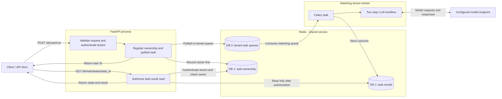
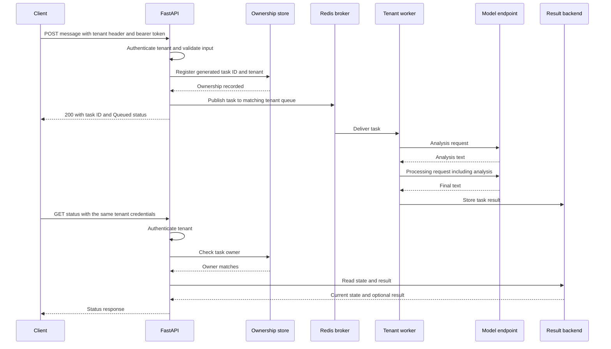
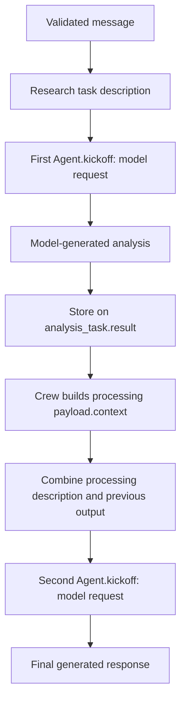
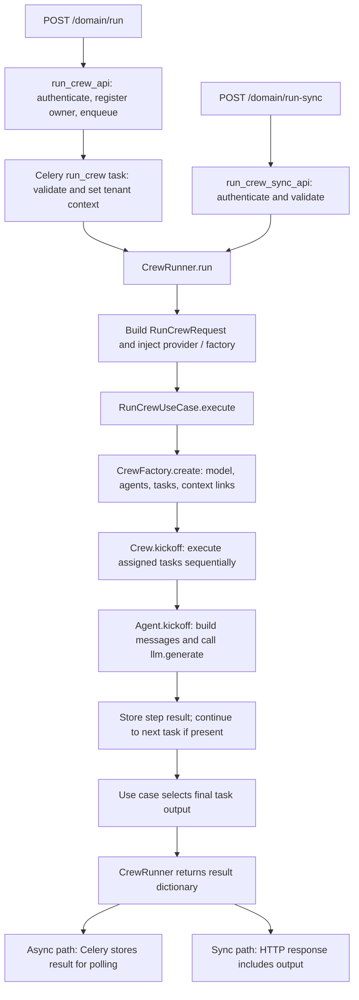
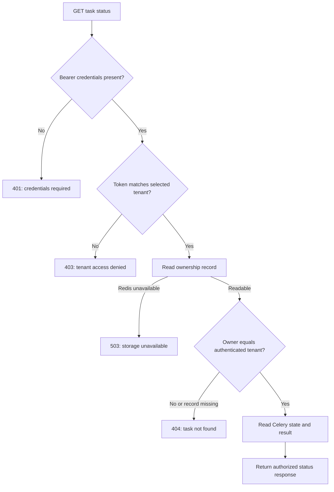

# CrewOS

A Python foundation for building an AI agent orchestration platform. Currently it executes a fixed two-step LLM workflow: analysis followed by processing. Tool-using agent loops, durable workflow checkpoints, approvals, and multi-agent evaluation are planned, not implemented capabilities.

## Contents

- [Current behavior](#current-behavior)
- [Architecture and workflow](#architecture)
- [Tech stack](#tech-stack)
- [Project structure](#project-structure)
- [Design decisions](#key-design-decisions)
- [Local setup](#local-setup)
- [Configuration reference](#configuration-reference)
- [Docker Compose](#docker-compose)
- [API reference](#api-reference)
- [Security and isolation](#security-and-isolation)
- [Retries, timeouts, and delivery guarantees](#retries-timeouts-and-delivery-guarantees)
- [Tests and verification](#tests)
- [Kubernetes](#kubernetes)
- [Troubleshooting](#troubleshooting)
- [Implemented versus planned](#implemented-versus-planned)
- [Contributing and documentation](#contributing-and-documentation)

## Current behavior

- FastAPI validates nonblank string messages before execution.
- `POST /domain/run` returns a generated task ID and routes work to `crewai.<tenant_id>` (prefix configurable).
- Celery executes the workflow outside the API request. Previous-step output is included in the next model request.
- The API records task ownership in Redis before dispatch and checks ownership before reading results. Unknown and unauthorized task IDs both return 404.
- A bearer token configured for the selected tenant is required on execution and status endpoints. Headers alone do not grant access. This is tenant-level API-token authentication, not user RBAC or SSO.
- `POST /domain/run-sync` executes immediately and returns `task_id`, `status`, and `output`; `sync_run` is a response label, not a pollable background task ID.
- Provider connection errors, HTTP 429, and HTTP 5xx receive bounded retries with backoff and jitter. Credential/input errors do not. Unsupported or excessive Retry-After values stop retries rather than retrying early.
- Model-client automatic retries are disabled; Celery owns inference retries. Generation may repeat on retry; no external write tools exist yet.
- HTTP logs include method, path, claimed tenant header, server request ID, duration, and status. The logged header is not an authenticated identity. Application code does not print raw prompts or model output.

## Architecture

The diagrams below describe the **current implementation**. GitHub renders fenced Mermaid blocks as diagrams; editors without Mermaid support display their source. The explanations remain alongside the diagrams.




The API and workers can run as separate processes. Slow model calls occupy a worker rather than holding open the task-submission request. Redis databases separate broker and result namespaces; they are not independent security boundaries.

### Background request sequence



This shows the successful path. Worker execution and client polling are asynchronous; a poll may arrive while work is queued or running, and fast work may finish before the submission response reaches the client. Failure paths are documented below.

### Why polling?

The submission endpoint answers “your work was accepted” with a task ID. The client can later ask whether it finished. This is useful when work takes longer than an interactive request should wait, or when users need to navigate away and return.

Polling is a design choice, not a requirement imposed by LLMs. Streaming, server-sent events, or other long-lived connections can also be appropriate. Poll at a reasonable interval and stop on terminal states; aggressive polling adds unnecessary API and Redis load.

### Agent pipeline: what actually runs today




`CrewFactory` assigns an agent to each task and sets `processing_task.context = [analysis_task]`. `Crew.kickoff()` runs tasks sequentially, stores each result, and prepares downstream context. `Agent.kickoff()` explicitly includes that context in the outgoing model message.

That last step matters: a value stored in a Python dictionary is not automatically visible to the model. Our regression test inspects the second model request to verify that previous output crosses the request boundary.

Today these are named LLM processing stages in a predefined workflow. The model does not yet select tools, delegate work, or choose arbitrary next steps. A second model call also cannot independently verify the first call's claims unless supplied with adequate evidence.

### Function flow through the application



The two final branches are alternatives selected by the entrypoint; a single execution does not return through both paths. `CrewRunner` constructs the provider, and the use case asks the factory to assemble the workflow. The named layers make responsibilities easier to inspect; they do not add autonomous tool selection.

## Tech stack

| Component | Technology | Responsibility |
|---|---|---|
| HTTP API | FastAPI | Request validation, authentication, submission, and polling |
| Validation/configuration | Pydantic and Pydantic Settings | Typed contracts and environment settings |
| Background execution | Celery | Deliver work to matching workers and handle bounded retries |
| Broker and result storage | Redis | Queue messages, result values, and task ownership |
| Model integration | LangChain OpenAI-compatible chat adapter | Send messages to a configured model endpoint |
| Local model option | Ollama | Serve a model on local/container infrastructure |
| Packaging | Poetry | Dependencies, lockfile, package, and console entrypoints |
| Containers | Docker and Compose | Reproducible local service setup |
| Cluster manifests | Kubernetes YAML | Describe optional deployment resources |
| Verification | pytest, coverage, Kubernetes schema validation | Behavioral and configuration regressions |

CrewOS uses its own small `Agent`, `Task`, and `Crew` classes. The unused CrewAI package was removed; the project name does not imply that the CrewAI framework runs the current workflow.

## Project structure

```text
crewos/
  api/
    middleware/          # HTTP logging and request-ID generation
    routes.py            # Submission, synchronous execution, status, and health
    schemas.py           # Typed request and response contracts
  application/
    dtos/                # Values passed across application boundaries
    interfaces/          # Model-provider abstraction
    use_cases/           # Workflow execution use case
  core/
    config.py            # Environment settings
    tenant.py            # Tenant authentication, queue naming, execution context
    worker.py            # Celery worker entrypoint
  domain/
    entities/            # Agent, Task, and sequential Crew
    factories/           # Assemble the current two-task workflow
  infrastructure/
    celery_app.py        # Broker/backend and execution configuration
    task_ownership.py    # Redis-backed task ownership
    logging.py           # JSON log formatting
    memory/              # Future memory implementation; currently a placeholder
  services/
    crew_runner.py       # Wires the model provider and application use case
  third_party/llm/        # Model-service adapter
  utils/retry.py         # Transient-error classification and retry delays
  workers/crew_task.py   # Background workflow task

tests/                   # Unit, API, deployment-schema, and opt-in integration tests
k8s/                     # Base resources and optional tenant workers
```

The layers separate HTTP handling, application execution, workflow objects, and external integrations. This is an organizational boundary, not a claim that the domain has no library dependencies: its current message construction uses LangChain message types.

## Key design decisions

1. **Queue slow work.** The API submits work while Celery handles model latency. A busy worker can still create queue delays, so async submission does not guarantee fast completion.
2. **Authenticate before trusting tenant scope.** A header selects a tenant; its matching configured token authorizes tenant-level access. Individual-user permissions and SSO remain future work.
3. **Record ownership before publication.** Result reads require a matching ownership record. If publication has an uncertain outcome, retain that record rather than assuming nothing was queued.
4. **Use explicit task context.** Downstream model inputs are constructed deliberately and tested at the outgoing-message boundary.
5. **Centralize queue naming.** API and worker derive the same name from a validated tenant ID. Separate queues do not remove contention on shared dependencies.
6. **Give one layer the retry policy.** Celery retries selected transient inference errors; the model client does not silently multiply those attempts. Retries may repeat generation and incur additional cost.
7. **Keep a synchronous debugging path.** It bypasses Celery and returns generated output immediately. It shares authentication and validation but does not create a pollable task.
8. **Test behavior as well as line execution.** Earlier mocks passed despite omitted context and a broken sync response. Tests now inspect actual message contents, meaningful runner results, and access boundaries.

## Local setup

### 1. Prerequisites

- Python 3.11 or 3.12. The Poetry constraint is `>=3.11,<=3.13`; use one of the verified versions rather than interpreting that constraint as support for every 3.13 patch release.
- Poetry for installing the package and its development dependencies.
- A running Redis instance.
- An OpenAI-compatible chat-completions endpoint, such as Ollama. Models and their weights are not bundled in this repository.
- Docker with Compose for the containerized option; a cluster and `kubectl` only for the optional Kubernetes path.

There is no required frontend. FastAPI's interactive API documentation is available at `http://localhost:8000/docs` after startup. Authentication still applies when invoking protected endpoints there.

### 2. Install and configure

Work from the repository root. If you have not cloned the project:

```bash
git clone https://github.com/khushal075/crewos.git
cd crewos
```


Requires Python 3.11 or 3.12, Poetry, Redis, and access to a compatible model endpoint. Install dependencies and create an untracked configuration:

```bash
poetry install --with dev
cp .env.local.example .env.local
```

Replace `TENANT_API_KEYS` with a JSON mapping of tenant IDs to long random bearer tokens. Generate a token with `python -c "import secrets; print(secrets.token_urlsafe(32))"`. Do not commit it. `.env.local` overrides the legacy `k8crew.env`; process environment overrides both. No tokens configured means tenant requests are denied.

The example file uses `http://ollama:11434/v1`, a Compose service address. For processes running directly on your host, change it to `http://localhost:11434/v1`.

Example local settings (keep your configured `TENANT_API_KEYS` mapping in the file too):

```text
REDIS_BROKER_URL=redis://localhost:6379/0
REDIS_RESULT_BACKEND=redis://localhost:6379/1
LLM_BASE_URL=http://localhost:11434/v1
LLM_MODEL=llama3
TENANT_ID=1
CELERY_QUEUE_NAME=crewai
```

### 3. Start dependencies

If you manage Redis locally, start it according to your installation. For a foreground development process:

```bash
redis-server
```

In another terminal, start Ollama if it is not already running:

```bash
ollama serve
```

Pull a model in a separate terminal:

```bash
ollama pull llama3
```

The configured `LLM_MODEL` must match the model name available at your endpoint. Model inference speed and memory requirements depend on the model and your hardware; CPU and GPU performance differ significantly.

### 4. Start API and worker

Use separate terminals, both from the repository root:

```bash
poetry run dev
```

```bash
poetry run worker --tenant-id 1
```

`dev` starts Uvicorn with reload for local development. The container starts Uvicorn without reload. The worker is a separate process; starting the API does not start a worker.

### 5. Check the API

```bash
curl http://localhost:8000/health
```

Expected response:

```json
{"status": "ok"}
```

This checks API liveness only. Then submit an authenticated task and poll it to exercise the queue, worker, and model path.


Start another worker with `--tenant-id tenant_b` only when that tenant has a configured token and submitted work. The API and worker use the same queue-name function. Dedicated queues route workloads but do not isolate shared Redis or model capacity.

## Configuration reference

Settings are defined in `crewos/core/config.py` and loaded when the process imports the application. Restart the relevant processes after configuration changes.

Priority, highest first: **process environment -> `.env.local` -> legacy `k8crew.env` -> code defaults**. Run local commands from the repository root so relative environment-file paths resolve as expected. Unknown environment-file keys are ignored; spelling mistakes can therefore leave a setting at its default.

| Setting | Code default | Meaning |
|---|---|---|
| `APP_NAME` | `crewai_platform` | Configuration metadata; the current FastAPI title is defined separately in `main.py` |
| `REDIS_BROKER_URL` | Empty | Redis URL for Celery task delivery; configure before running workers |
| `REDIS_RESULT_BACKEND` | Empty | Redis URL for task results and ownership storage |
| `TENANT_API_KEYS` | `{}` | JSON object mapping a tenant ID to its bearer token; empty configuration authorizes nobody |
| `TENANT_PERMISSIONS` | `{}` | JSON object mapping authenticated tenants to lists of tool-action permissions; absent assignments yield an empty permission set |
| `TENANT_ID` | `1` | Default tenant consumed by a worker; overridden by `--tenant-id` |
| `CELERY_QUEUE_NAME` | `crewai` | Queue prefix; effective queue is `<prefix>.<tenant>` |
| `CELERY_CONCURRENCY` | `10` | Worker execution slots; the example configuration and Kubernetes ConfigMap use `2` |
| `LLM_BASE_URL` | Empty | Compatible API base URL, usually ending in `/v1` |
| `LLM_MODEL` | `llama3` | Model identifier sent to the configured endpoint |
| `API_KEY` | Empty | Credential for the model provider; adapter substitutes `dummy` when empty for local compatible services |
| `LLM_TIMEOUT` | `30` seconds | Model-client request timeout; allowed range is greater than zero through 120 |
| `LLM_MAX_RETRIES` | `3` | Maximum additional Celery attempts after retryable failures; allowed range is 0–5 |
| `TASK_OWNER_TTL` | `86400` seconds | Ownership-record lifetime from registration; minimum 10800 |
| `TASK_RESULT_TTL` | `3600` seconds | Result retention after completion; allowed range 60–3600 |
| `TASK_QUEUE_TTL` | `3600` seconds | Initial submitted-job expiry; allowed range 60–3600 |
| `LOGGING_LEVEL` | `INFO` | Application logger level; worker command currently sets Celery log level to `info` |
| `DEFAULT_TENANT_ID` | `1` | Legacy setting; it does not authorize a tenant or replace the required request header |

A tenant mapping might have this shape; these are placeholders, not usable secrets:

```dotenv
TENANT_API_KEYS={"1":"YOUR_FIRST_RANDOM_TOKEN","tenant_b":"YOUR_SECOND_RANDOM_TOKEN"}
```

The tenant ID is case-sensitive and must contain 1–64 letters, digits, underscores, or hyphens. Use different strong random tokens for different tenants. Rotation currently requires updating configuration and restarting API processes; there is no token-management UI or overlapping-key rotation mechanism.

`SecretStr` masks the configured tokens in ordinary object representations; it does not encrypt their storage or transport. Keep configuration private and use HTTPS for remote clients.

## Docker Compose

Create `.env.local` first. Set `LLM_BASE_URL=http://ollama:11434/v1` when using the optional model container:

```bash
docker compose --profile local-model up --build -d
docker compose exec ollama ollama pull llama3
```

For a separately hosted model, configure its URL and use `docker compose up --build -d`. The Redis URLs are overridden with Compose service addresses. Redis is not published to the host and uses AOF persistence. The API binds to localhost. For remote access, add TLS and deployment-specific access controls.

The image installs the real `crewos` package and console entrypoints, runs as a non-root user, and starts Uvicorn without development reload. Workers let Celery manage shutdown signals. Time limits and late acknowledgment do not guarantee exactly-once execution or crash-safe workflow resumption.

## API reference

### Endpoints and request contract

| Method | Endpoint | Purpose | Credentials |
|---|---|---|---|
| `GET` | `/health` | API liveness | Not required |
| `POST` | `/domain/run` | Submit background work | Tenant header and bearer token |
| `GET` | `/domain/status/{task_id}` | Read owned task state/result | Tenant header and bearer token |
| `POST` | `/domain/run-sync` | Run immediately for debugging | Tenant header and bearer token |

```json
{
  "agent_type": "research",
  "input": {
    "message": "Explain why webhook deliveries can fail."
  }
}
```

`input.message` is required, must be a string, and must contain a non-whitespace character. Its original formatting is preserved by API validation. Additional fields within `input` are preserved. There is currently no request-size or token-budget enforcement, so callers should keep messages bounded.

`agent_type` defaults to `research`, but the current crew factory always builds the same research-plus-processing workflow. It is not yet a validated selector for different runtime graphs. Role, goal, expected-output, and tool attributes are not guarantees of execution capabilities: the current model request is driven by task descriptions and explicit context. Additional input fields survive request validation and queue serialization, but the current use case reconstructs the task payload from `message` and `agent_type`. Those other fields are not automatically forwarded to the model.

### Submit background work

Use your configured token; the value below is a placeholder:

```bash
curl -X POST http://localhost:8000/domain/run \
  -H 'Authorization: Bearer YOUR_TENANT_TOKEN' \
  -H 'X-Tenant-ID: 1' \
  -H 'Content-Type: application/json' \
  -d '{"input":{"message":"Explain why webhook deliveries can fail."}}'
```

Poll `/domain/status/<task_id>` with the same two headers. Use `/domain/run-sync` with the same JSON and headers for immediate execution. `/health` is unauthenticated liveness, not a guarantee that Redis or the model is ready. Missing bearer tokens return 401; invalid tenant credentials return 403; invalid message payloads return 422. Storage unavailability fails closed.

Task ownership lasts 24 hours by default; results expire one hour after completion and queued jobs expire after one hour. An expired result may appear PENDING while ownership remains. Unknown/unowned IDs never expose backend data. Keep Redis private; ownership records and result data share its trust boundary. Ambiguous broker-publish failures retain ownership and return an error; do not assume an enqueue error means execution never happened. An outbox and richer durable run states are future work.

### Response and polling examples

A successful submission returns a generated identifier:

```json
{"task_id": "<generated-task-id>", "status": "Queued"}
```

Use that identifier with the same tenant credentials:

```bash
TASK_ID='paste-the-returned-task-id-here'
curl "http://localhost:8000/domain/status/$TASK_ID" \
  -H 'Authorization: Bearer YOUR_TENANT_TOKEN' \
  -H 'X-Tenant-ID: 1'
```

Typical states are `PENDING`, `STARTED`, `RETRY`, `SUCCESS`, and `FAILURE`; expired queued work can be `REVOKED`. On success, `result` contains the workflow result, including its output. On failure, the API returns an error category and a generic message rather than the raw provider exception.

For synchronous debugging:

```bash
curl -X POST http://localhost:8000/domain/run-sync \
  -H 'Authorization: Bearer YOUR_TENANT_TOKEN' \
  -H 'X-Tenant-ID: 1' \
  -H 'Content-Type: application/json' \
  -d '{"input":{"message":"Explain a webhook delivery failure."}}'
```

```json
{"task_id": "sync_run", "status": "Completed", "output": "<generated answer>"}
```

### HTTP errors and request correlation

| Status | Meaning in this application |
|---|---|
| `200` | Submission accepted, synchronous execution completed, or status read succeeded; inspect the returned task state |
| `401` | Missing or unsupported bearer credentials when other required request fields are present |
| `403` | Unknown tenant, invalid token, or invalid configured tenant identifier |
| `404` | No task ownership record accessible to that tenant; unknown and cross-tenant IDs use the same response |
| `422` | Request validation failure, such as a missing tenant header or invalid message; validation/dependency ordering can affect which invalid field is reported first |
| `400` | A synchronous application execution raises `ValueError`; the current route maps it to a client error |
| `503` | Redis ownership/state access is unavailable during the protected operations |
| `500` | Enqueue failure, synchronous execution failure, or unavailable/unserializable task result |

A background task can fail while status polling still returns HTTP 200: the HTTP read succeeded, but the body contains `"status": "FAILURE"`. Clients must handle both transport errors and task states.

Responses include a server-generated `X-Request-ID`. The HTTP log records that same identifier after inner middleware runs. Client-supplied request IDs are not adopted. Request IDs correlate HTTP events; background worker logs use the Celery task ID. There is not yet a complete distributed tracing system linking every HTTP/model/tool operation.

## Security and isolation

The request header chooses a tenant, and a matching configured bearer token authenticates tenant-level access. That token grants access to the tenant's execution endpoints and owned tasks; it does not identify an individual recruiter, operator, or role.

Task IDs are generated by the API. Before publication, Redis stores an ownership record using a namespaced hash of the task ID, `SET ... NX`, and an expiry. `NX` prevents overwriting an existing owner. Hashing the ID is a key-naming choice, not encryption or an authorization check. The status route checks ownership before creating/reading the Celery result.

Workers consume a configured queue and set a temporary `ContextVar` tenant value while running the workflow. Context storage and queue names do not independently establish permission. The broker is a trusted internal component: a caller with direct broker access can bypass HTTP authentication. Redis database numbers do not isolate tenants.

Application code no longer prints raw task context or generated output. That does not prove all dependency, server, or exception logs are free of sensitive content. Review logging and provider data-handling behavior before processing real information.

CORS is configured for `http://localhost:5173` as a possible development frontend. It is a browser control, not authentication. There is currently no user RBAC, SSO, rate-limiting gateway, prompt-injection enforcement system, approval flow, or isolation of individual users within a tenant. Keep the demo local or add the controls required by its deployment environment.

### Protected task-result lookup



This illustrates the authorization decision with an otherwise valid request. A missing required tenant header can instead produce HTTP 422. Errors reading or serializing backend results follow the API error handling described above. Ownership mismatch stops execution before the result backend is consulted.

## Retries, timeouts, and delivery guarantees

The worker classifies model failures:

| Failure | Current behavior |
|---|---|
| OpenAI-client connection error, including its timeout subtype | Eligible for a bounded Celery retry |
| HTTP 429 or 5xx surfaced as an OpenAI API status error | Eligible for a bounded Celery retry |
| Authentication/permission errors and other 4xx | No automatic inference retry |
| Invalid internal message or payload | Reject before model execution |
| Other exception | Record failure category and propagate |

Without `Retry-After`, delay is randomized between zero and `min(30, 2 ** retry_number)` seconds. With defaults, three retries allow up to four workflow attempts, not four individual model calls. Each retry starts the two-step workflow again; a successful first call may repeat if the second failed.

`Retry-After` is accepted only as a numeric number of seconds from 0 through 60. Unsupported values, HTTP-date values, or larger waits stop automatic retries; the worker does not retry earlier than that header requests. There is no global circuit breaker or provider fallback yet.

SDK-level retries are disabled. Background retry policy belongs to Celery; synchronous debugging calls do not get that task-level retry loop. The model-client timeout is not a single deadline covering queue wait, both calls, and every retry.

Workers use one prefetched task per concurrency slot, late acknowledgment, a 240-second soft time limit, and a 270-second hard time limit. Support and shutdown behavior depend on Celery's pool and platform. The broker visibility timeout is 3600 seconds. Compose and worker manifests allow 300 seconds for graceful shutdown, but forced termination, host failure, or an in-flight remote request can still create uncertainty.

Late acknowledgment does not guarantee task redelivery under every worker-loss scenario. There are no durable per-step checkpoints, cancellation API, external-action idempotency mechanism, or exactly-once guarantee. These are agent-runtime roadmap items. Queue expiry is not a guarantee that started work stops at the expiry time.

## Tests

```bash
poetry run pytest tests --cov=crewos --cov-report=term-missing
```

The CI coverage threshold remains unchanged at 70%; project practice targets overall coverage above 80%. The opt-in integration test requires a dedicated test Redis and must run in a fresh process with URLs set before imports:

```bash
CREWOS_TEST_REDIS_URL=redis://localhost:6379/0 \
REDIS_BROKER_URL=redis://localhost:6379/0 \
REDIS_RESULT_BACKEND=redis://localhost:6379/1 \
poetry run pytest tests/test_queue_integration.py -q
```

It runs real Celery workers sequentially against separate tenant queues, uses a fake inference runner, checks that A's worker leaves B's job pending, and verifies result ownership. It does not benchmark real model output quality. Kubernetes YAML is schema-checked against Kubernetes 1.31; schema validation is not proof of a successful cluster deployment.

## Kubernetes

### Scope and prerequisites

These manifests are a deployment starting point, not a complete production environment. They have been schema-validated against Kubernetes 1.31. Cluster scheduling, image availability, storage provisioning, network access, and model inference must be checked in your environment.

### Example deployment order

Build the image, then load it into your local cluster or publish it to a registry and update deployment image references:

```bash
docker build -t crewai-crewos:local .
kubectl apply -f k8s/base/namespace.yaml
kubectl apply -f k8s/base/configmap.yaml
kubectl apply -f k8s/base/secret.yaml
```

Configure real tenant tokens through your deployment's secret-management process. The committed empty mapping is deliberately unusable. Apply the backing services and application:

```bash
kubectl apply -f k8s/base/redis/
kubectl apply -f k8s/base/ollama/
kubectl apply -f k8s/base/api/
kubectl apply -f k8s/base/worker/
kubectl -n crewai rollout status deployment/crewai-api
kubectl -n crewai get deployments,pods,services,pvc
```

The Ollama manifest requests 7 GiB and permits up to 10 GiB of memory. Check your cluster's available resources. Pull the exact model configured in the ConfigMap:

```bash
kubectl -n crewai exec deployment/crewai-ollama -- \
  ollama pull llama3:8b-instruct-q4_K_M
```

Model availability is an external prerequisite. The Ollama deployment currently has no persistent model volume, so a replacement pod can require another pull. Use external inference or add suitable model storage if that is required by your deployment.

For a basic local API check, port-forward rather than relying on an ingress controller:

```bash
kubectl -n crewai port-forward service/crewai-api 8000:8000
```

The example ingress is controller-specific and includes path-rewrite patterns; its acceptance and behavior require validation with the chosen controller. It is not part of the verified live deployment path. In particular, do not expose its Ollama route publicly without a separate security design.

Optional tenant workers:

```bash
kubectl apply -f k8s/tenants/tenant-a.yaml
kubectl apply -f k8s/tenants/tenant-b.yaml
```

Those workers consume `tenant_a` and `tenant_b`; add their credentials to the API configuration if clients will submit work for them. The separate `k8s/workers/worker-deployment.yaml` is an optional worker for tenant `default`, not a prerequisite for the base tenant `1`.


Build/tag `crewai-crewos:local` and make that image available to the cluster. Apply namespace, configuration, secrets, Redis PVC/deployment/service, API resources, and desired worker manifests. Configure `TENANT_API_KEYS` in the `crewai-secret` Secret; its committed empty mapping denies all tenants. Never commit real credentials. A persistent-volume provisioner and ingress controller are environment prerequisites. The base worker serves tenant `1`; optional tenant manifests set their own explicit `TENANT_ID`. This repository does not provision TLS, SSO, Redis high availability, or network policies.

## Troubleshooting

| Symptom | What to check |
|---|---|
| Import error or missing `dev`/`worker` command | Run `poetry install --with dev` from the repository root and confirm the selected Python version |
| HTTP 401 | Supply `Authorization: Bearer <token>`; the tenant header alone is insufficient |
| HTTP 403 | Check exact tenant spelling, configured token mapping, and whether API processes restarted after changes |
| HTTP 422 | Read `detail` for the field location; `input.message` must be a nonblank string and `X-Tenant-ID` is required |
| HTTP 404 for a task | Use the original tenant credentials and returned ID; missing/expired ownership and other-tenant tasks share this response |
| Task remains PENDING | Confirm a worker is consuming the exact prefix/tenant queue, broker settings match, and model work is not waiting behind other tasks; expired result data can also appear PENDING |
| Task becomes FAILURE | Inspect task-ID-correlated worker failure categories; check model availability, credentials, configured model name, and timeouts |
| Redis unavailable or HTTP 503 | Verify broker/backend URLs, Redis readiness, and network reachability; the ownership check deliberately blocks access when storage is unavailable |
| Host process cannot resolve `ollama` or `redis` | Use `localhost` for host-managed services; Compose service names resolve inside the Compose network |
| Container cannot reach a host model using `localhost` | Container localhost refers to that container; configure an address reachable from Docker, such as `host.docker.internal` where supported |
| Compose services start but model calls fail | Wait for Ollama to become ready and pull the exact configured model; Compose does not currently health-gate model readiness |
| Many rate-limit retries | Reduce concurrency and inspect provider quotas; adding workers can increase overload |
| Kubernetes pods remain Pending | Check events, image availability, node capacity, and whether the Redis PVC has bound |
| Integration test is skipped | Set all three documented Redis variables in a fresh process and use an isolated test instance |

Useful commands:

```bash
docker compose ps
docker compose logs --tail=100 backend worker redis
poetry run worker --help
poetry check --lock
```

Review logs before sharing them: third-party logs can contain data or connection details even when application payload printing is disabled.

## First tool contract: agent-task status input

`crewos/application/dtos/agent_task_status.py` defines `GetAgentTaskStatusInput`, the input contract for the planned read-only `get_agent_task_status` tool. This first tool concerns CrewOS task execution, not webhook delivery. It is not registered with the model or connected to a lookup yet.

```json
{"agent_task_id": "agent_task_123"}
```

`agent_task_id` identifies a task execution, not the configured agent or an individual HTTP request. The sample identifier is synthetic. This model validates a supplied identifier; it does not generate IDs, prove existence, or grant access.

The identifier must be a string. Surrounding whitespace is removed, and an empty or whitespace-only value is rejected. Missing identifiers and undeclared fields are rejected. Tenant identity and permissions must come from trusted application execution context rather than model arguments.

The existing HTTP API still returns a Celery `task_id`; its request/response contract and ownership mechanism have not changed. When task-status lookup is implemented, the application must explicitly define how `agent_task_id` maps to the existing execution identity rather than silently creating a second unrelated ID. The future agent loop must also prevent unbounded polling of its own active execution.

This DTO belongs in the application layer because it describes a CrewOS-native operation. Generic tool dispatch and policy evaluation must remain independent of this particular tool's fields. Separate business-domain examples can be added later without putting their concepts in the runtime.

Run the contract tests with:

```bash
poetry run pytest tests/test_agent_task_status_contract.py -q
```

Input validation and the `TaskLookupOutcome` enum exist so far. The enum describes the lookup result, not the task execution state:

| Outcome | Meaning |
|---|---|
| `found` | An accessible task record was found |
| `unavailable` | No accessible task record was found |

The string values are suitable for JSON and are validated with Pydantic in the contract tests. A task state such as `running` is not a valid lookup outcome. A storage outage must later be represented as an execution error, not silently converted to `unavailable`. The enum itself performs no lookup or authorization.

`AgentTaskStatus` separately defines the task's execution state:

| Task status | Meaning |
|---|---|
| `queued` | Accepted and waiting to execute |
| `running` | Execution has started |
| `succeeded` | Execution completed successfully |
| `failed` | Execution ended unsuccessfully |

A lookup can have outcome `found` while the task status is `failed`: the record was retrieved, and it describes an unsuccessful execution. Lookup outcomes are not accepted as task states, and task states are not accepted as lookup outcomes.

These are application-level vocabulary only. The enums do not execute transitions or map Celery states. In particular, Celery `PENDING` must not automatically mean `queued`, because an unknown or expired result can also appear pending. Retry and revocation semantics must be decided explicitly before connecting the lookup to the existing backend; they are not silently added or converted by this enum.

Two Pydantic response models now enforce different shapes:

| Model | Required fields | Restrictions |
|---|---|---|
| `AgentTaskFound` | `outcome`, `agent_task_id`, `status` | Outcome must be `found`; status must be an `AgentTaskStatus` |
| `AgentTaskUnavailable` | `outcome`, `agent_task_id` | Outcome must be `unavailable`; status is not allowed, even as null |

Both reject undeclared fields and require a nonblank string identifier. `Literal` constrains each model to its specific outcome value; enums restrict the allowed lookup outcomes and task states. These contracts validate structure, not existence, permissions, or factual correctness.

```json
{"outcome": "found", "agent_task_id": "agent_task_123", "status": "failed"}
```

```json
{"outcome": "unavailable", "agent_task_id": "agent_task_123"}
```

`GetAgentTaskStatusResult` is a discriminated union: one type accepting either response model, with `outcome` selecting which model to validate. `found` selects `AgentTaskFound`; `unavailable` selects `AgentTaskUnavailable`. A missing or unsupported outcome is rejected, and each selected model still enforces its required and forbidden fields.

```python
from pydantic import TypeAdapter
from crewos.application.dtos.agent_task_status import GetAgentTaskStatusResult

result = TypeAdapter(GetAgentTaskStatusResult).validate_python({
    "outcome": "found",
    "agent_task_id": "agent_task_123",
    "status": "failed",
})
```

This selects a validation model for supplied data. It does not decide whether the task actually exists or is accessible; the eventual authorized lookup handler must determine the true outcome. Policy evaluation, tenant-scoped lookup, registration, and model-selected execution are subsequent changes. No handler returns these models yet, and the existing HTTP API is unchanged. This does not add a webhook service, new input channel, or agent loop.

## Tool execution context

`crewos/application/dtos/tool_execution_context.py` defines `ToolExecutionContext`, separate from model-generated tool arguments:

```python
from crewos.application.dtos.tool_execution_context import ToolExecutionContext

context = ToolExecutionContext(
    tenant_id="tenant_a",
    permissions=frozenset({"agent_task.read"}),
)
```

The example shows an application-assigned permission, not an automatic grant. `get_tool_execution_context` now depends on the existing authenticated `get_tenant_id` dependency and reads grants from server-owned `settings.TENANT_PERMISSIONS`. Both execution endpoints (`/domain/run` and `/domain/run-sync`) use this builder; task polling retains its existing authentication and ownership checks.

```text
Tenant header and bearer token
             |
Verify token for selected tenant
             |
Read server-configured TENANT_PERMISSIONS for that tenant
             |
Construct frozen ToolExecutionContext
```

For example, explicitly assigning a read grant in private configuration looks like:

```dotenv
TENANT_PERMISSIONS={"tenant_a":["agent_task.read"]}
```

A tenant without a mapping receives no permissions. Restart API processes after changing configuration. Invalid blank or non-string configured permission names are rejected by settings validation. The model and request body cannot choose these grants; additional input fields named `tenant_id` or `permissions` are not used as execution context.

The endpoints currently use the context's authenticated tenant for their existing behavior. They do not yet enforce these new tool permissions or serialize/carry the context into the Celery worker. No tool dispatcher exists yet; execution-time context propagation and authorization remain necessary before tool use is enabled.

Tenant identity is required and follows the existing queue-compatible identifier format. Permissions default to an empty immutable `frozenset`, so no tool permissions are granted merely by creating a context. Duplicate permission strings collapse into one value; blank or non-string names are rejected. Permission names are not yet an action registry or policy rules.

The model is frozen to prevent ordinary field reassignment, and its permission set cannot be modified in place. This reduces accidental mutation, not malicious access from arbitrary Python code. Pydantic validates structure; it does not authenticate whoever constructed the object. Policy evaluation and resource-scoped enforcement are still necessary.

No API accepts this object, no tool uses it yet, and no authenticated request is being granted a new capability by this change.

## Policy decision contract

`crewos/application/dtos/policy_decision.py` defines `PolicyEffect` (`allow` or `deny`) and an immutable `PolicyDecision`:

```json
{"effect": "deny", "reason_code": "permission_missing", "policy_version": "1"}
```

All three fields are required. The effect must be an allowed enum value. The reason code is a lowercase machine-readable identifier beginning with a letter and containing letters, digits, or underscores. The policy version is a nonblank string identifying the rules used. Reason codes remain extensible rather than requiring every future module to modify a central reason enum.

This model validates decision structure only. It does not authenticate identity, establish that a claimed policy version exists, check consistency between a reason and effect, or enforce access. A policy evaluator must produce truthful decisions; an execution boundary must block disallowed operations. Freezing the model prevents ordinary reassignment but does not make an arbitrary caller-created decision authoritative.

No policy evaluator or execution gate is wired yet. Missing fields produce validation errors rather than an implicit allow. Fail-closed enforcement when evaluation fails will be implemented at the execution boundary.

## Policy-service interface

`crewos/application/interfaces/policy_service.py` defines `PolicyServiceInterface`, an abstract application boundary:

```python
def evaluate(
    self,
    *,
    context: ToolExecutionContext,
    action: str,
) -> PolicyDecision:
    ...
```

The `*` requires named arguments, making calls such as `evaluate(context=context, action="agent_task.read")` explicit. Concrete implementations must implement `evaluate`; the abstract interface cannot itself be instantiated as a working evaluator. This follows the existing provider-interface approach without adding a network service.

Application code must select the action and establish the context's authenticated identity and server-assigned permissions. The interface neither verifies their provenance nor creates them. Its initial scope is action-level permission evaluation; an allow decision does not waive tenant-scoped resource access, current-condition checks, or approval requirements.

The interface now has one concrete in-process strategy, described below. The trusted-context builder is connected at the API execution boundary, but propagation to the worker and a dispatcher enforcement gate are not wired yet; those responsibilities must be connected before enabling tool execution.

## First policy strategy: exact permission matching

`crewos/application/services/permission_policy.py` implements `PermissionPolicyService` behind `PolicyServiceInterface`. It is an in-process Strategy implementation, not a separately deployed service.

```python
from crewos.application.dtos.tool_execution_context import ToolExecutionContext
from crewos.application.services.permission_policy import PermissionPolicyService

context = ToolExecutionContext(
    tenant_id="tenant_a",
    permissions=frozenset({"agent_task.read"}),
)
decision = PermissionPolicyService().evaluate(
    context=context,
    action="agent_task.read",
)
```

An exact permission match returns `allow` / `permission_granted`; an absent permission returns `deny` / `permission_missing`. Decisions include policy version `1`. Empty permissions deny the action. There are no implicit role hierarchies, prefix matches, case folding, or wildcard grants: the string `*` does not grant arbitrary actions.

The service is not specific to agent tasks: it compares the application-selected action with the context's permissions. It does not maintain an action registry or decide which actions a tool requires. Those must be assigned by application code, not by model-generated arguments.

This rule checks action-level permission only. It does not fetch resource ownership, prove the context came from authentication, check approval, or execute/block a tool. A successful `agent_task.read` decision alone cannot authorize another tenant's task. The handler must still perform tenant-scoped access and the dispatcher must enforce the decision.

The execution endpoints now build authenticated context using configured tenant permissions, without changing their request or response fields. The policy strategy is not yet invoked by those endpoints. Dependency injection into a dispatcher, worker context propagation, and execution enforcement remain subsequent work.

## Policy-enforced execution boundary

`crewos/application/services/policy_executor.py` defines `PolicyEnforcedExecutor`. It receives a `PolicyServiceInterface` implementation through its constructor (dependency injection) and evaluates an application-selected action before invoking a supplied zero-argument callable.

```text
Trusted context + Application-selected action
                    |
              Evaluate policy
                    |
        +-----------+------------+
        |                        |
       Allow                Deny / Failure
        |                        |
Invoke operation          Do not invoke operation
```

A denial raises `PolicyDeniedError`, retaining its structured decision for application handling. An exception during policy evaluation or a non-`PolicyDecision` result raises `PolicyEvaluationError`. Both prevent the operation from running. Operation failures after authorization propagate as operation errors; they are not disguised as policy failures.

The generic `ResultT` annotation expresses that `execute` returns whatever the supplied operation returns. It does not validate a tool's arguments or output; those remain separate contract checks. The callback and required action must be selected by application code rather than accepted as arbitrary model-provided executable code.

This is a callable execution gate, not a registered tool dispatcher yet. No existing endpoint or Celery worker invokes it. Tests exercise the boundary with the real permission policy and controlled operations, including proving that denied or failed evaluation never invokes the operation. Resource ownership checks must still occur inside the protected operation, using trusted tenant scope. Worker propagation, tool registration, the actual task lookup, and model tool selection are subsequent work.

## Implemented versus planned

| Area | Current state |
|---|---|
| Fixed analysis/processing workflow | Implemented, including downstream context |
| Input validation and synchronous output | Implemented |
| Tenant token authentication and owned-result reads | Implemented at tenant level |
| Queued execution and explicit worker routing | Implemented |
| Bounded inference retries and request timeouts | Implemented |
| Container packaging and schema-checked cluster manifests | Implemented; cluster operation remains environment-dependent |
| Agent-task status input, outcome/state enums, and two response models | Implemented; validation only, not executable yet |
| Tool execution context | Built from verified tenant identity and server-configured grants at execution API entrypoints; not yet propagated to tools/workers |
| Policy decision contract | Model implemented; evaluation and enforcement not wired yet |
| Policy-service interface and exact-match strategy | Implemented; policy invocation and execution gate not wired yet |
| Policy-enforced executor | Implemented and tested; not connected to API/worker/tool dispatch yet |
| Dynamic model-chosen tool calls | Planned |
| Bounded observation/action agent loop | Planned |
| Durable run state, checkpoints, and resume | Planned |
| Scoped persistent memory | Planned; memory file is a placeholder |
| MCP discovery and tool integration | Planned |
| Evidence retrieval, hybrid search, and RAG evaluation | Planned |
| Human approvals and protected external actions | Planned |
| Provider capability routing, fallback, and circuit breakers | Planned |
| Multi-agent handoffs and comparative evaluation | Planned |
| Full distributed tracing, token/cost accounting, and rate controls | Planned |

## Verification record

The foundation batch was checked with a clean Poetry installation, 143 default tests passing, 98.08% line coverage, and one separately enabled real Redis/Celery integration test. The authentication and retry tests were subsequently split into focused files without changing their behavior. These are recorded results, not a continuously updated badge; rerun the suite for your revision.

The built worker image also consumed a real Redis task and completed two HTTP calls against a deterministic fixture model server. That validates packaging, delivery, and context forwarding, not real-model reasoning quality. No live Kubernetes deployment or real customer-scale benchmark is claimed.

## Contributing and documentation

Use small commits that pair each behavior change with meaningful tests. Preserve useful explanations when changing documentation: correct outdated statements, add newly implemented behavior, and explicitly label planned features rather than deleting architectural context.

When changing a feature, review its API contract, configuration, setup commands, failure behavior, security implications, and verification instructions here. Tests should assert observable behavior; coverage alone cannot establish correctness. Do not commit `.env.local`, bearer tokens, model-provider credentials, or sensitive logs. The project is distributed under the MIT license in `LICENSE`.

## Architecture and next milestone

API -> authenticated tenant scope -> ownership registration -> tenant queue -> Celery worker -> two-step LLM workflow -> Redis result -> authorized polling.

Redis ownership is a bounded foundation, not the durable run/checkpoint architecture planned for agent execution. Domain code uses application-provided models; generation and embedding contracts will be strengthened during the agent-runtime phase. Memory and advanced retry/orchestration features must not be inferred from placeholder filenames.

Next: a bounded agent loop with typed tool decisions, validated tool execution, completion criteria, and an observable step budget.
