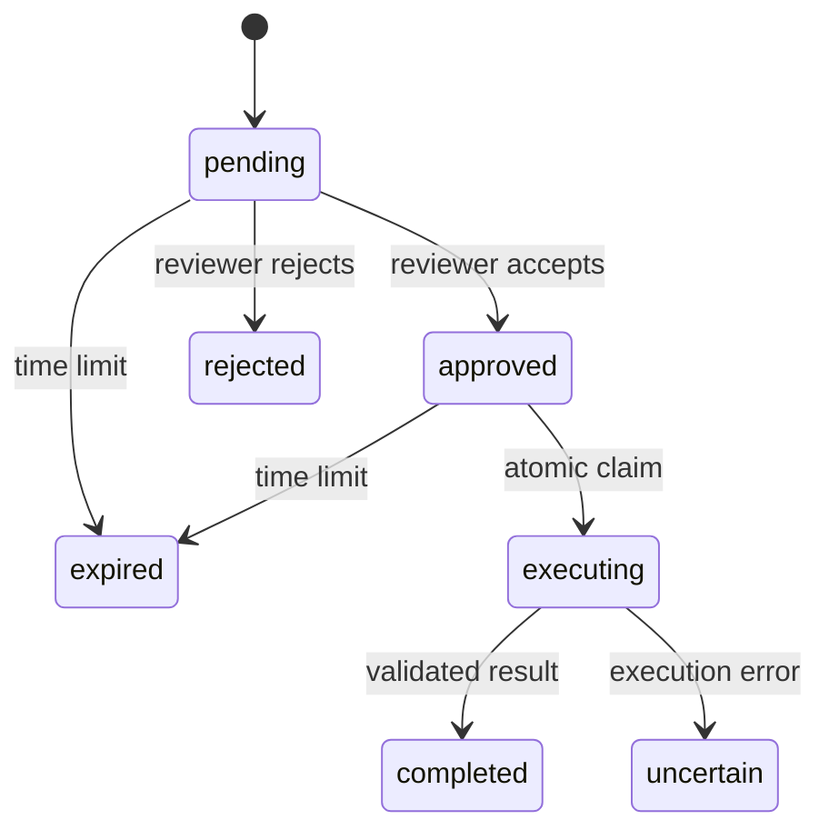

# Agent operational controls

All features described here are opt-in. See the
[deployment verification](../evaluation/deployment-verification.md) for a runnable
walkthrough using synthetic data.

## Human approval for mutations

1. The agent proposes the registered `add_demo_incident_note` tool with an
   incident ID and note. The dispatcher validates the arguments and checks
   `incident_note.write`. It records a pending action and returns an approval ID.
2. An operator reads the exact stored arguments with
   `GET /agents/actions/{approval_id}`, or looks up proposals for a run with
   `GET /agents/actions?run_id=...`. The run status also exposes approval IDs.
3. A reviewer sends `POST /agents/actions/{approval_id}/review` with
   `{"approve":true}` or `{"approve":false}`. The request needs the normal tenant
   bearer token, `agent_action.review`, and a separate `X-Approval-Token`.
4. An authorized operator sends `POST /agents/actions/{approval_id}/execute`
   with no new arguments. CrewOS checks `agent_action.execute` and the tool
   permission again, checks the registered contract version, and claims the
   approved record in SQLite before invoking the stored action.



Enable `AGENT_ACTIONS_ENABLED`; place `AGENT_ACTION_DB_PATH` on a volume shared
by the API and worker. Set `AGENT_REVIEWER_KEYS` as a tenant-to-secret map and
provide the relevant grants through `TENANT_PERMISSIONS`. Reading the action
requires `agent_action.read`. The reviewer credential must differ from the
tenant bearer token. This is tenant-level credential separation; individual
reviewer identity and SSO are separate work.

An approval belongs to an immutable tenant, tool, contract version and validated
argument snapshot. Expired or rejected records cannot execute. Bump the approval
version when changing a registered tool's contract or behavior. No agent-callable
tool can approve or consume the record. The original agent run reports the
proposal; it does not stay open or automatically resume after a decision.
Review is a separate operator action. This example writes a synthetic local note
and makes no live vendor mutation.

The claim prevents two requests from invoking the same action. It does not
provide exactly-once external side effects. A crash after the claim may leave
`executing`; an execution error records `uncertain` when storage is available.
Reconcile those states against the destination before creating another proposal.
A real vendor adapter should use an upstream idempotency key and a reconciliation
path where available. Do not automatically retry a consumed approval.

## Decision provider fallback

Set `AGENT_FALLBACK_MODEL` to a trusted JSON object containing `base_url`,
`model`, `api_key`, and optionally `primary_timeout_seconds`. This is an
OpenAI-compatible endpoint. The secondary client uses a fixed URL, TLS for remote
hosts, and no environment proxy, redirects or SDK retries. This configuration
authorizes sending the agent's decision history to that provider; configure it
only where that data transfer is allowed.

A decision gets one primary attempt and at most one secondary attempt for
eligible connection failures or transient HTTP statuses. Authentication errors,
model refusals, invalid decisions and exhausted budgets do not trigger fallback.
The secondary uses only the remaining decision time. Both attempts reserve
tokens through the same execution control, including an ambiguous failed
attempt. When run pricing is enabled, set `input_usd_per_million` and
`output_usd_per_million` on the secondary; it is admitted only at or below the
active primary rate ceilings. This keeps estimated cost conservative. Fallback
does not retry a tool or switch embedding/review providers.

## Feedback as a regression case

Enable `AGENT_FEEDBACK_ENABLED` and configure `AGENT_FEEDBACK_DB_PATH`. A
reviewer uses `POST /agents/runs/{run_id}/feedback` with the normal tenant token,
`agent_feedback.review`, and `X-Approval-Token`. For example:

```json
{"expected_outcome":"final_answer","required_phrases":["awaits approval"],"forbidden_phrases":["note already written"]}
```

CrewOS accepts feedback only for a completed run owned by that tenant and
freezes the baseline answer and criteria. Document cases can check
`answered`/ `insufficient_evidence` and specific citation identities. A
candidate JSON file maps the original run IDs to candidate answer objects.
Generate those candidates against a controlled fixture or equivalent input,
then compare them locally:

```sh
poetry run python -m crewos.evaluation.evaluate_feedback --tenant-id tenant_a --candidates /path/to/candidates.json
```

The report counts baseline and candidate passes, regressions and improvements.
Missing and malformed candidates fail. The comparison is offline and does not
automatically send tenant history to a provider or tune a model. Protect the
feedback database and candidate file as tenant data. Phrase and citation checks
are repeatable regression signals; they do not establish semantic correctness.
