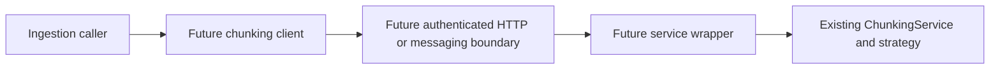

# Chunking module and deployment boundary

Chunking is an independently bounded module inside the current monolith. It is
not currently a deployed microservice. Ingestion callers explicitly pass prepared
text into its public API; the preparation service does not automatically split it.

```mermaid
flowchart LR
    Source[Source bytes] --> Ingestion[Ingestion: parser and validation]
    Ingestion --> Caller[Ingestion caller]
    Caller --> Public[Public chunking interface]
    Public --> Service[ChunkingService]
    Service --> Interface[ChunkerInterface]
    Interface --> Strategy[CharacterWindowChunker]
    Strategy --> Result[Validated chunks and strategy metadata]
    Result --> Future[Future tenant-scoped storage and indexing]
```

## Responsibilities

- `contracts.py`: immutable request, options, result, and text-span schemas.
- `text_chunker.py`: interchangeable splitting strategy and output-limit error.
- `service.py`: orchestrates splitting and checks source fidelity and coverage.
- `strategies/character_window.py`: deterministic fixed-window splitting.
- `bootstrap.py`: constructs the default service and operator-controlled limits.
- `__init__.py`: public import boundary for other modules and transport wrappers.

The chunking module has no imports from the rest of the CrewOS platform.
Ingestion retains compatibility exports for the original chunk type. All chunk
identities are transient positions; durable IDs, source versions, tenant ownership,
and deletion propagation require the later ingestion/storage work.

## Worked example

For `Check logs. Retry later.` (24 Python characters), a window of 10 and overlap
of 2 produces spans `[0:10]`, `[8:18]`, `[16:24]`. Each next start moves forward
by `chunk_size - overlap`. The overlap repeats context at a boundary; it does not
guarantee that a complete sentence or relevant explanation fits in a chunk.

The built-in strategy precomputes chunk count and output-character count before
building chunks. Server limits default to 1,000 chunks and 2,000,000 characters
including overlap. Admission failure returns an exception rather than a truncated
document. Input accepts at most 1,000,000 characters and window sizes up to 16,384;
these are independent character limits, not upload-byte or model-token limits.

Requests and results support Pydantic JSON serialization. The result includes
`schema_version=1`, `strategy="character_window_v1"`, and the selected options.
Those fields support later persisted provenance; callers must still associate
results with the correct tenant and source version.

## Future separate deployment

Extraction would add a transport wrapper and client while reusing the current
serializable boundary and tested splitting behavior. Deployment also needs
bounded request reading, authentication and permission checks, concurrency/rate
limits, timeout/cancellation behavior, logs/metrics/traces, packaging, health
checks, and failure handling. Stateless text processing does not remove those
requirements. There is no exactly-once processing guarantee or retrieval-quality
claim in this increment.
