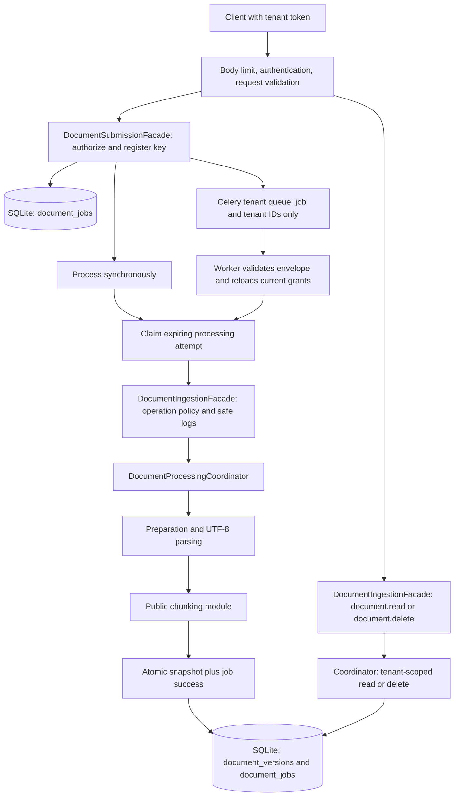
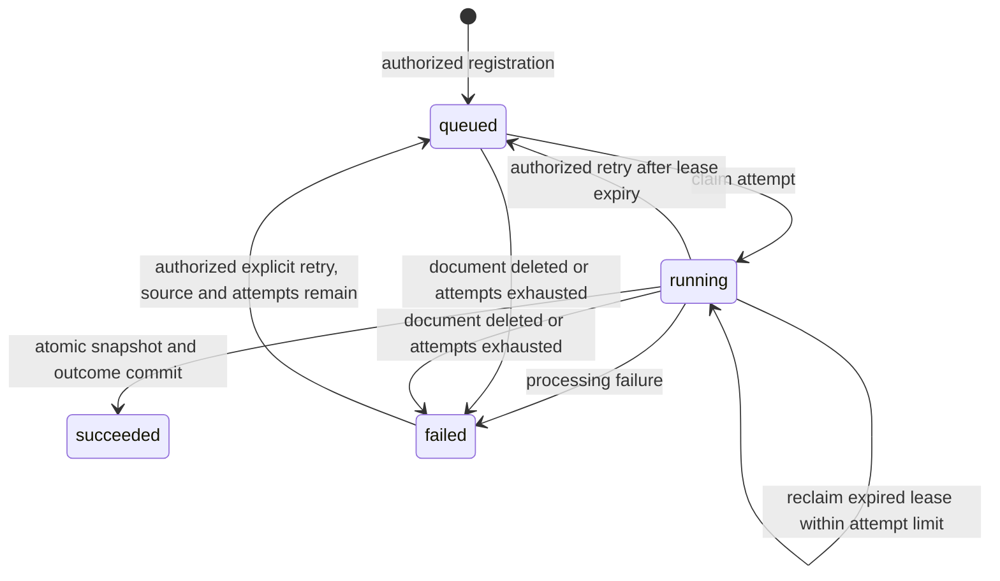

# Document lifecycle before retrieval

This module accepts plain-text JSON, stores versioned snapshots, exposes authorized
read/delete operations, and supports durable synchronous/background writes. It
adds no keyword search, embeddings, vector retrieval, or RAG behavior.

## Components

- **Submission facade:** authorize durable registration, status reads, and retry.
- **Processing facade:** authorize actual create/update/read/delete operations and
  record safe lifecycle events.
- **Coordinator:** prepare, chunk, assemble snapshots, and call storage interfaces.
- **Job processor:** claim an attempt and inject a claim-scoped storage adapter so
  snapshot insertion and job success share the same transaction.
- **SQLite adapter:** enforce tenant scope, immutable revision sequencing, key
  uniqueness, attempt fencing, atomic persistence, and deletion effects.
- **HTTP/Celery adapters:** translate transport into public module operations;
  neither transport confers permission or makes source text trusted.

Direct Python facade calls remain useful building blocks and do not by themselves
provide submission idempotency. The HTTP write path always registers a durable
job first, for both execution modes. The job processor calls the processing
facade again using current server grants; a queue message never supplies grants.

## HTTP contract

Every route requires `X-Tenant-ID` plus `Authorization: Bearer ...`. Matching
server-configured tenant credentials establish identity; `TENANT_PERMISSIONS`
provides the allowed actions. No new grants are enabled automatically.

| Operation | Route | Permission |
|---|---|---|
| Create | `POST /documents` | `document.create` |
| Full replacement | `PUT /documents/{id}` | `document.update` |
| Read latest/exact | `GET /documents/{id}?version=N` | `document.read` |
| Delete all versions | `DELETE /documents/{id}` | `document.delete` |
| Job status | `GET /documents/jobs/{id}` | `document.job.read` |
| Explicit retry | `POST /documents/jobs/{id}/retry` | `document.job.retry` and original operation permission |

Write bodies contain `title`, `text`, optional `source_ref`; updates additionally
require `expected_version`. The document ID is a route field on update. Tenant,
permissions, next version, and chunking options are forbidden body fields. Source
text/title/reference must be valid UTF-8; no URLs are fetched. The body middleware
caps received bytes before JSON parsing, even without a content-length header.
Validation responses are redacted rather than returning source inputs.

Write routes require an `Idempotency-Key` header, 1–128 ASCII alphanumeric or
`._:-` characters. They return a `DocumentSubmission` (`job`, `replayed`), with
safe job/document IDs, state, attempt count, publication confirmation,
`lease_active`, `result_available`, version, and optional error code. Source text
and chunk content are available only through an authorized document read.
Synchronous mode is default; `?background=true` enqueues and returns 202.
Completed/replayed synchronous writes return 200; synchronous failed receipts
use an appropriate failure status. Status reads return durable state even after
Redis result expiry. Delete returns 204; missing/other-tenant resources return
404. Permissions, conflicts, admission, and availability map to 403/409/422/503.

## Retry and failure semantics

1. Authorization precedes job registration. A hash of the key is unique per
   tenant; a fingerprint covers the normalized source command and operation.
2. Same key/same command returns the same job, including after process restart.
   Changed input or operation under the key conflicts. Different keys are
   different submissions; this is not content-based duplicate detection.
3. Source bytes and original chunking options are persisted before publication.
   The broker receives only job and tenant IDs, with matching task ID/tenant queue.
4. A claim grants a token and bounded lease. Concurrent active claims conflict;
   an expired claim can be reclaimed within the maximum attempts. Stale tokens
   cannot append a document.
5. Snapshot insertion and successful job state commit together. A crash after
   commit but before response/acknowledgement cannot cause a second append.
6. An unconfirmed publish returns 503; resubmit the same key/input to publish the
   same job. Queued duplicates are safe. A bounded attempt is not an exactly-once
   guarantee for arbitrary external effects; this pipeline performs local-only
   preparation plus transactional document writes.
7. Processing errors become durable redacted codes. Explicit retry accepts a
   failed or expired job with retained source and attempts remaining. It requires
   both retry and original operation permission. No automatic retry loop runs.
8. An update checks the latest revision before processing and the database checks
   again when appending. Competing edits return a conflict rather than merging.
   Same-key replay returns the previous receipt instead of repeating the update.

A hard-killed worker may leave `running` until lease expiry; no heartbeat or
scheduler automatically requeues it. A same-key resubmission or authorized retry
recovers eligible work. The worker has 120/150-second soft/hard limits; the
configured lease must exceed 150 seconds (default 180). Synchronous processing
has admission/lease bounds rather than a preemptive CPU timeout. Chunk/source
limits make current UTF-8 processing bounded; future rich parsers require their
own extraction/time/isolation limits.

## Deletion and retention

Delete removes all snapshots/chunks for the tenant/document in one transaction.
It also clears retained job input and invalidates pending/running tokens, so an
old attempt cannot restore a deleted version. Completed key fingerprints and
receipts remain; replay reports no available result rather than re-ingesting.

Source content is private database data: pending and failed jobs with retry
capacity retain it. Successful and exhausted jobs clear their payload. Deleted
document jobs clear it as well. There is no automated receipt/failed-job retention
cleanup. Operators must account for database access, backups, and retention;
logical SQL deletion is not secure disk erasure. No external index exists yet.

## Storage and deployment

Schema version 2 transactionally adds the jobs table to recognized version-1
files while preserving snapshots. Back up local files before operator upgrades.
A distinct application ID prevents opening unrelated databases as document stores.
Files use owner-only permissions and new directories use 0700. API and worker
must share one local SQLite file; Compose explicitly configures that path on the
existing shared `/app/var` volume. Do not mount different files on each process.

This remains a single-host module implementation. Existing Kubernetes manifests
do not establish a shared multi-host database. A future adapter must implement
the combined `DocumentManagementStoreInterface`, especially atomic snapshot/job
commit and concurrent key/attempt guarantees. Service extraction also requires a
transport/operational contract; current module boundaries alone do not deploy it.

## Verification scope

Tests use real SQLite files and authenticated ASGI requests, test concurrent
registrations and version appends, inject an error after snapshot insertion to
verify rollback with the job outcome, fence expired attempts, and verify deletion
cannot be undone by replay. Worker tests validate current permissions and delivery
metadata. An integration test executes actual Celery memory-transport delivery
and duplicate redelivery, with durable status and document reads.

These are controlled local tests, not live Redis/container/cluster/load evidence.
No private credentials, service state, or real corpus is modified by the tests.
Run the default full suite and the existing opt-in live Redis test separately
when an isolated environment is configured.

Verification recorded on 2026-11-01: **866 passed, 1 skipped; 96.81% line
coverage** with an 80% command-level check. The skipped test is the existing
opt-in live Redis/Celery test. Formatting checks and `git diff --check` passed.
The repository's configured coverage threshold was not changed.
