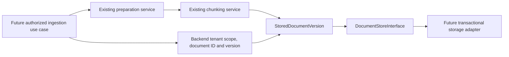

# Document version and storage contract

This increment defines a validated snapshot and a storage interface in
`crewos/ingestion/document_store.py`. It does not
implement persistence or expose an ingestion endpoint.

## Identity and versions

A document ID identifies one logical document. A positive integer version
identifies an immutable snapshot of its text and chunking result. Re-parsing or
re-chunking changed content/configuration should create a new version rather
than silently replacing passages used by earlier references. Chunks in a snapshot
are addressed by their index together with tenant, document ID, and version;
a chunk index alone is not a globally unique reference.

The version contract includes an aware timestamp with a UTC default. Version
ordering comes from the integer revision, not wall-clock timestamp order.
There is no content-hash deduplication or automatic version allocation yet.

`StoredDocumentVersion` rejects empty, incomplete, out-of-order, or source-mismatched
chunk sets. It does not establish that the caller may write for the supplied
tenant, that a document is factually correct, or that a revision is next in a
database. Trusted application code and the future storage adapter must enforce
those separate responsibilities.

## Required storage semantics

- Writes atomically append text, metadata, and chunks; existing snapshots are
  never overwritten. Versions start at 1 and advance by one per tenant/document.
- Concurrent appends for the same next version must have one winner; the other
  receives `DocumentVersionConflict`. This requires transactional adapter logic.
- Every lookup/delete includes tenant scope. Missing and other-tenant records
  both produce `DocumentNotFound`; an identifier alone grants no access.
- Latest lookup and exact-version lookup return validated snapshots. Database
  corruption and infrastructure failures must propagate as failures.
- Delete removes all local versions/chunks atomically. Indexes, caches, backups,
  and downstream evidence references need later propagation/retention rules.

## Next implementation

Build a storage adapter and integration tests for reopen persistence, tenant
isolation, atomic writes, version conflicts under concurrency, latest/exact reads,
and deletion. Then build the authorized ingestion coordinator around the existing
parser and chunker public boundaries. Retrieval will later consume an explicit
read/search boundary, rather than importing this adapter's tables or internals.
