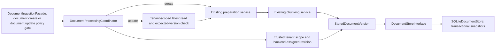

# Document version and storage contract

The validated snapshot and storage interface are implemented by a single-host
SQLite adapter. An authorized ingestion facade delegates to an internal processing coordinator,
which connects preparation, chunking, and storage in-process; API and worker integration remain future work.

## Identity and versions

A document ID identifies one logical document. A positive integer version
identifies an immutable snapshot of its text and chunking result. Re-parsing or
re-chunking changed content/configuration should create a new version rather
than silently replacing passages used by earlier references. Chunks in a snapshot
are addressed by their index together with tenant, document ID, and version;
a chunk index alone is not a globally unique reference.

The version contract includes an aware timestamp with a UTC default. Version
ordering comes from the integer revision, not wall-clock timestamp order.
There is no content-hash deduplication or automatic version allocation yet.

`StoredDocumentVersion` rejects empty, incomplete, out-of-order, or source-mismatched
chunk sets. It does not establish that the caller may write for the supplied
tenant, that a document is factually correct, or that a revision is next in a
database. Trusted application code must enforce authorization. The SQLite adapter
enforces scoped access and sequential writes within its transactions.

## Required storage semantics

- Writes atomically append text, metadata, and chunks; existing snapshots are
  never overwritten. Versions start at 1 and advance by one per tenant/document.
- Concurrent appends for the same next version must have one winner; the other
  receives `DocumentVersionConflict`. The SQLite adapter uses a serialized write transaction for this check.
- Every lookup/delete includes tenant scope. Missing and other-tenant records
  both produce `DocumentNotFound`; an identifier alone grants no access.
- Latest lookup and exact-version lookup return validated snapshots. Database
  corruption and infrastructure failures must propagate as failures.
- Delete removes all local versions/chunks atomically. Indexes, caches, backups,
  and downstream evidence references need later propagation/retention rules.

## SQLite implementation

`build_sqlite_document_store(path, lock_timeout_seconds=5)` constructs the
adapter through the public ingestion boundary. A dedicated file is required;
`:memory:` is rejected. No database is opened merely by importing the module.
New directories use mode 0700 and the database file is restricted to 0600.

The composite key is `(tenant_id, document_id, version)`. Each row contains a
single JSON snapshot, including text, parser-provided source label, chunking
strategy/options, and all chunks. This deliberately avoids a second search
schema in this increment; future retrieval/indexing must use its own boundary.

Each operation opens and closes its own connection. Writes use
`BEGIN IMMEDIATE`, full synchronous commits, and WAL journaling. A failed insert
rolls back the entire version; the next-version check and insertion share the
same transaction. Concurrent attempts at the same next version have one winner
and one `DocumentVersionConflict`. Infrastructure and lock errors propagate;
there is no internal automatic retry. The lock wait is a contention timeout,
not an end-to-end operation deadline.

Writes revalidate serialized snapshots deeply. Reads validate content and compare
its tenant, document ID, and version against the row's indexed keys. Corrupt
content or identity mismatches produce `DocumentStorageCorruption` with a generic
message. The dedicated database's application ID and schema version are checked
at initialization; unsupported or unrelated databases are rejected.

Logical delete removes every local version row (including its embedded chunks)
in one transaction. Secure erasure, backups, and external index/cache deletion
are separate concerns. Shared local-file access is supported on a single host;
multi-host/network-filesystem deployment requires a different storage adapter.

Tests exercise real temporary files, reopen persistence, exact/latest reads,
tenant isolation, competing connections, injected after-insert failure rollback,
corruption detection, deletion, schema checks, and lock contention.

## Facade and coordination

`DocumentIngestionFacade` uses the shared policy executor before invoking the
internal `DocumentProcessingCoordinator`. The coordinator alone sequences
preparation, chunking, snapshot assembly, and storage. The caller must establish trusted
context; this is authorization enforcement, not authentication. New-document
creation requires `document.create`, uses the context's tenant, and assigns a
UUID4/version 1 in backend code. `DocumentIngestionRequest` contains source bytes
and metadata only; chunking options are server-configured.

The facade and coordinator have separate responsibilities. The public facade
provides the simplified authorized entry point and lifecycle logging; it has no
parser, chunker, or storage dependency. The internal coordinator receives those
components through constructor injection and has no policy dependency. Neither
layer implements the GoF Bridge pattern. The facade is public; the coordinator
is not exported. This import boundary supports modularity but is not a security
sandbox for code already running inside the application.

Facade lifecycle events include tenant/operation IDs and elapsed time. Successful
events also include document ID, version, and chunk count; failures include the
exception class only. Source content, titles, labels, and raw exception messages
are excluded. The shared policy executor logs policy denial/evaluation failure
before processing begins.

`ingest()` creates a new ID/version 1 and provides no submission idempotency;
retrying after uncertain persistence can create a duplicate. `update()` now
preserves identity and appends a version under a separate permission and
optimistic concurrency precondition. Read/delete authorization, request
idempotency, and asynchronous scheduling remain future use cases. Low-level storage remains
protected by tenant-scoped SQL but cannot establish caller authentication.

## Versioned updates

`DocumentIngestionFacade.update()` enforces `document.update` before invoking
processing. The coordinator revalidates `DocumentUpdateRequest`, scopes the latest
lookup by tenant, and compares its revision with `expected_version`. Missing and
other-tenant documents raise `DocumentNotFound`; mismatched revisions raise
`DocumentVersionConflict` before parsing. Replacement bytes, title, and source
label are processed as a full replacement; absent source reference clears it.

The coordinator assembles the same document ID with version
`expected_version + 1`. Preparation and chunking happen outside the write
transaction. The storage adapter's existing next-version check fences concurrent
appends after the initial read. A conflict is propagated without automatic retry
or merging, and no historical snapshot is overwritten. Tests synchronize two
updates after their reads and verify one winner, one conflict, and unchanged
history. Parse/chunk/store failures leave the previous committed version intact.

Update lifecycle events use the `document_update_*` prefix. As with creation,
only safe IDs, timings, counts, and exception class names are emitted. No
credentials, grants, routes, or worker behavior change in this increment.

## Next implementation

Add authorized read/delete operations, then transport/background execution. Retrieval will later use an explicit
read/search boundary. No API/worker routes, environment grants, or container
volumes are added for ingestion in this increment.
