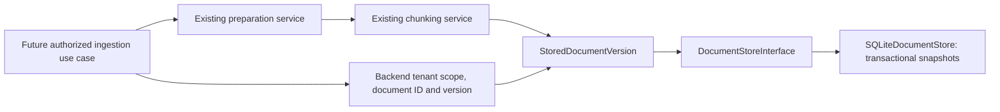

# Document version and storage contract

The validated snapshot and storage interface are implemented by a single-host
SQLite adapter. There is no authorized ingestion coordinator or ingestion
endpoint connected to storage yet.

## Identity and versions

A document ID identifies one logical document. A positive integer version
identifies an immutable snapshot of its text and chunking result. Re-parsing or
re-chunking changed content/configuration should create a new version rather
than silently replacing passages used by earlier references. Chunks in a snapshot
are addressed by their index together with tenant, document ID, and version;
a chunk index alone is not a globally unique reference.

The version contract includes an aware timestamp with a UTC default. Version
ordering comes from the integer revision, not wall-clock timestamp order.
There is no content-hash deduplication or automatic version allocation yet.

`StoredDocumentVersion` rejects empty, incomplete, out-of-order, or source-mismatched
chunk sets. It does not establish that the caller may write for the supplied
tenant, that a document is factually correct, or that a revision is next in a
database. Trusted application code must enforce authorization. The SQLite adapter
enforces scoped access and sequential writes within its transactions.

## Required storage semantics

- Writes atomically append text, metadata, and chunks; existing snapshots are
  never overwritten. Versions start at 1 and advance by one per tenant/document.
- Concurrent appends for the same next version must have one winner; the other
  receives `DocumentVersionConflict`. The SQLite adapter uses a serialized write transaction for this check.
- Every lookup/delete includes tenant scope. Missing and other-tenant records
  both produce `DocumentNotFound`; an identifier alone grants no access.
- Latest lookup and exact-version lookup return validated snapshots. Database
  corruption and infrastructure failures must propagate as failures.
- Delete removes all local versions/chunks atomically. Indexes, caches, backups,
  and downstream evidence references need later propagation/retention rules.

## SQLite implementation

`build_sqlite_document_store(path, lock_timeout_seconds=5)` constructs the
adapter through the public ingestion boundary. A dedicated file is required;
`:memory:` is rejected. No database is opened merely by importing the module.
New directories use mode 0700 and the database file is restricted to 0600.

The composite key is `(tenant_id, document_id, version)`. Each row contains a
single JSON snapshot, including text, parser-provided source label, chunking
strategy/options, and all chunks. This deliberately avoids a second search
schema in this increment; future retrieval/indexing must use its own boundary.

Each operation opens and closes its own connection. Writes use
`BEGIN IMMEDIATE`, full synchronous commits, and WAL journaling. A failed insert
rolls back the entire version; the next-version check and insertion share the
same transaction. Concurrent attempts at the same next version have one winner
and one `DocumentVersionConflict`. Infrastructure and lock errors propagate;
there is no internal automatic retry. The lock wait is a contention timeout,
not an end-to-end operation deadline.

Writes revalidate serialized snapshots deeply. Reads validate content and compare
its tenant, document ID, and version against the row's indexed keys. Corrupt
content or identity mismatches produce `DocumentStorageCorruption` with a generic
message. The dedicated database's application ID and schema version are checked
at initialization; unsupported or unrelated databases are rejected.

Logical delete removes every local version row (including its embedded chunks)
in one transaction. Secure erasure, backups, and external index/cache deletion
are separate concerns. Shared local-file access is supported on a single host;
multi-host/network-filesystem deployment requires a different storage adapter.

Tests exercise real temporary files, reopen persistence, exact/latest reads,
tenant isolation, competing connections, injected after-insert failure rollback,
corruption detection, deletion, schema checks, and lock contention.

## Next implementation

Build the authorized ingestion coordinator around the existing parser, chunker,
and storage public boundaries. It must establish tenant scope and permissions,
assign document identity/version, and decide how to handle conflicts and retries.
Then add transport/background execution and later retrieval against an explicit
read/search boundary. No API/worker routes, environment settings, or container
volumes are added for document storage in this increment.
