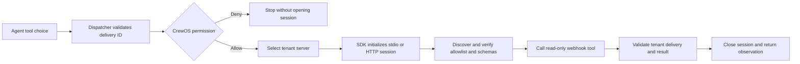

# MCP integration layout

Status: the read-only webhook tool works over local stdio and authenticated Streamable HTTP MCP.
Configuration is opt-in. The reference server runs as an independent subprocess,
and the scripted agent demo verifies both successful and rejected requests.

```text
crewos/
├── mcp_integration/
│   ├── __init__.py
│   ├── contracts.py
│   ├── server_configuration.py
│   ├── mcp_client.py
│   ├── approved_tool_catalog.py
│   ├── schema_compatibility.py
│   ├── connection_manager.py
│   └── adapters/
│       ├── __init__.py
│       ├── sdk_mcp_client.py
│       └── webhook_delivery_reader.py
└── core/
    └── mcp_setup.py

examples/webhook_mcp_server/
├── pyproject.toml
├── Dockerfile
├── .env.example
├── README.md
├── src/webhook_mcp_server/
│   ├── __init__.py
│   ├── config.py
│   ├── server.py
│   └── delivery_service.py
└── tests/
    └── test_server.py

tests/mcp_integration/
├── __init__.py
├── test_contracts.py
├── test_server_configuration.py
├── test_approved_tool_catalog.py
├── test_connection_manager.py
├── test_sdk_mcp_client.py
├── test_webhook_delivery_reader.py
└── test_end_to_end.py

docs/
├── architecture/mcp-integration.md
├── adr/0002-mcp-client-module-boundary.md
└── evaluation/
    ├── mcp-integration-verification.md
    └── reports/
```

Existing delivery contracts, handler, HTTP adapter and tool composition remain in
their current locations. The same protected handler can now use either transport.


## First contract: advertised tool metadata

`McpToolDescription` is exported from `crewos.mcp_integration`. It describes remote
metadata, not an executable CrewOS `ToolDefinition`:

| Field | Admission and meaning |
| --- | --- |
| `name` | Required; 1–128 ASCII letters/digits, underscores, dots or hyphens. No trimming or normalization. |
| `description` | Optional server-provided text; when present, nonblank and at most 4096 characters. Untrusted instructions remain data. |
| `input_schema` | Required JSON object explicitly declaring `type: object`. |
| `output_schema` | Optional JSON object with the same root requirement. |

These are CrewOS admission rules for the initial normalized representation, not a
claim to implement every MCP wire field or schema form. The SDK adapter
translates wire names such as `inputSchema` into these internal fields. The local
delivery input provides the expected argument shape through `GetWebhookDeliveryStatusInput.model_json_schema()`.

The model rejects extra authority/handler fields, non-JSON values, non-finite numbers
and total metadata above 65,536 UTF-8 bytes. It preserves admitted schema content.
It does **not** check all JSON Schema keyword semantics, validate future call
arguments, resolve `$ref` targets, prove a server's claims, establish tenant identity,
or approve/register a tool. A root-shaped schema can still be semantically invalid;
full schema compatibility/argument validation remains a later execution boundary.
A transport that accepts untrusted executables would also need a pre-parse wire limit.

Field reassignment is frozen. Nested schema dictionaries are not deeply immutable;
consumers must snapshot/revalidate them at later trust boundaries. Input dictionaries
are copied through validation so mutating the caller's original metadata does not
change the newly created model. Descriptions are not executed or added to model
prompts by this increment. No permission assignment or replay-safety assertion is
accepted at the top level of this contract.

Tests cover schema generation/round-trip, names, descriptions, root requirements,
strict JSON, UTF-8 limits, forbidden authority claims and mutation boundaries. This
is contract evidence only, not MCP protocol interoperability verification. Tool-call
and result contracts are now defined below; trusted configuration, client interface
and transport remain subsequent increments.


## Tool-call and result contracts

`McpToolCallRequest` carries `tool_name` (the same admitted name format as discovery)
and `arguments` (a JSON object, defaulting to empty). Total serialized size is at
most 32,768 UTF-8 bytes; non-finite numbers/non-JSON objects are rejected. It does
not contain server URLs, credentials, tenant context, approval or timeout fields.
A remote argument named `tenant_id` is still arbitrary argument data, not the
caller's verified identity. The approved domain adapter must control its mapping.
Generic argument admission does not validate arguments against the advertised schema.

`McpToolCallResult` contains:

| Field | Meaning |
| --- | --- |
| `is_error` | Required strict boolean; whether the remote tool reported execution failure. |
| `content` | Up to 16 `McpTextContent` blocks, each containing exact text of at most 16,384 characters. Empty text/list is valid. |
| `structured_content` | Optional strict JSON object; remains untrusted domain data. |

The whole result is bounded to 65,536 serialized UTF-8 bytes, including text and
structured data. Values are never truncated. Images, audio, embedded resources
and other MCP content kinds are unsupported by this initial normalized contract;
the SDK adapter rejects unsupported kinds, never silently
omit unsupported blocks. Both text and structured content may be present; this
shape does not establish that they agree or satisfy an advertised output schema.

The SDK adapter populates `is_error` explicitly, including applying the
selected protocol's semantics when its wire field is omitted. An error result is
not a missing domain record, even if structured data claims `outcome=unavailable`.
A domain adapter must check the error flag before interpreting a success payload.
Transport/protocol failures must propagate separately; this contract must not be
used to invent empty success after a failed request. Conversely, an empty success
result alone does not establish that a delivery is missing.

Connection/server identity, tenant scope, request correlation, authorization and
remaining timeout belong to trusted execution/session layers outside these payloads.
The result cannot prove which server/call/tenant produced it. No tool is invoked by
constructing these objects. Metadata/content can contain instruction-like strings;
validation does not make them trusted instructions or prevent prompt injection.

All models forbid extra top-level fields and prevent field reassignment. Nested
argument/structured dictionaries remain mutable. Future consumers should validate
from a Python-mode dump before serialization when handling existing model instances;
JSON serialization alone can normalize non-finite values after a bypassed mutation.
Call input dictionaries are copied during validation. These are post-parsing admission limits; the SDK stdio transport does not enforce
a pre-parse wire size cap.

Tests cover round-trip, strict booleans/JSON, field/byte/count limits, forbidden
connection/authority fields, content-kind rejection, exact text preservation, error
versus domain outcome and mutation/revalidation. See the verification walkthrough for real subprocess coverage.


## Trusted local-server configuration

`server_configuration.py` defines five data-only models:

- `McpStdioTransport`: absolute executable path, literal argument tuple, optional
  absolute working directory and explicitly supplied environment values.
- `McpStreamableHttpTransport`: fixed HTTP endpoint and redacted bearer credential.
- `ApprovedMcpTool`: remote tool name, local alias, required CrewOS permission and
  operator-assigned replay safety (false by default).
- `McpServerConfiguration`: server ID, tenant ID, transport, enable flag, timeout
  and tool allowlist. Defaults are disabled, a five-second timeout and no tools.
- `McpServerConfigurations`: bounded set of server definitions; empty by default.

`stdio` means the client starts a local child process and exchanges protocol
messages through stdin/stdout. Streamable HTTP instead connects to a configured
endpoint without launching a child process. For stdio, absolute paths are
validated syntactically using the host platform; existence/permissions are not
checked and no process is started. Arguments remain individual strings, not a
shell command. The configured executable may itself run arbitrary code, including a
shell: operator approval is essential and this is not a process sandbox.

A server definition belongs to one tenant. Server IDs and local aliases may repeat
across tenants; duplicates within a tenant are rejected. A server has at most 16
allowlisted tools, with unique remote names and local aliases. A configuration set
has at most 32 servers. Aliases are also unique across configured servers in one
tenant, including disabled definitions to reserve their names. Collisions against
existing non-MCP registry tools must be checked later during composition.

Permissions are explicit action names such as `webhook_delivery.read`, not wildcards
or automatically inferred roles. A model/server cannot grant these by supplying
metadata. Constructing `ApprovedMcpTool` does not prove trusted provenance or grant
the caller a permission; only trusted operator configuration may supply it. The
handler enforces permissions on each invocation. Remote read-only
annotations do not establish replay safety. Tool-schema compatibility and changes
are checked by the catalog and schema verifier before an MCP webhook invocation.

Configuration admits at most 64 arguments of 2048 characters, 32 explicit environment
entries with portable names, and environment values up to 4096 characters. NUL is
rejected. Environment values use `SecretStr`; repr/JSON serialization redact them.
Use environment/secret management rather than command arguments for credentials.
Redacted JSON is not a secret backup: trusted Python-mode revalidation preserves
SecretStr values. These models do not inherit a parent process environment; the
SDK merges its default environment allowlist with explicitly configured overrides.
Nested dictionaries can still be mutated, so later boundaries must snapshot and
revalidate configuration rather than assume deep immutability.

The timeout is a finite positive value at most 30 seconds. It is stored configuration
only until the connection manager and adapter apply it and cap it by remaining budget.
Nothing reads a private environment file, launches a process, discovers tools,
registers handlers or changes application settings through constructing this model.
The composition layer reads this configuration from CrewOS settings only for opt-in MCP.


## MCP client interface

`mcp_client.py` defines `McpClientInterface`, a structural `Protocol` for one
tenant/server session. Its asynchronous methods are `discover_tools`, `call_tool`
and `close`. The connection manager creates the initialized session from
trusted configuration. No model-supplied tenant, executable or credential selects
its connection.

Discovery returns normalized descriptions, not authorized tools. The interface
requires complete pagination within one time allowance, at most 128 tools and
1 MiB of combined compact UTF-8 normalized metadata JSON. Duplicate names,
oversized data or unsupported protocol content must fail rather than disappear
through truncation. These are CrewOS admission requirements, not MCP standard
limits; SDK adapter tests verify count, byte and pagination rejection.

Calls require prior CrewOS authorization and approved-schema validation. A valid
remote tool error returns `is_error=True`; `McpConnectionError` represents connection
or timeout failures, while `McpProtocolError` represents malformed or unsupported
data. Neither means the business record is missing. Calls must not retry
automatically because a missing response does not prove an action failed to run.
Timeouts must be finite, positive and capped by configuration and remaining caller
budget across all waits. Cleanup must be bounded, cancellation must propagate, and
repeated close must be safe. These are implementation obligations, not behavior
that a Python Protocol enforces.


## Approved-tool catalog: name admission

`ApprovedMcpToolCatalog` snapshots one trusted tenant/server configuration and
its discovered descriptions. Disabled configurations expose nothing. Enabled
configurations reject duplicate discovered names, missing configured tools and
discovery exceeding 128 tools or 1 MiB of normalized metadata. Unmapped remote
tools are excluded. Each admitted entry preserves the operator's local alias,
permission and replay-safety assignment; none comes from server annotations.
Metadata is revalidated in Python mode and stored as an immutable JSON snapshot;
reading a description returns a fresh model to prevent nested mutation.

Resolution is local to one catalog. Future composition must select that catalog
from trusted context and check aliases across the complete registry. This does
not grant callers permission, register tools, validate full JSON Schema semantics
or approve schema compatibility. Those checks must precede executable registration;
name admission alone is insufficient. No MCP connection is opened by the catalog.


## Trusted schema comparison

`schema_compatibility.verify_schema_compatibility` compares an admitted entry
against a `McpToolDescription` supplied independently by trusted application code.
It checks remote identity and exact input/output schema JSON, ignoring object-key
order and descriptive text. Missing versus present output schemas differ. Array
order and numeric representation remain significant; this is conservative pinning,
not a proof of semantic JSON Schema equivalence. A mismatch raises a sanitized
`McpSchemaMismatch`. Trusted metadata is revalidated before comparison.

The expected schema must never be copied from current discovery as an automatic
approval. The MCP webhook reader supplies trusted expectations and checks them
after discovery and before invocation, then validates the result with its local model. Matching pins
do not validate schema semantics, resolve references or authorize callers.


## Per-execution connection management

`McpConnectionManager.session` is an asynchronous context manager: entering opens
one initialized client through `McpClientFactoryInterface`; leaving calls `close`.
There is no pool, shared session or retry. It snapshots configuration, rejects
disabled servers and mismatched tenant scope, and caps initialization by both the
configured timeout and caller allowance. Tenant identity must come from verified
application context; this check does not authenticate callers or authorize tools.

Initialization failure is sanitized. The factory owns cleanup of partial creation
because no client has been returned yet. Completed sessions receive a separate,
bounded cleanup allowance on success, body failure or cancellation. Cleanup errors
fail successful operations, but do not replace an existing operation failure.
Cancellation propagates. Timeouts rely on cooperative async implementations; an
uncooperative adapter or repeated cancellation can interrupt cleanup, so this is
not a guarantee that arbitrary child processes are terminated. The SDK adapter
must implement and test process/task ownership, cancellation and partial cleanup.
It must not leave task-bound context managers open across a factory return.

Each discovery/call still needs its remaining execution budget; the initialization
timeout is not a total session deadline. Tests use controlled clients to verify
scope rejection, distinct sessions, timeout capping, failure and cancellation
cleanup. Separate SDK tests verify subprocess interoperability and cleanup.

## Runtime wiring



`MCP_WEBHOOK_ENABLED=true` selects MCP for the existing webhook tool. HTTP
remains the default adapter when enabled without MCP. There is no HTTP fallback
after an MCP error. Configuration needs exactly one matching enabled server per
tenant, an explicit mapping for the known tool, and the existing
`webhook_delivery.read` permission for the caller. Registration does not contact
a server. The model sees the local tool description, not server-supplied prose.

Example settings for the independently installed reference executable:

```dotenv
MCP_WEBHOOK_ENABLED=true
MCP_WEBHOOK_SERVERS={"servers":[{"server_id":"reference","tenant_id":"tenant_a","enabled":true,"transport":{"command":"/tmp/crewos-webhook-server/bin/webhook-mcp-server","environment":{"WEBHOOK_MCP_TENANT":"tenant_a"}},"allowed_tools":[{"remote_name":"get_webhook_delivery_status","local_name":"get_webhook_delivery_status","required_permission":"webhook_delivery.read"}]}]}
```

Grant the permission separately through the existing tenant configuration. The
adapter checks the result's claimed tenant ID to catch launch misconfiguration;
a malicious executable could lie. Use trusted executables only. The SDK inherits
a limited environment by default and parses wire messages before CrewOS applies
its normalized size limits. Those limits are not a wire cap or process sandbox.
The adapter rejects schema references in advertised outputs before calling tools,
discards child stderr, and returns sanitized integration errors. MCP calls do not
automatically replay after an uncertain execution.

See the [verification walkthrough](../evaluation/mcp-integration-verification.md)
for commands, traces and coverage scope. Independent deployment of CrewOS's
remaining modules is the subsequent repository refactor.


## Streamable HTTP transport

Select this transport by replacing a tenant server's `transport` block:

```json
{
  "kind": "streamable_http",
  "url": "https://mcp.example.com/mcp",
  "bearer_token": "<provisioned-tenant-token>"
}
```

Inject the real credential through trusted deployment configuration. This client
uses TLS verification, disables redirects and environment proxies, and sends the
credential only to the configured endpoint. Plain HTTP is admitted only for
literal IPv4/IPv6 loopback tests. URL credentials, query strings and fragments
are rejected. The endpoint must implement MCP Streamable HTTP and accept the
provisioned bearer credential. OAuth discovery, token acquisition and refresh are
outside this increment.

CrewOS does not derive endpoints or credentials from model arguments or discovered
metadata. The same application permission gate, pinned schemas, tenant/result
checks and session budgets apply. The SDK attempts to terminate a stateful HTTP
session when closing. The SDK may resume response streams with GET; CrewOS
does not replay a tool invocation after an uncertain POST. This is not a
general-purpose proxy or network egress
policy; operators still control approved endpoints and deployment network access.

The tests exercise the pinned SDK against a real authenticated loopback server.
They cover successful lookup, credential rejection, session termination, and
redirect refusal. The Docker reference example remains a stdio server; the HTTP
test harness wraps the same tool for interoperability testing.
