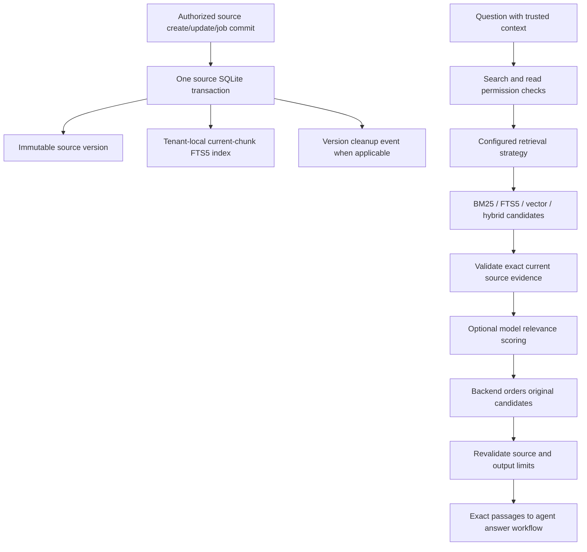

# Indexed keyword search and second-stage reranking

These components extend the existing retrieval module without changing the default
strategy or enabling extra tenant permissions. No new dependency is required.



## 1. Index boundary and implementation

`KeywordSearchIndexInterface.search_current_chunks` defines a tenant-scoped,
bounded keyword lookup returning authoritative source snapshots and chunk indices.
`IndexedBM25Retriever` turns these into normal `RetrievalResult` passages.
`build_indexed_retrieval` adds the existing dual permission gate.

The SQLite source adapter implements the index in
`ingestion/adapters/sqlite_document_search_index.py`. Source schema **5** adds
FTS5 indexes and a row-ID mapping table. Index rows contain only current chunk text
and identity; old source versions remain in source storage. Appending a source
version, replacing its FTS rows, recording a version event and completing a
background job share the source transaction. Source deletion removes FTS rows in
that transaction before committing its downstream vector-cleanup event. Failure
rolls everything back. Vector deletion still uses its separate durable worker.

Each tenant has an FTS table named from a backend-generated SHA-256 digest of its
validated ID. This keeps both candidate selection and BM25 collection statistics
within the tenant. It avoids a global ranking whose statistics include other
organizations. SQL identifiers never contain unvalidated request text. A regular
mapping table lets updates/deletes locate FTS row IDs through the tenant/document
primary key rather than scan all indexed text rows.

Queries become at most 64 literal Unicode-word terms joined with OR; raw user text
is not executed as FTS query syntax. FTS5's Unicode61 tokenizer and built-in BM25
are not identical to the Python baseline tokenizer/BM25 implementation. Results
are ordered by FTS rank and stable source identity. Lower FTS rank sorts first.
See [SQLite FTS5](https://www.sqlite.org/fts5.html), including its BM25 and tokenizer
sections, for backend semantics.

Only top-ranked hit snapshots are loaded through indexed point lookups. Source-byte
and output limits remain enforced. In the same read transaction each hit is checked
against its latest authoritative version, chunk text and metadata. Missing or corrupt
source references fail explicitly. A missing tenant index with existing sources is
an error, not an empty-success result. A source store with no documents for that
tenant returns empty. Tests search a 101-document tenant while forbidding calls to
the full-corpus reader.

Schemas 1–4 migrate transactionally, backfilling only latest source versions.
`rebuild_search_index(tenant_id=...)` is a trusted maintenance method that rebuilds
one tenant atomically; it is not an agent tool or permission grant. Index writes
need SQLite compiled with FTS5. There is no silent fallback if the extension fails.
Restart API, Celery and cleanup processes together before using schema 5; old
binaries are unsupported against the migrated source database. Back up data before
upgrading a deployed installation. This implementation has only migrated disposable
databases during verification, not the existing tenant database.

The FTS index contains derived source text and needs the same access/backup policies
as the source. Transactional deletion is not secure erasure from SQLite WAL files,
backups or already-returned results. Per-tenant tables increase schema size as tenant
count grows. This is a single-host SQLite implementation, not a distributed search
cluster. Vector and existing hybrid modes still use bounded exact scans; **no ANN
vector index is implemented**. Select indexed keyword mode to avoid that corpus
scan. The keyword index does not silently turn hybrid into an indexed vector service.

## 2. Reranking boundary and concrete implementation

`PassageRerankRequest` carries the original query/cutoff and up to 20 unique candidate
passages. Input is bounded to 128 KB. It contains no tenant or permission claims;
callers must authorize and validate source scope before making a provider call.

- `PassageScoringInterface` returns one finite 0–4 score per input position.
- `PassageRerankerInterface` returns a selected/reordered set of original passages.
- `ModelPassageReranker` applies scores in descending order, preserving original
  ordering on ties and exact passage content/metadata in all cases.
- `JsonPassageRelevanceScorer` is the concrete structured-output model adapter.
- `RerankingRetriever` requests a wider pool from the first-stage retriever, validates
  it, reranks, checks output membership/limits and revalidates the entire pool against
  current source through point lookups before returning.

The model sees the question and candidate texts as untrusted data. Its response can
supply scores only: no tool calls, source rewrites or new identities are accepted.
Malformed JSON, refusal, non-finite/out-of-range scores, missing/extra scores and
provider failures propagate. Prompts and schemas do not guarantee correct relevance
judgments or immunity to prompt injection; backend constraints protect evidence
identity and authorization independently of model scoring.

The adapter caps request timeout at the remaining tool allowance, reserves a
conservative input-byte/output-token budget, and caps its response at 16 KB. Priced
runs fail explicitly until separate reranking-model cost accounting is supplied;
chat-model price settings are not applied to a different model automatically.
Structured logs record candidate count, duration, scorer version and safe error
types. Query text, passage text, responses and credentials are excluded.

Reranking is selection/ordering, **not an answerability gate**. A score of 0 can still
be returned when `top_k` asks for results; no calibrated relevance threshold is
claimed. It cannot recover an omitted candidate. It adds model latency and input
cost. Current-source checks detect observed update/deletion races, but do not hold
locks through response delivery or revoke already-returned evidence.

## 3. Agent configuration

```dotenv
RETRIEVAL_STRATEGY=indexed_bm25
RERANKING_ENABLED=true
RERANKING_MODEL=your-explicit-chat-model
RERANKING_CANDIDATE_K=20
```

Reranking can wrap BM25, indexed BM25, vector or hybrid retrieval. Hybrid requires
reranking depth no greater than `HYBRID_CANDIDATE_K`; final `top_k` cannot exceed the
reranking depth. The registered `search_documents` tool and its permission names
are unchanged. Normal agent output limits remain 8,000 text characters and 32,000
serialized observation bytes. Model/store construction stays behind authorization.
The model uses the configured chat provider endpoint; embedding settings remain
separate. Restart affected processes to load settings. Defaults remain BM25 with
reranking disabled, and `.env.local` has not been modified.
