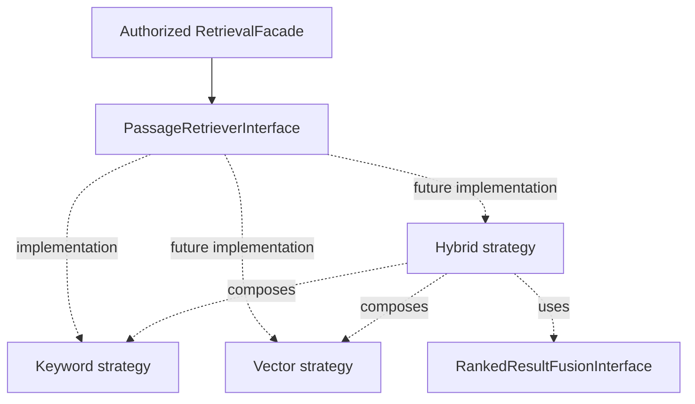
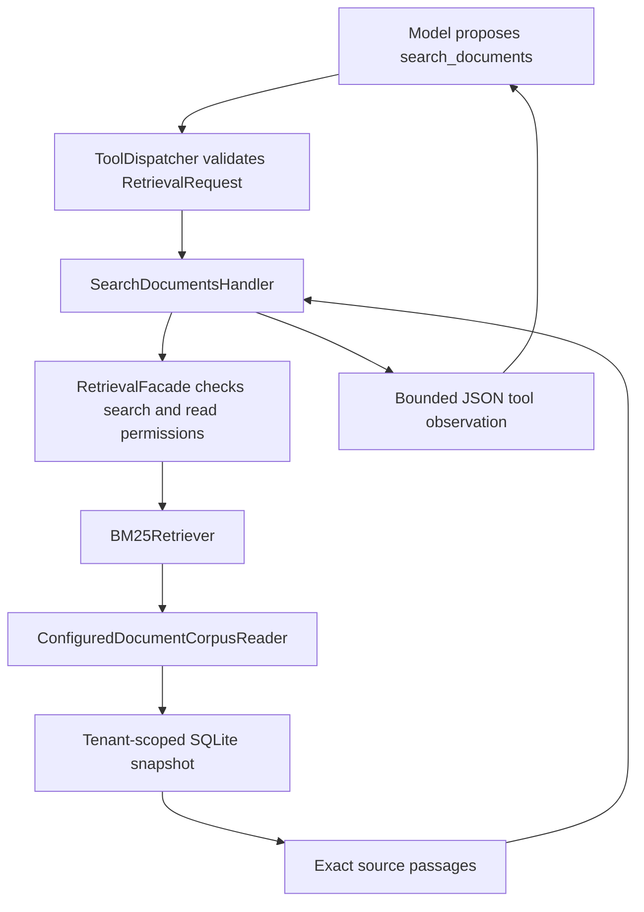
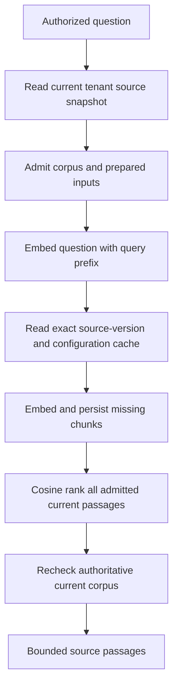

# Retrieval foundation and keyword baseline

The module provides contracts, a permission-enforcing facade, keyword-overlap and
BM25 strategies, a bounded current-tenant corpus reader, and offline evaluation.
Agent integration exposes search_documents and validates structured citation
provenance. There is no dedicated retrieval HTTP endpoint. Native Ollama embeddings and a
persistent, bounded exact-vector strategy are now available as explicit opt-ins;
BM25 remains the default. An explicit document-answer mode enforces a successful
search, structured source provenance and a separate model-based support review.
A positive review is a fallible assessment rather than proof of correctness.

```mermaid
flowchart LR
    Caller[Authenticated application caller] --> Facade[RetrievalFacade]
    Facade --> Policy[document.search and document.read checks]
    Policy --> Strategy[KeywordOverlapRetriever]
    Strategy --> Reader[Public DocumentCorpusReaderInterface]
    Reader --> SQLite[Ingestion-owned SQLite adapter]
    SQLite --> Current[Tenant-scoped latest snapshots]
    Current --> Rank[Distinct query-word overlap and stable tie ordering]
    Rank --> Result[Passages with exact document version and chunk positions]
```



## Responsibilities and boundaries

- `search_contracts.py`: query, top-k, source passage, and ordered result shapes.
- `passage_retriever.py`: replaceable strategy interface and result/capacity errors.
- `retrieval_facade.py`: shared policy enforcement, validation, top-k checks,
  and safe metadata-only lifecycle events.
- `strategies/keyword_overlap.py`: deterministic word-overlap ranking.
- `bootstrap.py`: wire the strategy/reader behind the public facade.
- Ingestion's `document_corpus_reader.py`: a narrow read boundary returning
  validated current document snapshots under trusted tenant scope.

Retrieval imports the public ingestion interface, not its adapter or tables.
The SQLite reader scopes and versions data before retrieval sees candidates.
Both search and content-read permission are required before corpus access.
The interface and Python module boundary are not an authentication mechanism or
security sandbox; callers must establish context and implementations must honor
scope. No extra grants are enabled by these changes.

## How the baseline works

Case-fold the query and each chunk; extract Unicode `\w+` terms (letters, digits,
underscores). Score a chunk by the count of distinct query terms present. Select
positive-scoring chunks, ordered by descending count, then document ID, version,
and chunk index. Return at most top-k, with the original text and source offsets.
No score is exposed as model confidence. Titles/source labels are metadata only.

For query `webhook timeout`, chunk A containing only `timeout` scores 1; chunk B
containing both terms scores 2. Repetition does not increase either score. There
is no stop-word removal, stemming, Unicode normalization beyond case folding,
accent folding, synonym expansion, phrase search, BM25 weighting, or semantic
reasoning. This is a learning baseline whose limitations should be measured.

## Admission and consistency

Defaults admit at most 20 latest documents and 8,000,000 stored snapshot bytes
per tenant scan; selected passage text is capped at 100,000 characters. Snapshot
bytes include document text, embedded chunks/overlap, and metadata. Limits are
operator-owned constructor settings. The SQLite reader computes scoped count
and byte total before decoding any snapshot. Excess fails explicitly, never
silently omitting documents. These limits make a small-corpus scan bounded;
they do not establish an indexed-search throughput guarantee.

One SQLite read transaction pins admission and returned rows to a consistent
snapshot. Historical versions are excluded even when they contain matching terms.
New queries after a committed delete see no deleted source; in-flight reads may
still reflect the earlier snapshot. No separate search index or stale index copy
exists in this baseline. Database and validation failures propagate as failures.

## Verification and next steps

Real SQLite tests verify score ordering, evidence identity, stable ties, tenant
filtering before admission/ranking, update/deletion visibility, read consistency
during a concurrent delete, admission before decoding, output limits, corruption
propagation, and rejection of a wrongly scoped custom reader. Controlled facade
tests verify permission gates and privacy of lifecycle logs. None of these tests
establish semantic relevance or enterprise search quality.

Next: evaluate this baseline with explicit queries/expected source passages,
then introduce indexed keyword search/BM25 and compare failure cases. Embeddings,
vector similarity, hybrid retrieval, reranking, and RAG generation follow as
separate learning and implementation steps.

## Reproducible offline relevance evaluation

Run `poetry run python -m crewos.retrieval.evaluate_demo` from the repository.
The runner creates disposable SQLite storage containing four synthetic integration
runbooks and executes seven explicitly labeled queries through the authorized facade.
It needs no model, Redis, credentials, network, or existing application database.
The fixture identity is synthetic; it does not implement request authentication.

The reviewable documents and labels live in `crewos/retrieval/evaluate_demo.py`.
Labels identify an exact document ID, version, and zero-based chunk index within the
evaluation tenant. Each document currently has one chunk (500 character window,
zero overlap). Changing source versions or chunking requires reviewing those labels.

- Recall@k: relevant passages returned in the first k results divided by all labeled
  relevant passages for that query.
- Reciprocal rank@k: 1 divided by the rank of the first relevant passage; zero if
  none occurs within k. MRR@k averages that value across queries.
- Mean recall gives each query equal weight, regardless of its number of labels.

With `keyword_overlap_v1` at k=1, mean recall is 0.642857 and MRR is 0.714286.
Four literal queries find their passage. Two paraphrases miss entirely. The query
`timeout credentials` finds one of two relevant sources, giving recall 0.5 but
reciprocal rank 1. These metrics answer different questions.

This is a small, hand-authored teaching fixture, not a held-out benchmark or evidence
of production retrieval quality. Unlabeled passages are treated as irrelevant;
incomplete or subjective labels affect the scores. Empty relevance sets are rejected
because recall would be undefined; no-answer behavior needs separate evaluation.
Execution failures propagate rather than being counted as empty results. Security,
latency, capacity, answer factuality, and citation support require separate checks.
Before comparing strategies, keep the corpus, labels, chunking and k fixed, and
expand the dataset with representative queries independent of ranking development.

## Abstractions for keyword, vector, and hybrid retrieval

`PassageRetrieverInterface` is the shared search Strategy contract. Keyword,
vector, and hybrid retrievers all accept a query and trusted tenant scope and
return the same evidence contract. Separate marker interfaces for each algorithm
family are unnecessary until their callers need different behavior.

`RankedResultFusionInterface` is a second Strategy contract, for combining ranked
lists. A future hybrid retriever will receive child retrievers and a fusion
implementation through dependency injection. Composition lets hybrid retrieval
itself satisfy the same search interface. No hybrid or fusion algorithm is
implemented by this abstraction-only step.



`RankedResultFusionRequest` holds the original retrieval request and one to eight
ordered child results. Each result can be empty. The fusion implementation must
honor top_k, deduplicate exact source identities, reject conflicting evidence for
one identity, and document deterministic tie-breaking. The boundary uses ranks,
not scores whose meanings differ between search algorithms.

The composing retriever is responsible for supplying the same query and trusted
tenant to every child. Fusion does not authenticate, authorize, search, or prove
that passages are current. Separate child reads are not automatically a consistent
snapshot; hybrid implementation will need an explicit version/availability policy.
Existing facade authorization remains the public entry point.

## Concrete BM25 strategy

`build_bm25_retrieval(reader=..., executor=...)` injects `BM25Retriever` into the
same authorized facade. The overlap builder remains available. There is no
automatic runtime selection, hybrid search, vector backend, or index in this step.

Each current tenant chunk is one search unit. With N chunks, df chunks containing
term t, frequency tf in the current chunk, length dl, and mean length avgdl:

```text
idf(t) = ln(1 + (N - df(t) + 0.5) / (df(t) + 0.5))
score = sum over distinct matching query terms of:
        idf(t) * tf * (k1 + 1) / (tf + k1 * (1 - b + b * dl / avgdl))
```

Defaults are k1=1.2 and b=0.75. k1 controls frequency saturation; b controls
length normalization (zero disables it). Configuration accepts finite
0 < k1 <= 100 and 0 <= b <= 1; the k1 upper bound is an application guardrail.
The positive IDF form is documented in
[Apache Lucene's BM25Similarity](https://lucene.apache.org/core/9_12_3/core/org/apache/lucene/search/similarities/BM25Similarity.html).
This implementation does not promise identical Lucene or SQLite FTS5 scores.

Tokenization remains Unicode word matching after case folding, with no stemming,
stopword removal, phrase handling, or synonym expansion. Query repetitions are
ignored. Chunk statistics include all current tenant chunks, including zero-word
chunks; an empty or all-zero-word corpus returns no hits. Overlapping chunks count
separately, so changing chunking changes statistics and rankings. Titles are not
searched. Positive scores rank highest; exact ties use document ID, version, then
chunk index. Scores are internal ordering signals, not correctness probabilities.

The bounded snapshot read and output character caps match the overlap strategy.
Statistics are rebuilt in memory on each request, suitable only for the admitted
small corpus. Security and storage failures propagate. No benchmark improvement
is claimed; the fixed-data comparison below reports the observed results.

## Comparing concrete keyword strategies

Run `poetry run python -m crewos.retrieval.evaluate_demo --compare`, optionally with
`--top-k 2`. Without `--compare`, the original overlap baseline remains the default.
Both runs seed identical disposable corpora with fixed document IDs, text, versions,
chunking, query labels and cutoff. Reports include actual ordered document IDs and
expected fixture document numbers so results can be inspected beyond aggregates.
Errors are propagated; no backend fallback is performed by the evaluation runner.

At k=1, both strategies score mean recall 0.642857 and MRR 0.714286 on the seven
queries. This dataset cannot demonstrate that BM25 improves retrieval quality.
Its literal matches are straightforward and its paraphrase misses require more
than changing keyword ranking. At k=2, both retrieve both expected passages for
`timeout credentials`. Cutoff changes and algorithm changes must be compared
separately. Focused BM25 tests cover rarity, length and frequency behavior; these
are correctness checks, not independent evidence of real-world relevance gains.
Representative, independently labeled queries remain necessary for that claim.

## Agent tool integration



`core/tool_setup.py` registers the tool for the existing agent setup used by CLI
and worker execution. A facade can be injected for alternate composition/testing.
`core/retrieval_setup.py` supplies a lazy configured corpus reader, ensuring no
SQLite initialization or lookup before authorization. The application handler
translates the tool invocation to the public retrieval API and admits at most
32,000 serialized UTF-8 result bytes. Default retrieval allows 8,000 passage text
characters; other corpus limits remain unchanged. It does not truncate evidence.

Identity comes from authenticated CLI/API execution or the worker's current
server-assigned context, never the model arguments. Both document.search and
document.read are required; task-status permission is separate. Registration
does not grant access. Search is marked replay-safe because it has no document
mutation, not because results are immutable across retry attempts.

Tool text remains untrusted. Model instructions are one layer, not a security
boundary for authorization or a complete prompt-injection defense. Existing durable
checkpoints store tool observations and therefore may contain retrieved text.
Grounded generation, citation validation, and answer evaluation remain separate
work; scripted integration tests establish observation delivery and access control.

## Citation provenance in the agent lifecycle

`SourceReference` identifies document ID, version and chunk index. Optional
`FinalAnswerDecision.citations` are bounded and distinct. Only successful backend
`search_documents` results extend the run's observed-source set; model arguments,
caller-supplied tool history, and prose do not. The set is persisted with the
existing history checkpoint. Before accepting a final answer, the loop checks
that every structured citation belongs to that set. Resume of a final-answer
checkpoint applies the same check without invoking a model again.

The check fails closed on an unobserved identity. It does not attempt semantic
claim support, require citations, parse prose references, refresh document access,
or prevent prompt injection. A cited passage can still be irrelevant or wrong.
Empty citations preserve non-document tasks and existing result compatibility,
although serialized final results now include `citations: []`. Current CLI output
prints any references; background results retain them as structured data.

## Explicit document-answer contracts

`application/dtos/document_answer.py` defines a discriminated union: the `outcome`
field selects which shape is valid. `DocumentAnswerOutcome` enumerates the two
values. This is separate from general-purpose `FinalAnswerDecision`.

- `answered`: nonblank answer text and 1–20 distinct structured source references.
- `insufficient_evidence`: a nonblank explanation, with no answer or citations fields.

Zero search hits can motivate insufficient evidence, but nonempty search hits may
also be irrelevant, incomplete, outdated, or contradictory. The shape does not
judge any of those conditions. Authorization denials, storage failures, capacity
limits, and timeouts remain operational exceptions, not insufficient-evidence
outcomes. The explanation is a model proposal; its content is not validated by
Pydantic. An answered proposal still needs provenance and semantic support checks.

These contracts are integrated through the explicit document mode described below.
General mode remains separate. The application fixes the mode from the configured
CLI/API input and preserves it in the backend-created job and checkpoints. Model
output cannot switch to a general final answer during a document-mode run.

## Explicit document-mode execution

`AgentAnswerMode` selects `general` (default) or `document` at composition. API
submission copies that validated choice into the backend-created `AgentRunJob`.
`JsonDecisionAdapter` and `AgentLoop` use the same mode-specific decision union:

- General: `ToolCallDecision | FinalAnswerDecision`.
- Document: `ToolCallDecision | DocumentFinalAnswerDecision`, whose `result` is
  the discriminated `DocumentAnswer` contract.

The document loop accepts a final outcome only after successful backend search,
including a valid empty result. Answered outcomes must cite observed passages;
insufficient-evidence explanations may follow empty or nonempty results. Ordinary
final_answer proposals do not satisfy the document schema and can consume the
existing bounded malformed-decision recovery allowance. Backend workflow/provenance
failures fail the run; they are not automatically rewritten as abstentions.

Checkpoints persist answer_mode and document_search_completed along with observed
sources and history. A conflicting mode on recovery is rejected. The worker
validates a checkpointed final result using the job's mode and repeats workflow
checks before finalization. Exact job payload matching prevents delivery-side mode
changes. Default general mode is omitted by the job serializer, preserving legacy
payload matching; explicit document mode is stored and compared for idempotency.
CLI rendering and background serialization preserve the two answer outcomes.

This is a workflow gate, not semantic validation. A model may choose inadequate
queries, cite irrelevant observed passages, or produce an insufficient-evidence
explanation with unsupported content. Claim support, retrieval coverage, ambiguity,
and abstention quality need separate evaluation. Current source availability and
grants are not refreshed at finalization; references identify observed evidence.


## Document-answer semantic review

Explicit document mode now includes a separate, replaceable evidence reviewer
before final acceptance. Earlier provenance/workflow rules remain necessary but
are not sufficient alone. The reviewer assesses claim support, citation coverage,
question relevance, conflicts and abstention; deterministic validation checks the
verdict and exact quoted evidence. Recovery requires a review receipt bound to
the question, answer and observed passage snapshots. General mode is unchanged.
See [the complete workflow and calibration guide](../evaluation/document-answer-evaluation.md)
for acceptance criteria, budgets, tests, live commands and model-judge limitations.

## Embedding boundary (contracts only)

`embedding_contracts.py` defines immutable `TextEmbeddingRequest` and
`EmbeddingBatch`; `text_embedding.py` defines `TextEmbeddingInterface`. The Ollama
provider adapter is described below. Embedding storage, vector search and retrieval
runtime wiring are not implemented yet.
Existing keyword/BM25 behavior is unchanged.

Requests preserve exact text and admit 1–128 nonblank inputs, at most 8,192
characters each and 65,536 characters total. These are application admission
limits, not token guarantees; adapters must also enforce provider limits. Results
contain model identity/revision, 1–16,384 dimensions and ordered finite numeric
vectors. Booleans and numeric strings are rejected. Adapters and callers must
use `validate_for(request)` to check output count. Shape validation cannot prove
that a provider preserved ordering or generated meaningful representations.

Corpus and query embeddings must share compatible configuration, including model
revision, preprocessing, task modes and normalization; equal dimensions do not
prove compatibility. A later storage contract must preserve this configuration.
Authorization must happen before sending source text to a provider. No permission
grants, network calls, provider credentials or logging of text/vectors are added.

## Native Ollama embedding adapter

`third_party/llm/ollama_embedding_adapter.py` implements the embedding protocol
without inheriting from it. `core/embedding_setup.py` composes it only when called
explicitly; existing agent search remains BM25. No new dependency is required.

Configure `EMBEDDING_BASE_URL` as a native HTTP(S) origin, without `/v1`, credentials,
query parameters or a path. Set `EMBEDDING_MODEL` to the exact installed model tag,
`EMBEDDING_MODEL_REVISION` to its inspected digest and `EMBEDDING_DIMENSIONS` to its
verified output length. No chat model is substituted and no model is downloaded.
Revision is operator-configured and now checked against the server's `/api/tags`
metadata before and after every inference call. A mismatch fails explicitly. This
does not prevent mutable tags changing; keep model deployments controlled. Equal
names or dimensions alone do not prove compatibility.

The adapter posts ordered texts to `/api/embed` with `truncate=false`, so an input
that exceeds the model context should fail rather than silently lose content. It
checks the returned model label, finite vectors, configured dimensions and output
count. It does not request reduced dimensions or add task-specific prefixes. Model
selection must account for any required query/document formatting.

HTTP/transport errors and invalid results raise `EmbeddingProviderError`; there is
no automatic retry, fallback or empty-result substitution. Error messages omit
provider bodies, source text and vectors. Responses are admitted up to 32 MB by
default. Redirects and environment proxies are disabled to avoid silently forwarding
text elsewhere. Timeout is a per-socket operation bound, not a total request deadline;
a slow streaming response or DNS resolution can exceed it. Runtime deadline and usage
budget integration remain future work before this adapter is exposed as an agent tool.
Remote authentication and proxy support are not implemented.

Tests use controlled responses, requiring no model or credentials. Inspection of
local Ollama on 2026-11-05 found only completion models, so no live embedding-quality
or model inference claim is made. A dedicated embedding model is needed for the
next live check. Native API reference: https://docs.ollama.com/api/embed.

## Explicit live embedding smoke command

`poetry run python -m crewos.retrieval.embedding_demo --help` describes an opt-in
smoke runner. It sends two fixed synthetic integration examples, one with a nomic
`search_document:` prefix and one with `search_query:`. These prefixes are model-
specific and are not automatically applied by the generic provider adapter.

1. Install the dedicated model with `ollama pull nomic-embed-text:v1.5`.
2. Inspect `curl http://localhost:11434/api/tags` for the exact installed tag and digest.
3. Inspect model information using `/api/show` to establish the expected dimensions.
4. Run the command below, substituting the inspected values:

```bash
poetry run python -m crewos.retrieval.embedding_demo \
  --model nomic-embed-text:v1.5 \
  --revision INSTALLED_MODEL_DIGEST \
  --dimensions VERIFIED_DIMENSIONS
```

The runner prints a JSON summary with counts, dimensions, configured revision and
actual elapsed time, without printing vectors. It requires finite nonzero norms
and one vector per input. The native adapter now checks the server-reported digest
before and after inference. The runner does not measure semantic relevance, modify
`.env.local`, store vectors, change retrieval or authenticate a real tenant.
Failures return exit code 1. Tests use controlled providers and do not download models.

On 2026-11-05 the installation attempt failed because the Ollama registry connection
was refused. At that point no dedicated embedding model was installed and no successful live
inference report was produced. The subsequent successful check is recorded below.
Model reference: https://ollama.com/library/nomic-embed-text.

## Successful live inference

A subsequent local inspection on 2026-11-05 found `nomic-embed-text:v1.5` installed
with digest `0a109f422b47e3a30ba2b10eca18548e944e8a23073ee3f3e947efcf3c45e59f`,
embedding capability and 768 output dimensions. The real adapter smoke command
returned two finite nonzero 768-dimensional vectors in 1.153174 seconds. See
[the actual JSON report](../evaluation/reports/2026-11-05-embedding-smoke.json).
In that historical run the digest was inspected separately via `/api/tags`; automatic
adapter verification was added later, as described below. This is one inference smoke check, not a latency benchmark or relevance
evaluation. It does not exercise tenant authentication, indexing or vector retrieval.

## Vector comparison

`vector_similarity.py` defines `VectorSimilarityInterface` and
`strategies/cosine_similarity.py` provides `CosineSimilarity`. The strategy measures
vector direction: identical direction scores 1, perpendicular direction 0 and opposite
direction -1. Negative scores do not prove semantic contradiction, and no score is
an answer-correctness probability. Callers must enforce compatible embedding spaces
and tenant scope before comparing vectors.

Coordinates are validated as finite numeric values, excluding booleans and strings.
Empty/zero vectors, dimensions above 16,384 and mismatched lengths fail explicitly.
Normalization scales coordinates before computing vector length to avoid overflow
or underflow for extreme finite values. Tests cover known angles, magnitude
invariance, symmetry, extremes and rejection cases. This step does not store vectors
or change BM25 search; vector persistence and tenant-scoped retrieval remain next.

## Embedding persistence boundary (contracts only)

`embedding_storage_contracts.py` defines three internal backend-owned shapes:

- `EmbeddingSpace`: provider/model/revision, dimensions, preprocessing revision,
  exact document/query prefixes and normalization configuration. Its SHA-256 key
  namespaces derived records by canonical configuration. Changing these settings
  creates a different namespace; equal dimensions alone do not establish compatibility.
- `StoredChunkEmbedding`: trusted tenant scope, exact versioned `RetrievedPassage`,
  configuration and finite nonzero vector with matching dimensions. Source text and
  metadata are duplicated as derived evidence; the source catalog remains authoritative.
- `ChunkEmbeddingWriteBatch`: 1–128 unique records from one tenant, with at most
  100,000 source text characters. This is a write unit, not a whole-document size limit.

`chunk_embedding_store.py` defines `ChunkEmbeddingStoreInterface`: atomic batch
put, exact tenant/document/version/configuration read with explicit admission limits,
and idempotent tenant-scoped deletion. Identical writes are replay-safe; changed
content under an immutable key must conflict. Missing reads differ from corruption
or infrastructure errors. Read adapters must admit count and serialized snapshot
bytes before loading content and must never silently truncate results.

These contracts do not prove authorization, vector-to-text correspondence, actual
provider configuration or source availability. The configuration key is not a secret.
Future authorized orchestration must build records from trusted source snapshots
and validated provider batches. Retrieval must check current source identity and
coverage before ranking; incomplete or stale derived data must not be presented as
a complete current index. Automatic source-deletion propagation and index publication
require lifecycle coordination beyond this interface. Explicit cache deletion now
retains a durable write fence, as described below. No database adapter, vector writes, vector search
or automatic ingestion wiring is implemented in this step.

## SQLite embedding persistence

`adapters/sqlite_chunk_embedding_store.py` implements the storage interface using
a dedicated file with application/schema identifiers and private file permissions.
It revalidates writes, uses transactional replay/conflict handling and validates
snapshots against indexed identities on reads. Reads admit scoped record counts
and actual serialized UTF-8 bytes before decoding. Deletion is tenant-scoped and
idempotent. Writes above 32 MB fail explicitly. This is single-host persistence,
not an approximate-nearest-neighbor index or a multi-host database.

## Bounded chunk embedding and cache reuse

`DocumentEmbeddingIndexer` prepares document-prefixed inputs without altering source
passages, batches at 128 inputs/65,536 characters and stores validated vectors.
It verifies provider model/revision/dimensions against `EmbeddingSpace`, and validates
cached records against the exact current source passage. Only missing chunks are
embedded; prior successful batches can be reused after a later batch fails. This
is read-through cache preparation, not atomic publication of a complete index.

`identity_v1` preprocessing and provider normalization are currently implemented;
other declared configurations fail explicitly. Input limits include prefixes and
oversized chunks fail rather than truncate. A per-search UTF-8 byte budget bounds
embedding work. Active agent execution reserves those bytes conservatively as input
tokens and checks cancellation/deadlines between calls; native HTTP timeouts are
clamped to the remaining tool budget. This is conservative admission, not measured
token usage. Priced agent runs fail before embedding calls until separate embedding
price accounting exists; chat-model rates must not silently price embedding work.
Operational events contain tenant/counts, not text, queries, vectors or credentials.

## Opt-in exact vector retrieval

`VectorRetriever` implements `PassageRetrieverInterface` and is composed through
`build_vector_retrieval`. The existing `RetrievalFacade` still requires both
`document.search` and `document.read` before source/cache/provider access. Agent
`search_documents` can use vector retrieval without changing its argument or result
contracts. Core setup is lazy so denied requests cannot initialize the embedding DB.

Flow:



The strategy scans at most 20 current documents, 8 MB of source snapshots and 512
chunks by default. It admits 262,144 UTF-8 bytes of prepared query plus corpus text
even when some vectors are cached. Stored vector snapshots are bounded at 32 MB
per search. Cache writes may survive a later failed search and can be reused.
Full source coverage is required; missing vectors are generated rather than silently
omitted. Oversized chunks, admission failures, model failures and inconsistent
cache records fail explicitly, with no automatic BM25 fallback. No source text or
vectors appear in operational events.

Results are ordered by descending cosine, then document ID, version and chunk index.
All scores are eligible; there is no calibrated relevance cutoff, so unrelated
queries can still return nearest passages. Review/abstention and representative
evaluation remain necessary. This is exact in-memory ranking over a persistent
SQLite vector cache, not ANN indexing, indexed full-text search, hybrid fusion or
reranking. Search may perform embedding/cache work and cold requests cost more.

Only latest source versions participate. Deleted sources are excluded even if stale
vector rows remain. A second bounded source read detects changes during inference
and fails the search instead of returning the old corpus. As with other snapshot
reads, a deletion immediately after the final check cannot revoke already-returned
data. Explicit cache deletion uses `delete_document` and now fences future writes.
Automatic source-deletion propagation and retention are not yet implemented. The source and cache files
do not share a distributed transaction.

### Configuration

Use the native Ollama origin, not `/v1`. For the verified local Nomic model:

```dotenv
RETRIEVAL_STRATEGY=vector
EMBEDDING_BASE_URL=http://localhost:11434
EMBEDDING_MODEL=nomic-embed-text:v1.5
EMBEDDING_MODEL_REVISION=0a109f422b47e3a30ba2b10eca18548e944e8a23073ee3f3e947efcf3c45e59f
EMBEDDING_DIMENSIONS=768
EMBEDDING_DOCUMENT_PREFIX="search_document: "
EMBEDDING_QUERY_PREFIX="search_query: "
EMBEDDING_DB_PATH=var/embeddings.sqlite3
```

Inspect your own installed digest before configuring it. The native adapter requires
a full 64-character lowercase digest and verifies server metadata before and after
every embedding call. Keep model tags/artifacts stable; rebuild vectors under a new
revision/configuration when they change.
API/agent workers must share the configured single-host embedding file. Restart
processes after configuration changes. No private `.env.local` is edited automatically.
Active priced agent runs reject embedding calls pending separate embedding price
accounting; unpriced runs reserve conservative UTF-8 input bytes as token admission.
Per-socket HTTP timeouts are clamped to remaining tool time; total DNS/stream timing
is not a hard transport deadline, and cancellation is checked between blocking steps.

### Reproducible live development demonstration

```bash
poetry run python -m crewos.retrieval.vector_demo \
  --model nomic-embed-text:v1.5 \
  --revision YOUR_INSTALLED_DIGEST \
  --dimensions 768
```

This uses disposable SQLite source/vector files, three synthetic documents and
three development questions, with explicit Nomic prefixes. It compares actual
BM25/vector top results and checks warm-cache reuse. It uses trusted synthetic
context, not request authentication, Redis, Celery or generated answers.
The runner exits 1 if an expected top result is missed; this tiny hand-authored
fixture is not independent or representative evaluation.

The recorded local run returned the expected top passage for all three cases.
BM25 found the expected top passage for two cases and no passage for the credentials
paraphrase. Cold execution made six provider calls; the repeated three queries made
three query-only calls, confirming chunk cache reuse. Actual elapsed time was
0.571633 seconds; this is one observed run, not a benchmark. See
[the live development report](../evaluation/reports/2026-11-05-vector-retrieval-demo.json).

## Automatic server-reported model revision verification

`ollama_model_revision.py` validates bounded model-list metadata and requires one
exact installed tag with the expected full lowercase SHA-256 package digest.
Missing, duplicate, malformed or mismatched metadata fails closed. The adapter
uses the same bounded, no-redirect HTTP client for this sequence:

```text
GET /api/tags → verify configured digest
POST /api/embed → validate vectors
GET /api/tags → verify digest again → return batch
```

Initial verification failure prevents sending text to the embedding endpoint.
Failure after inference discards the vectors before the indexer can persist them.
No automatic retry, tag alias guessing, revision update or cache overwrite occurs.
Metadata responses are limited to 1 MB; inference retains its configured response
limit. Each HTTP request checks the active deadline and recomputes its socket
timeout. Construction remains network-free, preserving authorization before IO.
Successful inference makes two additional metadata requests.

This verifies what the configured server reports, not cryptographic attestation or
an atomic link between a digest and inference. A tag that changes and changes back
between checks can escape detection. Load-balanced servers must serve consistent
model artifacts. Immutable deployment/controlled updates remain necessary for
stronger guarantees. Matching digests do not prove relevance or authorize text
access. Existing cache rows are not retroactively verified; rebuild any vectors
whose original model identity is uncertain. Generic embedding contracts and the
SQLite schema remain unchanged.

Historical reports are preserved. New local checks on 2026-11-05 are recorded in
[the verified embedding smoke report](../evaluation/reports/2026-11-05-verified-embedding-smoke.json),
[the verified vector demo](../evaluation/reports/2026-11-05-verified-vector-demo.json), and
[the intentional mismatch probe](../evaluation/reports/2026-11-05-revision-mismatch.json).
The negative probe recorded actual adapter HTTP calls with an intentionally wrong
expected digest: only GET `/api/tags` was sent, with no embedding POST. The small
positive demos establish execution, not representative quality or performance.
API reference: https://docs.ollama.com/api/tags.

## Durable cache-deletion fences

`SQLiteChunkEmbeddingStore` schema version 2 adds a minimal deletion-marker table
keyed by tenant/document. `delete_document` atomically records the marker and removes
all live vector rows for that key. Even deletion of a missing document records the
marker, covering a writer that has not yet inserted its first batch. Repeating the
operation is safe. `put` checks markers inside its write transaction and raises
`EmbeddingWriteFenced` before committing a batch containing a deleted key.

This protects against a stale indexer finishing inference after cleanup: whether
the writer or deleter obtains the SQLite write transaction first, committed deletion
leaves no vectors and subsequent writes are fenced. A blocked record rolls back
the entire batch. Markers survive restart and cover every source version and
embedding space, while other tenants remain independent. Schema-1 databases migrate
transactionally on open and preserve existing vectors.

A deletion marker is a tombstone: a retained record of deletion without source text
or vector payload. It retains tenant/document identifiers and must not be removed
while stale writers can still exist. This operation is permanent for that document
ID, not a cache reset or re-embedding command. Restore content using a new document
identity; future cache invalidation needs a distinct operation. SQL deletion does
not promise secure erasure from WAL files or backups.

Source deletion now durably records an outbox event, as described below. A tenant-scoped polling worker is now implemented; it must be configured and
running for automatic vector cleanup. Source
authorization/current-version checks remain necessary. Obsolete-version cleanup is
also a separate lifecycle step.

## Source-deletion cleanup outbox contracts

Ingestion owns `document_cleanup_contracts.py` and
`document_cleanup_outbox.py`. `DocumentDeletedEvent` is an immutable backend-owned
fact containing schema/type, event ID, tenant/document IDs and an aware occurrence
time. No source text, vectors, credentials or permission claims are included.
`DocumentCleanupClaim` adds a worker lease token, attempt and expiry; it represents
delivery ownership, not application authorization. Failure metadata uses a small
`CleanupFailureCode` enum rather than raw exception strings.

`DocumentCleanupOutboxInterface` defines tenant-scoped claim/reclaim, completion
and retry operations. Its eventual adapter must atomically lease eligible events,
reclaim expired leases with fresh tokens and reject stale acknowledgements. The
initial consumer is vector cleanup; multiple future consumers need independent
delivery records. Worker crashes recover through lease expiry; retry scheduling
must not silently discard cleanup work.

There is intentionally no independent append operation. Source deletion now records
the event in its own transaction. A future worker can call the vector store's
idempotent fenced deletion and acknowledge the event. A crash after vector cleanup
but before acknowledgement can then replay safely. Claim/complete/retry persistence is now implemented in the source adapter.
Worker execution is implemented below; propagation requires starting the configured
poller.

## Transactional deletion-event recording

Source database schema version 3 adds `document_cleanup_outbox`. Existing schema-1
and schema-2 databases migrate transactionally on open, preserving snapshots and
existing job records. There is no backfill for deletions predating this migration:
the deleted identities are not recoverable from absent snapshots. Restart all source
writers with the new code; older processes do not record these events.

A successful `SQLiteDocumentStore.delete` now commits these changes together:

1. Delete every source version in the requested tenant/document scope.
2. Fence pending document jobs and remove their retained source payloads.
3. Insert one backend-generated `DocumentDeletedEvent` with pending delivery state.

The outbox helper shares the existing source transaction and refuses independent
nontransactional recording. Failed/missing/other-tenant deletions produce no event.
Concurrent deletions have one successful commit and one event. Failure at any point
rolls back source removal, job changes and event insertion together. Process-termination
tests demonstrate both pre-commit rollback and post-commit durability on reopen.

The event contains IDs and time, not source content or vectors. The outbox also
persists delivery state for the claim/complete/retry operations described below. Deletion API success means **source
deleted and cleanup intent saved**, not **vector cache already cleaned**. Current
source checks still exclude deleted content from searches.

Deleted tenant/document identities cannot be reused: a delayed cleanup event must
not delete embeddings for new content with the same ID. Restoration requires a new
document ID. The retained outbox row currently supplies this source identity fence;
do not purge it without preserving an equivalent durable deletion marker. Existing
vector-cache tombstones use the same permanent-document-deletion assumption.

This transaction covers only the source SQLite database. It does not atomically
update the vector database or publish a Celery message. Durable claiming/retries and worker execution are implemented below.

## Durable cleanup delivery operations

`SQLiteDocumentStore` now implements `DocumentCleanupOutboxInterface` through its
cleanup outbox adapter. No additional schema migration is needed beyond source
schema 3. Each operation uses its own serialized SQLite write transaction:

- `claim_next`: choose the oldest eligible event within the supplied tenant, with
  event ID as the tie breaker; increment attempts and issue a fresh UUID lease token.
  Unexpired claims and future retry times are skipped. Expired claims are reclaimed.
- `complete`: require the current unexpired token, then persist completed state.
  Repeating completion with the same final token is a no-op; other tokens fail.
- `retry`: require current ownership, clear the lease, retain the event and schedule
  its next eligible time. Store a known failure code instead of a raw exception.

Missing, other-tenant, expired and replaced ownership raises `CleanupLeaseLost`.
Malformed event payloads, indexed identity mismatches and invalid delivery metadata
raise `CleanupOutboxCorruption` rather than silently completing or dropping work.
Event decoding is capped at 16 KiB. Attempt-counter exhaustion fails explicitly and
retains the event. Corruption or repeated failures still need worker alerts and
operator intervention; these operations do not implement automatic remediation.

Leases accept finite durations in (0, 300] seconds and retries in [0, 86400] seconds.
Eligibility uses the source host wall clock; operational clock stability matters.
Workers must treat a claim as temporary ownership, perform idempotent target
cleanup, and acknowledge only after success. A crash after target cleanup but
before acknowledgement causes replay after lease expiry. This is at-least-once
delivery, not exactly-once execution or a cross-database transaction.

Completion retains the event/identity marker, preserving the ban on source ID reuse.
Lifecycle logs contain tenant/event IDs, attempts and safe failure codes, without
source text, payloads or lease tokens. Tests cover concurrent claims, stable order,
restart recovery, stale acknowledgements, tenant scope, retry timing, corruption,
invalid inputs, rollback and logging privacy. The polling worker and runtime configuration described below are now available;
they must be enabled and running before vector cleanup happens automatically.

## Tenant-scoped cleanup polling worker

`application/use_cases/process_document_cleanup.py` claims one source-deletion event,
revalidates its tenant identity, lazily opens the target vector store, performs its
idempotent fenced deletion, then acknowledges completion. Safe outcomes are `idle`,
`completed`, `retry_scheduled` and `lease_lost`. Target failures schedule bounded
exponential retries using known error codes; failures at/above the configured attempt
threshold emit warnings. Raw exception bodies, payloads and lease tokens are omitted.

Acknowledgement or retry-persistence failures propagate without false completion.
A process crash after target deletion but before acknowledgement leaves the lease
recoverable; replay safely repeats deletion. Ownership loss cannot complete or
reschedule another worker's claim. There is no heartbeat during this short operation;
slow work can lose its lease and replay. Cleanup remains at-least-once.

`core/document_cleanup_setup.py` checks an explicit server-configured tenant
allowlist before opening any database and again before each new claim. This is
an internal service scope, not request authentication or a permission supplied by
an agent. It intentionally does not require the original API token to remain active:
authorized deletion cleanup must continue after user credentials are revoked.
Trusted source events and correct deployment/filesystem access are prerequisites.

`workers/document_cleanup_worker.py` polls the durable outbox directly rather than
requiring a Celery notification. Redis, Ollama and model credentials are unnecessary.
Each pass handles at most `DOCUMENT_CLEANUP_BATCH_SIZE` events (default 20), stopping
on idle. Continuous mode waits between passes, handles transient poll failures and
exits if service scope is revoked. Events remain durable while the process is down.

Configure the same source/vector file paths used by API and agent processes, plus
an explicit tenant allowlist (empty by default):

```dotenv
DOCUMENT_CLEANUP_TENANTS=["tenant_a"]
DOCUMENT_CLEANUP_LEASE_SECONDS=30
DOCUMENT_CLEANUP_RETRY_BASE_SECONDS=10
DOCUMENT_CLEANUP_RETRY_MAX_SECONDS=300
DOCUMENT_CLEANUP_POLL_SECONDS=2
DOCUMENT_CLEANUP_BATCH_SIZE=20
DOCUMENT_CLEANUP_ALERT_AFTER_ATTEMPTS=5
```

Run one bounded pass:

```bash
poetry run python -m crewos.workers.document_cleanup_worker --tenant-id tenant_a --once
```

Run continuously by omitting `--once`. Use process supervision in deployment; no
background daemon or deployment workload is started automatically. An optional
Compose cleanup profile provides a supervised tenant_a service.
`--once` exits 1 for scheduled retries or failures, and 0 for idle/completed or
lease-loss outcomes. It does not wait for future retry times or imply that every
retained outbox record is complete. Logs and the final summary contain safe counts.
Repeated-failure warning logs still require external monitoring/alert routing.

Integration tests run a real CLI subprocess against disposable SQLite databases,
verify source-to-vector cleanup, and exercise a real process crash before ack.
They do not establish deployment-scale latency, backup erasure or continuous
production operation. Embedding pricing remains separate.

## Durable obsolete-version retention (storage boundary)

`ChunkEmbeddingStoreInterface.retain_from_version` accepts a trusted tenant/document
and minimum source version. The SQLite adapter atomically advances a durable version
floor and deletes lower-version vectors across all embedding spaces. For example,
a floor of 3 removes versions 1–2, retains versions 3 onward and rejects later writes
for 1–2 with `EmbeddingWriteFenced`. A read below the floor returns no cached vectors.
This is a **source document version**, not an embedding-model revision or digest.

Floors only increase: duplicate, delayed or out-of-order requests cannot roll them
back. An old indexing task cannot resurrect retired vectors, regardless of whether
it obtains the SQLite write lock before or after cleanup. A blocked record rolls
back its entire write batch. Failed deletion rolls back the floor change as well.
Other tenants/documents are untouched; permanent document deletion remains stronger
and cannot be undone by retention. Missing documents can receive a floor before a
late writer arrives. Metadata-only logs record retained floor and removed count.

The **vector database** now uses schema version 3, migrating schemas 1 and 2 on open
while preserving vectors and permanent-deletion markers. This is independent of
the source database's schema version. Corrupt floors fail explicitly. Floor markers
must survive while old writers can retry; they contain IDs/version metadata only.

This operation is internal maintenance, not a public agent tool or permission grant.
Its caller must obtain the version from authoritative source state. It does not
generate new embeddings, delete historical source snapshots or establish that a
particular version is current. Source version commits now record transactional
`document.version_created` events; the same cleanup poller delivers them to this
operation. Current-source checks remain the search correctness boundary.

## Transactional source-version propagation

Source schema 4 extends the cleanup outbox with discriminated deletion/version
events. Each version above 1 records one content-free event in its source commit,
including `commit_job`. Failure rolls back both. Events carry the tenant, document
ID and committed source version; callers cannot supply a replacement version at
cleanup time. The worker dispatches deletion to `delete_document` and version events
to `retain_from_version`. Both use the same lease, retry and acknowledgment rules.

Migration preserves deletion event identities, states and claim tokens, and queues
one latest-version event per existing source above version 1. Migration is atomic
and reopening schema 4 does not duplicate backfill. Restart source writers together;
old-version binaries are not supported against the migrated schema. A source update
can commit before vectors exist; the floor still fences obsolete indexing writes.
This does not embed current chunks or purge historical source snapshots. Polling
must be enabled and running; completed events are retained as durable receipts.

## Live vector lifecycle evidence

The [vector lifecycle verifier](../evaluation/vector-lifecycle-verification.md)
combines the real Ollama provider, authorized ingestion/retrieval facades, SQLite
stores and bounded cleanup CLI subprocesses. It records cold and reopened-cache
searches, source-update cleanup, current-version indexing, permission/tenant checks,
and deletion fences. Temporary paths isolate it from application tenant data.
Successful checks and measured latency/workload are available in the linked report;
monetary cost is not inferred from byte counts. Representative relevance and load
evaluation remain separate work.

## Reciprocal Rank Fusion strategy

`strategies/reciprocal_rank_fusion.py` implements the existing
`RankedResultFusionInterface` using equal-weight Reciprocal Rank Fusion (RRF).
For a passage at one-based rank `r` in a child list, add `1 / (rank_constant + r)`.
A missing passage contributes zero. The default constant is 60; configuration
accepts integers 1–10000. This constant differs from `top_k`, which limits output.
See the [original RRF paper](https://cormack.uwaterloo.ca/cormacksigir09-rrf.pdf).

For keyword results `[A, B]` and vector results `[B, C]`, B receives
`1/62 + 1/61`, A receives `1/61`, and C receives `1/62`. The fused order is
`[B, A, C]`. These scores express ranking agreement, not relevance probabilities.
The method ignores how large the original score gaps were and cannot recover
passages that neither child retrieved.

Passage identity is `(document_id, document_version, chunk.index)`. Identical hits
across lists merge; conflicting text or metadata for one identity fails the entire
operation, including conflicts outside the eventual output limit. Different
versions remain different identities; the composing retriever must ensure current
source scope. Source text and metadata are preserved exactly.

Scores use exact rational arithmetic, keeping mathematically equal sums tied
regardless of accumulation order. Ties preserve first appearance in stable child
list/rank order. Child order is therefore a deliberate tie-breaking choice.
Repeated strategy names are supported and do not deduplicate independently supplied
rankings; accidentally supplying one retriever twice would give it extra influence.
The request already bounds admission to 8 child lists of at most 20 passages each.
Logs contain counts and configuration, without query text or passage content.

The opt-in hybrid retriever below now invokes BM25 and vector search and supplies
their rankings to this strategy. No search default or agent tool configuration is
changed. Fusion itself performs no model calls or permission checks and cannot
prove that children used the same tenant or query.

## Hybrid retriever composition

`build_hybrid_retrieval` exposes a `RetrievalFacade` with the same dual permission
checks as other search strategies. It composes `HybridRetriever`, a request-local
snapshot reader, BM25, the vector retriever/indexer and `ReciprocalRankFusion`.

1. Authorize search and reading before source/cache/model activity.
2. Read and validate one bounded current tenant snapshot.
3. Create both child retrievers over that immutable view; invoke them sequentially
   with the same query and tenant. Validate each result against exact source evidence.
4. Fuse both rankings, validate output identity/text, limit and membership in child
   results, and enforce the final output character bound.
5. Reread authoritative source state and fail if the corpus changed. Return
   `hybrid_fusion_v1` only after this check succeeds.

The view is request-local, so a shared retriever does not retain another request's
source snapshots. Snapshot reads enforce child tenant scope and admission limits.
Both children search identical source versions even while the embedding model runs.
The final comparison detects updates, additions and deletion observed by that read;
it does not provide a transaction covering response delivery or revoke data already
returned. Failed searches may have populated derived cache entries; the existing
cleanup fences and source checks still govern those entries.

`candidate_k` (1–20, default 20) controls each child's list depth; `top_k` controls
final output and must not exceed candidate depth. This leaves room for a passage
below one child's first result to receive support from the other. Current contracts
cap each child at 20; larger pools need a separate contract/admission change. Default
limits remain 20 source documents, 512 chunks, 8 MB serialized source and 100,000
output characters, with existing vector byte/input admission limits. This is a
bounded exact scan, not an approximate-nearest-neighbor or BM25 index.

BM25 is first and vector second, making BM25 appearance the deterministic tie
preference under RRF. Lists have equal weight. Errors from either child fail the
search; there is no implicit partial-result fallback. Empty tenant corpora return
empty without invoking embedding inference. No extra user permissions are granted.

The public builder enables explicit composition without changing API/agent strategy
selection. Integration tests use real temporary SQLite stores with controlled
vectors to test boundaries and races, not to establish semantic relevance. Live
hybrid relevance evaluation and agent configuration wiring are still separate work.
