# Retrieval foundation and keyword baseline

The module currently provides contracts, a permission-enforcing facade, an
interchangeable search strategy, and a bounded keyword-overlap implementation.
There is no HTTP endpoint, agent tool, embedding model, vector store, or RAG
answer generation in this increment.

```mermaid
flowchart LR
    Caller[Authenticated application caller] --> Facade[RetrievalFacade]
    Facade --> Policy[document.search and document.read checks]
    Policy --> Strategy[KeywordOverlapRetriever]
    Strategy --> Reader[Public DocumentCorpusReaderInterface]
    Reader --> SQLite[Ingestion-owned SQLite adapter]
    SQLite --> Current[Tenant-scoped latest snapshots]
    Current --> Rank[Distinct query-word overlap and stable tie ordering]
    Rank --> Result[Passages with exact document version and chunk positions]
```

## Responsibilities and boundaries

- `search_contracts.py`: query, top-k, source passage, and ordered result shapes.
- `passage_retriever.py`: replaceable strategy interface and result/capacity errors.
- `retrieval_facade.py`: shared policy enforcement, validation, top-k checks,
  and safe metadata-only lifecycle events.
- `strategies/keyword_overlap.py`: deterministic word-overlap ranking.
- `bootstrap.py`: wire the strategy/reader behind the public facade.
- Ingestion's `document_corpus_reader.py`: a narrow read boundary returning
  validated current document snapshots under trusted tenant scope.

Retrieval imports the public ingestion interface, not its adapter or tables.
The SQLite reader scopes and versions data before retrieval sees candidates.
Both search and content-read permission are required before corpus access.
The interface and Python module boundary are not an authentication mechanism or
security sandbox; callers must establish context and implementations must honor
scope. No extra grants are enabled by these changes.

## How the baseline works

Case-fold the query and each chunk; extract Unicode `\w+` terms (letters, digits,
underscores). Score a chunk by the count of distinct query terms present. Select
positive-scoring chunks, ordered by descending count, then document ID, version,
and chunk index. Return at most top-k, with the original text and source offsets.
No score is exposed as model confidence. Titles/source labels are metadata only.

For query `webhook timeout`, chunk A containing only `timeout` scores 1; chunk B
containing both terms scores 2. Repetition does not increase either score. There
is no stop-word removal, stemming, Unicode normalization beyond case folding,
accent folding, synonym expansion, phrase search, BM25 weighting, or semantic
reasoning. This is a learning baseline whose limitations should be measured.

## Admission and consistency

Defaults admit at most 20 latest documents and 8,000,000 stored snapshot bytes
per tenant scan; selected passage text is capped at 100,000 characters. Snapshot
bytes include document text, embedded chunks/overlap, and metadata. Limits are
operator-owned constructor settings. The SQLite reader computes scoped count
and byte total before decoding any snapshot. Excess fails explicitly, never
silently omitting documents. These limits make a small-corpus scan bounded;
they do not establish an indexed-search throughput guarantee.

One SQLite read transaction pins admission and returned rows to a consistent
snapshot. Historical versions are excluded even when they contain matching terms.
New queries after a committed delete see no deleted source; in-flight reads may
still reflect the earlier snapshot. No separate search index or stale index copy
exists in this baseline. Database and validation failures propagate as failures.

## Verification and next steps

Real SQLite tests verify score ordering, evidence identity, stable ties, tenant
filtering before admission/ranking, update/deletion visibility, read consistency
during a concurrent delete, admission before decoding, output limits, corruption
propagation, and rejection of a wrongly scoped custom reader. Controlled facade
tests verify permission gates and privacy of lifecycle logs. None of these tests
establish semantic relevance or enterprise search quality.

Next: evaluate this baseline with explicit queries/expected source passages,
then introduce indexed keyword search/BM25 and compare failure cases. Embeddings,
vector similarity, hybrid retrieval, reranking, and RAG generation follow as
separate learning and implementation steps.

## Reproducible offline relevance evaluation

Run `poetry run python -m crewos.retrieval.evaluate_demo` from the repository.
The runner creates disposable SQLite storage containing four synthetic integration
runbooks and executes seven explicitly labeled queries through the authorized facade.
It needs no model, Redis, credentials, network, or existing application database.
The fixture identity is synthetic; it does not implement request authentication.

The reviewable documents and labels live in `crewos/retrieval/evaluate_demo.py`.
Labels identify an exact document ID, version, and zero-based chunk index within the
evaluation tenant. Each document currently has one chunk (500 character window,
zero overlap). Changing source versions or chunking requires reviewing those labels.

- Recall@k: relevant passages returned in the first k results divided by all labeled
  relevant passages for that query.
- Reciprocal rank@k: 1 divided by the rank of the first relevant passage; zero if
  none occurs within k. MRR@k averages that value across queries.
- Mean recall gives each query equal weight, regardless of its number of labels.

With `keyword_overlap_v1` at k=1, mean recall is 0.642857 and MRR is 0.714286.
Four literal queries find their passage. Two paraphrases miss entirely. The query
`timeout credentials` finds one of two relevant sources, giving recall 0.5 but
reciprocal rank 1. These metrics answer different questions.

This is a small, hand-authored teaching fixture, not a held-out benchmark or evidence
of production retrieval quality. Unlabeled passages are treated as irrelevant;
incomplete or subjective labels affect the scores. Empty relevance sets are rejected
because recall would be undefined; no-answer behavior needs separate evaluation.
Execution failures propagate rather than being counted as empty results. Security,
latency, capacity, answer factuality, and citation support require separate checks.
Before comparing strategies, keep the corpus, labels, chunking and k fixed, and
expand the dataset with representative queries independent of ranking development.
