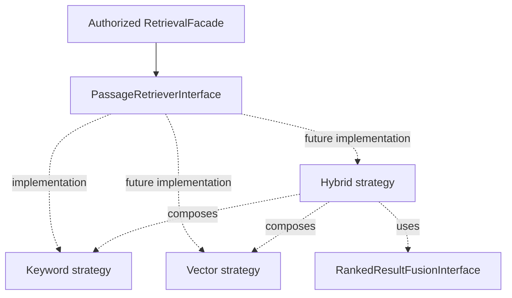
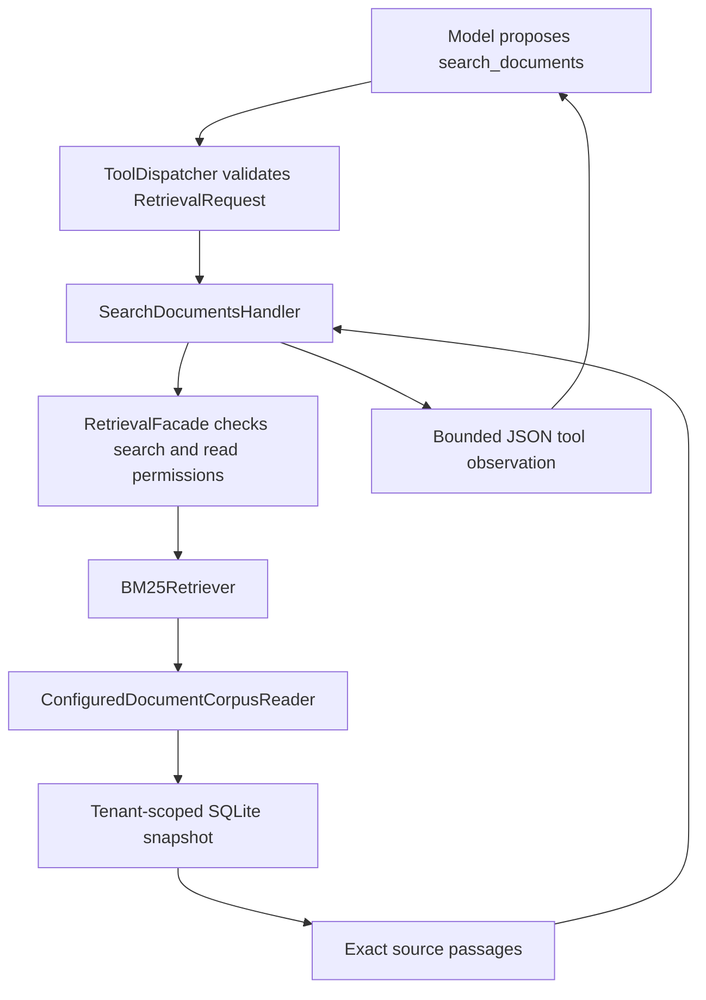

# Retrieval foundation and keyword baseline

The module provides contracts, a permission-enforcing facade, keyword-overlap and
BM25 strategies, a bounded current-tenant corpus reader, and offline evaluation.
Agent integration exposes search_documents and validates structured citation
provenance. There is no dedicated retrieval HTTP endpoint, embedding model,
vector store, or enforced evidence-based document-answer workflow yet.



```mermaid
flowchart LR
    Caller[Authenticated application caller] --> Facade[RetrievalFacade]
    Facade --> Policy[document.search and document.read checks]
    Policy --> Strategy[KeywordOverlapRetriever]
    Strategy --> Reader[Public DocumentCorpusReaderInterface]
    Reader --> SQLite[Ingestion-owned SQLite adapter]
    SQLite --> Current[Tenant-scoped latest snapshots]
    Current --> Rank[Distinct query-word overlap and stable tie ordering]
    Rank --> Result[Passages with exact document version and chunk positions]
```

## Responsibilities and boundaries

- `search_contracts.py`: query, top-k, source passage, and ordered result shapes.
- `passage_retriever.py`: replaceable strategy interface and result/capacity errors.
- `retrieval_facade.py`: shared policy enforcement, validation, top-k checks,
  and safe metadata-only lifecycle events.
- `strategies/keyword_overlap.py`: deterministic word-overlap ranking.
- `bootstrap.py`: wire the strategy/reader behind the public facade.
- Ingestion's `document_corpus_reader.py`: a narrow read boundary returning
  validated current document snapshots under trusted tenant scope.

Retrieval imports the public ingestion interface, not its adapter or tables.
The SQLite reader scopes and versions data before retrieval sees candidates.
Both search and content-read permission are required before corpus access.
The interface and Python module boundary are not an authentication mechanism or
security sandbox; callers must establish context and implementations must honor
scope. No extra grants are enabled by these changes.

## How the baseline works

Case-fold the query and each chunk; extract Unicode `\w+` terms (letters, digits,
underscores). Score a chunk by the count of distinct query terms present. Select
positive-scoring chunks, ordered by descending count, then document ID, version,
and chunk index. Return at most top-k, with the original text and source offsets.
No score is exposed as model confidence. Titles/source labels are metadata only.

For query `webhook timeout`, chunk A containing only `timeout` scores 1; chunk B
containing both terms scores 2. Repetition does not increase either score. There
is no stop-word removal, stemming, Unicode normalization beyond case folding,
accent folding, synonym expansion, phrase search, BM25 weighting, or semantic
reasoning. This is a learning baseline whose limitations should be measured.

## Admission and consistency

Defaults admit at most 20 latest documents and 8,000,000 stored snapshot bytes
per tenant scan; selected passage text is capped at 100,000 characters. Snapshot
bytes include document text, embedded chunks/overlap, and metadata. Limits are
operator-owned constructor settings. The SQLite reader computes scoped count
and byte total before decoding any snapshot. Excess fails explicitly, never
silently omitting documents. These limits make a small-corpus scan bounded;
they do not establish an indexed-search throughput guarantee.

One SQLite read transaction pins admission and returned rows to a consistent
snapshot. Historical versions are excluded even when they contain matching terms.
New queries after a committed delete see no deleted source; in-flight reads may
still reflect the earlier snapshot. No separate search index or stale index copy
exists in this baseline. Database and validation failures propagate as failures.

## Verification and next steps

Real SQLite tests verify score ordering, evidence identity, stable ties, tenant
filtering before admission/ranking, update/deletion visibility, read consistency
during a concurrent delete, admission before decoding, output limits, corruption
propagation, and rejection of a wrongly scoped custom reader. Controlled facade
tests verify permission gates and privacy of lifecycle logs. None of these tests
establish semantic relevance or enterprise search quality.

Next: evaluate this baseline with explicit queries/expected source passages,
then introduce indexed keyword search/BM25 and compare failure cases. Embeddings,
vector similarity, hybrid retrieval, reranking, and RAG generation follow as
separate learning and implementation steps.

## Reproducible offline relevance evaluation

Run `poetry run python -m crewos.retrieval.evaluate_demo` from the repository.
The runner creates disposable SQLite storage containing four synthetic integration
runbooks and executes seven explicitly labeled queries through the authorized facade.
It needs no model, Redis, credentials, network, or existing application database.
The fixture identity is synthetic; it does not implement request authentication.

The reviewable documents and labels live in `crewos/retrieval/evaluate_demo.py`.
Labels identify an exact document ID, version, and zero-based chunk index within the
evaluation tenant. Each document currently has one chunk (500 character window,
zero overlap). Changing source versions or chunking requires reviewing those labels.

- Recall@k: relevant passages returned in the first k results divided by all labeled
  relevant passages for that query.
- Reciprocal rank@k: 1 divided by the rank of the first relevant passage; zero if
  none occurs within k. MRR@k averages that value across queries.
- Mean recall gives each query equal weight, regardless of its number of labels.

With `keyword_overlap_v1` at k=1, mean recall is 0.642857 and MRR is 0.714286.
Four literal queries find their passage. Two paraphrases miss entirely. The query
`timeout credentials` finds one of two relevant sources, giving recall 0.5 but
reciprocal rank 1. These metrics answer different questions.

This is a small, hand-authored teaching fixture, not a held-out benchmark or evidence
of production retrieval quality. Unlabeled passages are treated as irrelevant;
incomplete or subjective labels affect the scores. Empty relevance sets are rejected
because recall would be undefined; no-answer behavior needs separate evaluation.
Execution failures propagate rather than being counted as empty results. Security,
latency, capacity, answer factuality, and citation support require separate checks.
Before comparing strategies, keep the corpus, labels, chunking and k fixed, and
expand the dataset with representative queries independent of ranking development.

## Abstractions for keyword, vector, and hybrid retrieval

`PassageRetrieverInterface` is the shared search Strategy contract. Keyword,
vector, and hybrid retrievers all accept a query and trusted tenant scope and
return the same evidence contract. Separate marker interfaces for each algorithm
family are unnecessary until their callers need different behavior.

`RankedResultFusionInterface` is a second Strategy contract, for combining ranked
lists. A future hybrid retriever will receive child retrievers and a fusion
implementation through dependency injection. Composition lets hybrid retrieval
itself satisfy the same search interface. No hybrid or fusion algorithm is
implemented by this abstraction-only step.



`RankedResultFusionRequest` holds the original retrieval request and one to eight
ordered child results. Each result can be empty. The fusion implementation must
honor top_k, deduplicate exact source identities, reject conflicting evidence for
one identity, and document deterministic tie-breaking. The boundary uses ranks,
not scores whose meanings differ between search algorithms.

The composing retriever is responsible for supplying the same query and trusted
tenant to every child. Fusion does not authenticate, authorize, search, or prove
that passages are current. Separate child reads are not automatically a consistent
snapshot; hybrid implementation will need an explicit version/availability policy.
Existing facade authorization remains the public entry point.

## Concrete BM25 strategy

`build_bm25_retrieval(reader=..., executor=...)` injects `BM25Retriever` into the
same authorized facade. The overlap builder remains available. There is no
automatic runtime selection, hybrid search, vector backend, or index in this step.

Each current tenant chunk is one search unit. With N chunks, df chunks containing
term t, frequency tf in the current chunk, length dl, and mean length avgdl:

```text
idf(t) = ln(1 + (N - df(t) + 0.5) / (df(t) + 0.5))
score = sum over distinct matching query terms of:
        idf(t) * tf * (k1 + 1) / (tf + k1 * (1 - b + b * dl / avgdl))
```

Defaults are k1=1.2 and b=0.75. k1 controls frequency saturation; b controls
length normalization (zero disables it). Configuration accepts finite
0 < k1 <= 100 and 0 <= b <= 1; the k1 upper bound is an application guardrail.
The positive IDF form is documented in
[Apache Lucene's BM25Similarity](https://lucene.apache.org/core/9_12_3/core/org/apache/lucene/search/similarities/BM25Similarity.html).
This implementation does not promise identical Lucene or SQLite FTS5 scores.

Tokenization remains Unicode word matching after case folding, with no stemming,
stopword removal, phrase handling, or synonym expansion. Query repetitions are
ignored. Chunk statistics include all current tenant chunks, including zero-word
chunks; an empty or all-zero-word corpus returns no hits. Overlapping chunks count
separately, so changing chunking changes statistics and rankings. Titles are not
searched. Positive scores rank highest; exact ties use document ID, version, then
chunk index. Scores are internal ordering signals, not correctness probabilities.

The bounded snapshot read and output character caps match the overlap strategy.
Statistics are rebuilt in memory on each request, suitable only for the admitted
small corpus. Security and storage failures propagate. No benchmark improvement
is claimed; the fixed-data comparison below reports the observed results.

## Comparing concrete keyword strategies

Run `poetry run python -m crewos.retrieval.evaluate_demo --compare`, optionally with
`--top-k 2`. Without `--compare`, the original overlap baseline remains the default.
Both runs seed identical disposable corpora with fixed document IDs, text, versions,
chunking, query labels and cutoff. Reports include actual ordered document IDs and
expected fixture document numbers so results can be inspected beyond aggregates.
Errors are propagated; no backend fallback is performed by the evaluation runner.

At k=1, both strategies score mean recall 0.642857 and MRR 0.714286 on the seven
queries. This dataset cannot demonstrate that BM25 improves retrieval quality.
Its literal matches are straightforward and its paraphrase misses require more
than changing keyword ranking. At k=2, both retrieve both expected passages for
`timeout credentials`. Cutoff changes and algorithm changes must be compared
separately. Focused BM25 tests cover rarity, length and frequency behavior; these
are correctness checks, not independent evidence of real-world relevance gains.
Representative, independently labeled queries remain necessary for that claim.

## Agent tool integration



`core/tool_setup.py` registers the tool for the existing agent setup used by CLI
and worker execution. A facade can be injected for alternate composition/testing.
`core/retrieval_setup.py` supplies a lazy configured corpus reader, ensuring no
SQLite initialization or lookup before authorization. The application handler
translates the tool invocation to the public retrieval API and admits at most
32,000 serialized UTF-8 result bytes. Default retrieval allows 8,000 passage text
characters; other corpus limits remain unchanged. It does not truncate evidence.

Identity comes from authenticated CLI/API execution or the worker's current
server-assigned context, never the model arguments. Both document.search and
document.read are required; task-status permission is separate. Registration
does not grant access. Search is marked replay-safe because it has no document
mutation, not because results are immutable across retry attempts.

Tool text remains untrusted. Model instructions are one layer, not a security
boundary for authorization or a complete prompt-injection defense. Existing durable
checkpoints store tool observations and therefore may contain retrieved text.
Grounded generation, citation validation, and answer evaluation remain separate
work; scripted integration tests establish observation delivery and access control.

## Citation provenance in the agent lifecycle

`SourceReference` identifies document ID, version and chunk index. Optional
`FinalAnswerDecision.citations` are bounded and distinct. Only successful backend
`search_documents` results extend the run's observed-source set; model arguments,
caller-supplied tool history, and prose do not. The set is persisted with the
existing history checkpoint. Before accepting a final answer, the loop checks
that every structured citation belongs to that set. Resume of a final-answer
checkpoint applies the same check without invoking a model again.

The check fails closed on an unobserved identity. It does not attempt semantic
claim support, require citations, parse prose references, refresh document access,
or prevent prompt injection. A cited passage can still be irrelevant or wrong.
Empty citations preserve non-document tasks and existing result compatibility,
although serialized final results now include `citations: []`. Current CLI output
prints any references; background results retain them as structured data.

## Explicit document-answer contracts (not yet wired to execution)

`application/dtos/document_answer.py` defines a discriminated union: the `outcome`
field selects which shape is valid. `DocumentAnswerOutcome` enumerates the two
values. This is separate from general-purpose `FinalAnswerDecision`.

- `answered`: nonblank answer text and 1–20 distinct structured source references.
- `insufficient_evidence`: a nonblank explanation, with no answer or citations fields.

Zero search hits can motivate insufficient evidence, but nonempty search hits may
also be irrelevant, incomplete, outdated, or contradictory. The shape does not
judge any of those conditions. Authorization denials, storage failures, capacity
limits, and timeouts remain operational exceptions, not insufficient-evidence
outcomes. The explanation is a model proposal; its content is not validated by
Pydantic. An answered proposal still needs provenance and semantic support checks.

These contracts are intentionally not yet added to ModelDecision, APIs, or the
agent loop. They do not enforce document mode, force a search, or replace existing
answers. The next integration step must select document-answer behavior through
trusted application configuration and preserve it through durable recovery;
the model must not be able to bypass it by declaring an ordinary final answer.
