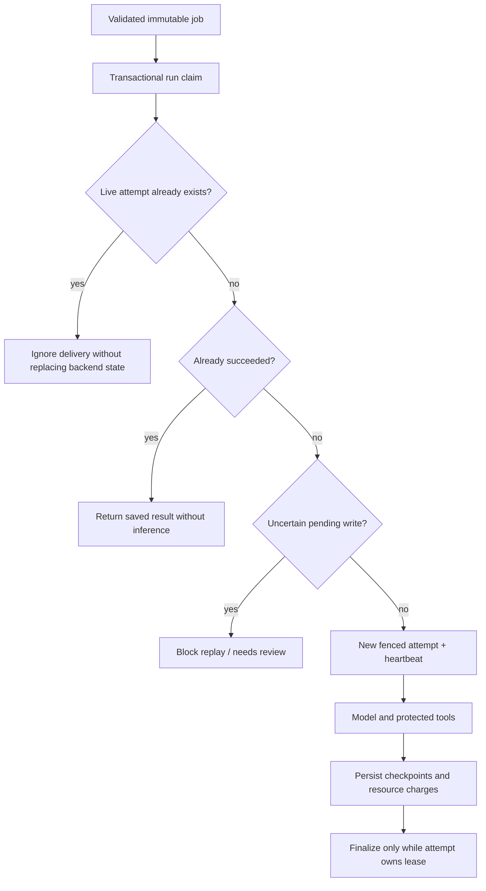

# Runtime reliability: local deployment contract

This document describes the point-4 reliability implementation. It extends the previously verified agent path; the new failure/recovery behavior is covered by controlled tests, not a new live customer or multi-host deployment.

## 1. Durable agent state

Queued agent submissions now create a durable record in `AGENT_RUN_DB_PATH` (default `var/agent_runs.sqlite3`) before publication. Submission/job messages are limited to 32768 characters before persistence. The record owns the immutable job, tenant association, lifecycle, attempt history, checkpoint, result, and generic error code. It does not expire with Celery results or Redis ownership keys.

`RunStoreInterface` defines the persistence boundary; `SQLiteRunStore` implements it for one host, using WAL, full synchronous commits, short transactions, and parameterized SQL. The database file is owner-readable/writable only. A newly created data directory uses mode 0700. Data includes user messages, observations, and answers; it is not encrypted by this implementation and requires operator-controlled access, backups, and a retention/deletion policy. Never commit the data directory or SQLite/WAL files.

SQLite is not a shared database adapter for a multi-host worker fleet or network filesystem. API and workers must point at the same local file. Compose shares a local named volume at `/app/var`; the image creates that directory for its non-root user. A shared SQL service and its migrations/operations are required before multi-host agent execution. Existing Kubernetes files do not establish that capability. Schema version 1 is initialized for a new database; unsupported versions fail rather than being silently interpreted.

Existing fixed-workflow task status is unchanged. Older queued agent jobs without a durable registration are rejected by the new runner; drain old work or resubmit through the updated API when rolling out. Redis task ownership is retained as a compatibility aid for the old polling path, not the authoritative owner of new agent-run history.

## 2. Public operations

| Operation | Permission | Behavior |
|---|---|---|
| `POST /agents/runs` | `agent_run.create` | Validate, register durable identity, and publish |
| `GET /agents/runs/{id}` | `agent_run.read` | Return durable lifecycle/result/attempt summary |
| `POST /agents/runs/{id}/cancel` | `agent_run.cancel` | Request cooperative cancellation |
| `POST /agents/runs/{id}/resume` | `agent_run.resume` | Requeue eligible work under its original ID and budgets |

All operations authenticate tenants. Missing and other-tenant records both return 404. Transition conflicts return 409. Permissions are separate; creating a run does not grant read/cancel/resume or tool access. The worker rebuilds execution context from worker-loaded grants. Configuration changes require process restart; this is not instantaneous centralized revocation.

The durable response exposes lifecycle, attempt summaries, final result, generic error code, decision count, reservations, and reported token counts when present. It omits prompts, checkpoint history, pending-tool arguments, and lease tokens. Unlike the old Celery status endpoint, its lifecycle does not become `PENDING` merely because a result expired. A caller may still use old polling for compatibility, but durable status is authoritative for new agent runs.

Add `Idempotency-Key` (1–128 characters) to submission to reuse the same logical run for the same tenant and request. Only a hash of the key is stored. Reusing it with different input returns 409. Known-published/running/completed submissions return the existing identity and current state without new work. If publication was uncertain, a retry can republish the original identity; delivery deduplication protects execution. Concurrent publication may still occur, so this is not exactly-once messaging. Without a key, separate submissions intentionally create separate runs.

There is no autonomous outbox relay. A process crash between durable creation and publication can leave queued-but-unpublished work. Retrying with its idempotency key or explicitly resuming can publish it. `publication_confirmed` records that publication returned successfully, not guaranteed worker completion.

## 3. Attempt claims and fencing

A transaction serializes claims. Only one active attempt owns a run. Heartbeats extend its lease while inference blocks. An expired lease can be taken over; the old attempt can no longer save checkpoints or finalize results. Each claim increments the bounded attempt count and creates an attempt-history row. Late external activity cannot be undone by database fencing.

A duplicate/busy/fenced Celery delivery is ignored so it cannot overwrite the active attempt's Celery state. Completed redelivery returns the durable final result without calling the model again. These safeguards do not guarantee exactly-once remote inference or external effects, and ignored delivery does not implement a scheduler. An abandoned run can require explicit resume after its lease expires.

## 4. Checkpoints and safe resume

Checkpoints store conversation history, consumed decisions, resource reservations, recovery count, pending tool decision/replay policy, and a computed final answer before terminal storage. A completed tool observation is saved before the next model request. Resume uses that observation rather than repeating completed tool work. An interrupted read may be repeated only when its registered tool explicitly declares `replay_safe=True`; the status tool does so because it is read-only.

Tool definitions default to replay-unsafe. The pending marker is saved before dispatch. An uncertain pending write cannot be replayed automatically and may enter `needs_review`. No write connector, idempotency implementation for remote mutations, or force-replay API is introduced. Such tools need their own idempotency/approval contract before safe recovery can be claimed.

The original deadline, decision count, recovery count, reservations, and initial resource ceilings persist across attempts. Tighter current worker ceilings still apply; resume does not replenish budgets. A failed run needs explicit resume, a live attempt cannot be resumed, and cancelled/exhausted/review/completed runs are not resumable. A final-answer checkpoint can be finalized without another model call. Resume is limited to available time before the original deadline; it is not an unlimited offline continuation facility.

Stored observations were acquired under prior permissions. Reloading current tool grants prevents new unauthorized tool actions; it does not erase previously retained content. Access to retained history and stronger revocation/deletion semantics belong to the data-governance boundary.

## 5. Cancellation and deadlines

Cancellation of queued work prevents inference. Cancellation during execution is observed at guards/checkpoints, prevents new model/tool operations and late successful completion, and records a cancelled lifecycle. A cancelled crashed attempt is reconciled after lease expiry. An abandoned run past its original deadline is reported exhausted once its lease is no longer active. This does not forcibly cancel a remote request, kill a thread, or undo effects. An in-flight synchronous operation may continue until its network timeout; Celery's outer limits remain separate.

The run budget starts on first execution. Resume retains its persisted absolute deadline, so waiting between attempts consumes remaining time. A monotonic clock bounds each invocation while the persisted deadline bridges processes; host clock corrections remain an operational consideration. Lease heartbeats do not extend the execution deadline.

Remaining tool time is propagated into isolated ownership/result Redis clients, capped by `REDIS_OPERATION_TIMEOUT`. Shared client defaults/pools are not mutated. Ownership is checked first, then remaining time is recomputed for backend access. These are per-socket connect/read limits, not a hard total-operation wall-clock cap; DNS, multiple socket phases, and database waits can exceed the remaining allowance before the next cooperative check. Injected custom readers are responsible for their own IO timeouts.

## 6. Token and estimated-cost admission

The adapter reserves an input estimate plus a configured output allowance before each model request. The input estimate uses serialized UTF-8 byte length plus framing allowance; it is a conservative local policy heuristic, not an exact tokenizer for every model/provider. `max_tokens` bounds requested output. Failed or uncertain calls retain their reservations rather than refunding possible usage.

`AGENT_MAX_TOKENS` bounds admitted estimated tokens. Cost admission additionally requires an explicit ceiling and both configured input/output rates; no provider prices are invented. When pricing is absent the API reports cost as unknown (`null`), not zero. Rates must match the deployed model and be maintained by the operator.

When the provider supplies prompt/completion usage, it is recorded separately. Reported excess increases charges and stops further work when the ceiling is exceeded; smaller reported usage does not refund conservative reservations. Missing usage cannot be reconstructed as exact billing. A provider ignoring the requested output cap or reporting usage only after processing can already have incurred excess cost. These are admission/continuation controls, not guaranteed invoice caps. Exact tokenizer/pricing integration and billing reconciliation are still provider-specific concerns.

Defaults:

| Setting | Default |
|---|---:|
| `AGENT_MAX_DURATION` | 120 seconds |
| `AGENT_MAX_DECISIONS` | 20 server ceiling; request default 5 |
| `AGENT_LEASE_SECONDS` | 45 seconds, heartbeat at one third |
| `AGENT_MAX_ATTEMPTS` | 3 |
| `AGENT_MAX_RECOVERIES` | 1 across model/tool recovery |
| `AGENT_MAX_TOKENS` | 100000 estimated tokens |
| `AGENT_MAX_OUTPUT_TOKENS` | 512 per request |
| `AGENT_MAX_COST_USD` | unset; optional explicit configured ceiling |

## 7. Bounded failure recovery

Malformed model decisions can trigger one schema-repair request within the decision/deadline/resource budgets. Eligible inference connection/transient failures can also consume the recovery allowance. A server `Retry-After` response is not immediately retried by this loop. Refusals, authorization denial, failed policy evaluation, cancellation, exhausted budgets, and unsafe tool failures stop execution.

Unknown tools and invalid argument shapes can produce a sanitized error observation. A transient read-tool error can do so only for a replay-safe tool. The next model decision may choose another action or stop; it is not guaranteed to retry or solve the problem. Raw exception details are never supplied as recovery instructions. SDK and Celery automatic agent retries remain disabled. Recovery allowance and resource charges persist in checkpoints.

## 8. Tests and rollout

Controlled tests cover reopened durable records; tenant isolation; concurrent claims; stale lease fencing; duplicate-result protection using Celery's real tracer; cancelled late success; preserved checkpoints/deadlines/charges; resumed tool observations; pending unsafe replay; bounded repair; resource rejection before inference; reported-usage reconciliation; API authorization/idempotency; and isolated Redis timeout settings. They use temporary SQLite databases, synthetic credentials, controlled model/backend responses, and a short real heartbeat test. An additional integration test submits through HTTP into a real Celery worker over in-memory transport, executes the controlled model/tool path, reads the durable result, and redelivers the completed job without another model call. This is real Celery delivery with a controlled broker, not a live Redis/model run. No live worker fault or multi-host deployment was performed.

Rollout: review the patch, install/deploy the updated code, ensure API/workers share the correct local database, back up its directory including WAL-aware handling, grant only intended management permissions, and restart API/workers. Drain/resubmit pre-upgrade agent jobs. The CLI remains a local, non-durable demonstration unless a caller explicitly supplies a durable execution control; queued submission is the managed resumable path.

Suggested review/commit groups: (1) durable store and contracts, (2) execution control and adapter budgets, (3) loop checkpoints/recovery/tool deadlines, (4) worker/API integration and deployment settings, (5) documentation. These groups have dependencies; keep the full working tree available while reviewing and run the suite before publishing a release.
