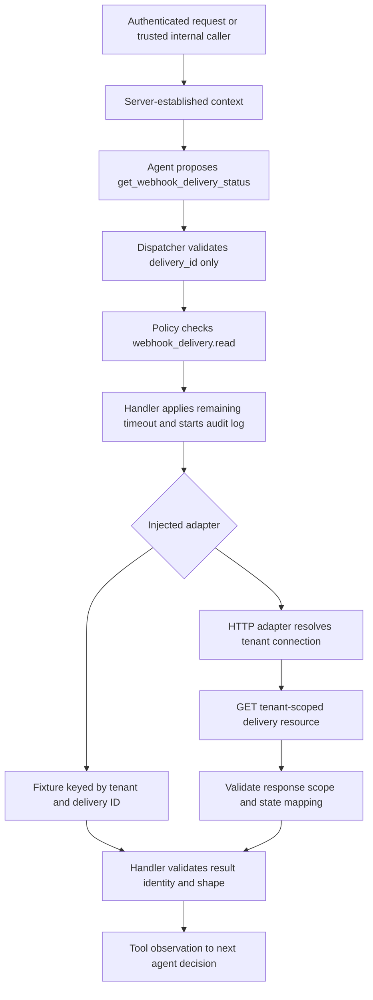

# Read-only webhook integration: contracts first

## Meaning of a delivery

A webhook delivery is the logical work of sending one event to a subscriber. The
external webhook service assigns its delivery ID. It can have several HTTP attempts.
It is not a CrewOS agent run ID, Celery task ID, incoming HTTP request ID or HTTP
response code. Different tenants may use the same opaque identifier; tenant scope
must participate in lookup. CrewOS will read the service's existing record.

## Contracts and interface

`application/dtos/webhook_delivery_status.py` defines the input and discriminated
response contracts. Input accepts only a bounded opaque `delivery_id`. It cannot
supply a tenant, endpoint, permission assignment or credential. The initial ID
format permits ASCII letters/digits and `_.:-`, starts with a letter/digit and has
at most 128 characters. Adapters for incompatible provider ID formats would need
an explicit contract change; this format is not a universal webhook standard.

A found response has the same requested ID, a logical delivery status and an aware
`observed_at` timestamp. Lookup outcome answers whether a scoped readable record
exists; delivery status describes that record's execution state:

| Status | Required interpretation for future adapters |
| --- | --- |
| `pending` | Service reports the logical delivery waiting to be attempted. |
| `in_progress` | Service reports delivery work underway. |
| `retry_scheduled` | Service reports another attempt scheduled. |
| `succeeded` | Service reports recipient acknowledgment under its documented delivery semantics. This does not prove downstream business processing. |
| `failed` | Service reports terminal delivery failure, not merely one failed attempt. |
| `unknown` | A readable record exists, but no supported state mapping can be established. |

Missing and other-tenant records share `outcome=unavailable`, with no state or
ownership explanation. This avoids confirming another tenant's records. An upstream
outage, timeout or throttling must raise `WebhookServiceUnavailable`, not return
unavailable. Malformed or identity-mismatched responses raise `WebhookResponseInvalid`.
Those error messages must exclude credentials and upstream response bodies.

`application/interfaces/webhook_delivery_status_reader.py` defines a `Protocol`
requiring explicit tenant scope, delivery ID and timeout. Its documentation specifies
read-only behavior, result identity preservation and provider failure semantics.
It does not itself authenticate, authorize, isolate storage, or enforce timeouts.
Concrete adapters and the handler must implement those obligations. A network
transport timeout is also not a guarantee of total execution duration.

## Implemented execution path



All five read-only integration stages are now implemented: fixture, handler,
registration, HTTP transport and end-to-end verification. MCP/skills and later
approval-controlled writes remain separate work. No webhook sending/retry service
is implemented by this integration; it reads an existing service's delivery record.


## Fixture and handler

`FixtureWebhookDeliveryStatusReader` accepts explicitly injected records keyed by
`(tenant_id, delivery_id)`. It validates and snapshots them on construction, does
not expose its mutable dictionary, validates read arguments and returns the same
unavailable shape for missing/cross-tenant lookups. It is not an HTTP-failure
fallback or automatically selected by production settings.

`GetWebhookDeliveryStatusHandler` applies `webhook_delivery.read` through the
existing policy executor before any reader/HTTP activity. It caps the reader's
timeout by the remaining execution-control tool allowance, checks that allowance
after I/O, revalidates result shape and preserves the requested delivery ID.

Audit events record tenant/delivery identifiers, outcome, normalized state, duration
and safe exception type. In an agent loop they inherit `agent_run_id`, `tool_call_id`
and step from the existing invocation context. Query text, credentials, upstream
bodies and raw exception messages are not logged. Generic agent-loop tool metrics
also apply when the loop is composed with its normal metrics collector; the demo
does not establish an exported monitoring deployment.

The read-only tool is marked replay-safe. Read observations can change over time;
replay-safe means no delivery mutation, not identical repeated answers. The adapter
performs no automatic HTTP retries. Retry policy is not inferred from a delivery's
own `retry_scheduled` status. Existing decision/duration budgets still bound agent
activity. Network timeout is an I/O allowance, not absolute remote cancellation.

## HTTP contract and tenant trust boundary

`HttpWebhookDeliveryStatusReader` targets this **specific documented contract**, not
every vendor's webhook API. No third-party provider was specified. A conforming
service or a provider-specific adapter is required for a real vendor connection.

```http
GET /v1/tenants/tenant_a/deliveries/delivery_123
Authorization: Bearer <tenant-specific service token>
Accept: application/json
Accept-Encoding: identity
```

A successful lookup returns HTTP 200 with this exact JSON shape:

```json
{
  "tenant_id": "tenant_a",
  "delivery_id": "delivery_123",
  "state": "delivered",
  "observed_at": "2026-11-06T12:00:00Z"
}
```

| Upstream state | CrewOS delivery state |
| --- | --- |
| `queued` | `pending` |
| `sending` | `in_progress` |
| `retrying` | `retry_scheduled` |
| `delivered` | `succeeded` |
| `failed` | `failed` (terminal under this contract) |
| `unknown` or another well-formed state string | `unknown` |

HTTP 200 means the lookup succeeded; it does not itself imply successful delivery.
The adapter checks both response IDs against requested scope before exposing state.
`observed_at` is the provider's aware observation timestamp, not a guarantee of
current state or business completion. The upstream must itself enforce tenant-bound
credentials/resources and use HTTP 404 for missing or unreadable delivery records.
Echoing a matching tenant string is validation, not independent proof of ownership
against a dishonest or compromised provider.

HTTP 404 maps to unavailable and its body is discarded. HTTP 401/403, 429, 5xx and
redirects are service failures, not absent records or failed deliveries. Unexpected
success statuses, wrong IDs, invalid timestamps/types, duplicate JSON keys, extra
fields, malformed/oversized data, non-JSON content and unsupported content encodings
fail explicitly. Unknown well-formed state names map to unknown without exposing raw
upstream text. The adapter limits body reads to the configured maximum plus one byte.

Each tenant's trusted configuration contains an origin and separate bearer token.
The model cannot choose either. Origin validation rejects embedded credentials,
paths, queries and fragments. HTTPS is required outside loopback development; TLS
verification uses the standard transport defaults. Redirects and environment proxies
are disabled so credentials are not automatically forwarded elsewhere. IDs are
validated and URL-encoded. Trusted endpoint configuration still requires operator
network/secret governance; this is not a general SSRF sandbox.

## Registration and configuration

`build_tool_dispatcher(webhook_reader=...)` supports explicit injection for tests or
application composition. Otherwise HTTP registration is opt-in:

```dotenv
WEBHOOK_INTEGRATION_ENABLED=true
WEBHOOK_TIMEOUT_SECONDS=5
WEBHOOK_MAX_RESPONSE_BYTES=16384
```

Supply `WEBHOOK_HTTP_CONNECTIONS` using your server/deployment secret mechanism. Its
JSON shape is:

```json
{
  "tenant_a": {
    "base_url": "https://webhooks.example.com",
    "token": "replace-with-tenant-scoped-service-token"
  }
}
```

The example host/token are placeholders, not a configured external connection.
Configuration tokens use `SecretStr`; configuration validation suppresses input
values in error text. Do not log settings dictionaries or reveal secrets manually.
Incoming CrewOS API tokens and outgoing webhook-service tokens are separate
credentials. Incoming authentication must establish tenant identity, and the server
must separately grant `webhook_delivery.read` in its permission assignments.

Without explicit injection, the default is disabled with an empty connection map.
No tool or permissions are enabled automatically. With the tool enabled, configured
HTTP reader construction and token access occur only after policy authorization.
Missing tenant connection configuration fails as a service-configuration error,
not as an unavailable delivery. The lazy adapter checks the enable flag on reads;
normal environment changes require restarting affected API/worker/CLI processes.

## Evidence and remaining integration decisions

See [scripted and live-model verification](../evaluation/webhook-integration-verification.md).
Tests use a real loopback HTTP service, not a mocked `urlopen`, plus targeted timeout
inspection and a scripted agent provider for deterministic orchestration. The live
model run demonstrates the instructed tool choice and subsequent observation.

Connecting a named third-party service still requires its endpoint/credential setup
and confirmation or adaptation of this wire contract/state meanings. A large-scale
load test, vendor availability guarantees and real incoming API authentication are
not established by the local demo. MCP, reusable skills and controlled write actions
remain later increments. Existing tenant data, private configuration and grants
were not changed during these checks.
