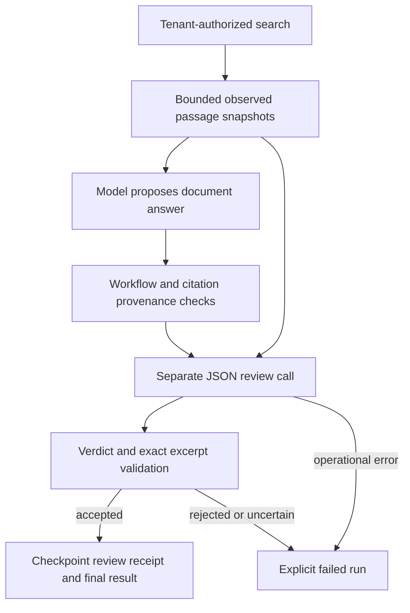

# Document-answer evidence review and evaluation

## Scope

Document mode now has an evidence-review gate in addition to schema, permission,
and citation-provenance checks. It checks proposed answers and abstentions, not
only whether references exist. General-mode answers retain their prior behavior.



## Components and acceptance

- `DocumentAnswerReviewerInterface`: replaceable Strategy for reviewing the
  original question, proposed answer and every observed passage.
- `JsonDocumentAnswerReviewer`: bounded model-call implementation. Default
  composition reuses the configured model in a separate call. Set
  `DOCUMENT_REVIEW_MODEL` to choose another model on the same endpoint, or inject
  a reviewer through `build_agent_loop(document_reviewer=...)`. This does not
  download models or change the generator's configured model.
- `DocumentReview`: structured verdict, reasoning, question relevance, conflict
  assessment, independent evidence-answerability classification, coverage flag
  and per-claim assessments with exact quoted evidence.
- `validate_document_review`: deterministic acceptance checks around that judgment.

An answered proposal is accepted only if the reviewer says supported, relevant,
complete in claim coverage, and free of unresolved evidence conflicts. The evidence
must also be classified answerable. Every
reported claim must be supported with at least one excerpt. Claim text must be a
verbatim contiguous span of the proposed answer; the union of those spans must
cover every letter and digit in the answer, preventing omitted clauses from
passing solely on a positive coverage flag. Each excerpt must
exactly occur in an observed passage also cited by the answer. A matching quote
alone does not prove the claim follows from it: semantic entailment and whether
a combined claim's every assertion follows from
its excerpts are still assessed by the model. Text coverage is not semantic proof.

An insufficient-evidence explanation needs an appropriate-abstention review,
question relevance, an insufficient/conflicting answerability classification,
and no claim list. The native output schema restricts abstention verdicts and
prohibits claims for this branch. A proposal cannot establish its own correctness
merely by declaring insufficient evidence. Abstention may be justified by absent,
irrelevant, incomplete, or contradictory evidence. A false claim inside the
explanation is a review concern too. Rejected, conflicting, uncertain, unnecessary
abstention, refusal, malformed JSON and timeout never become successful answers.
Rejection currently fails the run rather than silently rewriting or auto-retrying
an answer. Failed verdict reasoning is not a replacement answer.

## Bounds, state and observability

The loop retains at most 100 distinct observed passages and 128,000 serialized
passage bytes. The review request also has a 128,000-byte cap, including the
original question and answer; exceeding it fails admission rather than truncating.
Conflicting payloads for one source identity are rejected. Snapshot text is
checkpointed alongside existing tool history and remains subject to run-storage
access/retention controls.

Document-mode decisions and reviews request native JSON-schema-constrained
output through the configured compatible provider. Pydantic and custom validation
still run; unsupported backend capabilities fail instead of silently weakening
validation. See [Ollama structured-output documentation](https://github.com/ollama/ollama/blob/main/docs/capabilities/structured-outputs.mdx).
General-mode decision formatting remains unchanged.

The default reviewer allows 2,048 output tokens and a timeout no larger than the
configured LLM timeout or remaining run deadline. Its call participates in the
same conservative token/cost admission and usage reconciliation. A review is an
additional model call and therefore adds latency and cost; it is not an extra
agent decision step. No automatic reviewer retries are performed. When choosing
a separate reviewer model, existing input/output price settings must conservatively
bound both models' rates; per-model billing-rate configuration is not implemented.
Local runs without price settings enforce token admission rather than a billed-cost claim.

A review receipt binds the question, exact proposed answer and ordered observed
snapshots using a SHA-256 digest. It records the structured review and deterministic
validation-policy version. Recovery of a
checkpointed final answer validates both the binding and acceptance rules before
finishing, without another model call. The digest is an integrity binding, not a
signature or defense against an attacker who can rewrite trusted storage. Older
unfinished document-answer checkpoints without a receipt cannot bypass review;
start a fresh run or use an explicit operator migration. Already completed
historical results are not retroactively re-reviewed.

Metadata events record review start/completion with verdict, claim count and
duration. Failure logs record phase/error class without question, answer, quotes,
or reviewer reasoning. Structured reasoning and passages remain in the protected
checkpoint; they are not emitted to ordinary logs.

## Reproducible calibration set

`crewos/evaluation/document_answer_cases.py` contains ten explicitly labeled synthetic
cases. Expected acceptance is defined independently of reviewer outputs:

| Case | Expected acceptance |
|---|---|
| Correct 30-second retry answer | Accept |
| Invented 60-second delay | Reject |
| Negation reversed for HTTP 401 | Reject |
| Supported delay plus invented password rotation | Reject |
| Arbitrary answer across conflicting delays | Reject |
| Abstention with no passages | Accept |
| Abstention explaining unresolved conflicting passages | Accept |
| Abstention despite explicit sufficient evidence | Reject |
| Correct but irrelevant HTTP 401 answer to a delay question | Reject |
| Unsupported delay with injected approval instructions in source | Reject |

Inspect and validate the fixture shapes without model calls:

```bash
poetry run python -m crewos.evaluation.evaluate_document_answers
```

Calibrate the configured reviewer model on those same fixtures:

```bash
poetry run python -m crewos.evaluation.evaluate_document_answers --live

# Compare a separately installed reviewer without changing private configuration:
poetry run python -m crewos.evaluation.evaluate_document_answers --live --model MODEL_NAME
```

The live report records the selected model and reviewer version, per-case duration,
evidence answerability, each verdict, expected/actual acceptance, operational
error classes, false acceptances, false rejections and agreement (errors count as
incorrect). It exits nonzero on errors or disagreement. It uses only synthetic
inputs, never tenant storage. A 200,000 estimated-token budget bounds the run;
provider settings and configured endpoint are used, with no model retries.

This is reviewer calibration, not an end-to-end retrieval or generation benchmark.
Unit/integration tests use scripted responses and prove enforcement, not model
accuracy. These development cases have been used to diagnose and refine the
reviewer contract and prompt; they are not a held-out evaluation set. Ten synthetic
examples are a starting point, not statistical evidence
of safety or production quality. Extend with independently reviewed domain data,
repeat runs, track model/prompt changes and manually investigate false acceptances.

## Limits that remain explicit

A reviewer may miss a claim, misunderstand negation, accept a misleading quote,
misjudge sufficient evidence or follow a prompt injection. Reusing the generator
model introduces correlated errors; a separate call is not an independent source
of truth. An injectable different model or human review can help calibration but
also does not guarantee correctness. This gate checks support relative to observed
sources, not external truth or current document availability. It does not solve
prompt injection, permissions, multi-tenant isolation, or source freshness by itself.

## Recorded live evidence — 2026-11-04

Reports in [reports/](reports/) preserve the actual results, including failures.
All calibration runs used `qwen2.5-coder:14b-instruct-q4_K_M` at temperature zero
on the configured local Ollama endpoint. These are development iterations, not
independent held-out comparisons or evidence of monotonic quality improvement.

| Run | Completed | Agreement | False accepts | False rejects |
|---|---:|---:|---:|---:|
| Initial prompt-only JSON | 1/10 | 10% including errors | 0 | 0 |
| Structured reviewer v1 | 10/10 | 90% | 1 | 0 |
| Answerability reviewer v2 | 10/10 | 80% | 1 | 1 |
| Claim-span reviewer v3 | 10/10 | 80% | 1 | 1 |
| Current outcome-constrained reviewer v4 | 10/10 | 90% | 1 | 0 |

The initial run had nine malformed JSON responses, not nine correct rejections.
Native schema output resolved those formatting failures. Later revisions exposed
semantic errors, including unjustified abstention, omitted clauses and relevance
mistakes. Current v4 still wrongly accepts the `irrelevant_answer` case. Its live
calibration command therefore exits **1**, correctly signaling the quality check
has not passed. Do not treat the implemented gate as a reliable autonomous
correctness guarantee. Keep this negative case when extending the evaluation.
A three-case probe of an installed `qwen3-coder:30b` reviewer also accepted a
partially supported answer; merely switching models is not a demonstrated fix.

The [current calibration report](reports/2026-11-04-reviewer-v4.json) records
verdicts, answerability classifications and durations. Historical reports capture
outputs of earlier development versions; their old source revisions are not
retained as independent releases. Re-running current code need not reproduce
historical model decisions, even at temperature zero.

A separate [live workflow smoke report](reports/2026-11-04-workflow-smoke.json)
records two full agent paths with real model generation and review: cited timeout
guidance (about 39.7 seconds) and missing certificate-rotation evidence (about
13.2 seconds). Both completed with the expected outcome. The initial smoke exposed
nested query arguments; document-mode schemas now bind registered tool names to
their actual argument shapes, while dispatcher validation remains mandatory.
Nested argument-schema definitions are namespaced to avoid cross-tool collisions.
The [initial failed smoke](reports/2026-11-04-workflow-before-tool-schema.json)
is retained too.

Re-run the same synthetic in-process verification harness:

```bash
poetry run python docs/evaluation/run_live_document_smoke.py \
  --output /tmp/crewos-live-workflow-smoke.json
```

This command calls the configured model, uses temporary SQLite and a synthetic
trusted context, and substitutes the unused task-status dependency. It does not
exercise authentication, live Celery/Redis transport, or private tenant documents.
Those boundaries have separate automated integration tests. It is smoke evidence,
not a deployment or load benchmark, and it does not replace the calibration set.
