# Embeddings and vector-search lifecycle verification

This is a reproducible development smoke check using real Ollama inference and
SQLite storage. It establishes that the components work together on a small fixture;
it is not a production readiness or representative relevance benchmark.

## Reproduce

Run from the repository root with Ollama serving the already-installed model:

```bash
poetry run python -m crewos.retrieval.vector_lifecycle_demo \
  --model nomic-embed-text:v1.5 \
  --revision 0a109f422b47e3a30ba2b10eca18548e944e8a23073ee3f3e947efcf3c45e59f \
  --dimensions 768
```

The model and revision are explicit inputs. The command checks server-reported
revision metadata before and after each embedding batch. It does not download a
model, change `.env.local`, or enable vector retrieval in the normal application.
Normal application settings must separately specify the embedding model, revision,
dimensions and prefixes before the configured provider builder can be used.
The CLI accepts this specific model because the fixture uses its document/query
prefixes. Other models need deliberately chosen preparation settings.

The command creates temporary source and vector databases and deletes them on exit.
It uses synthetic `tenant_a` context with explicit permissions, not the tenant's
existing documents or API credentials. Cleanup subprocess environment overrides
both database paths and the cleanup allowlist. Your running application/poller
keeps using its own paths. A report with any failed assertion returns exit code 1;
provider or subprocess failures raise rather than become successful empty results.

## What runs

```mermaid
flowchart LR
  A[Authorized synthetic ingestion] --> B[Cold vector search]
  B --> C[Reopen stores and search again]
  C --> D[Commit source version 2]
  D --> E[Cleanup CLI advances vector floor]
  E --> F[Search current version and reject old writes]
  F --> G[Verify permission and tenant boundaries]
  G --> H[Delete source and run cleanup CLI]
  H --> I[Reopen cache and verify deletion fence]
```



The fixture has three short, one-chunk documents about authentication, webhook
timeouts and Python experience, with three hand-labeled queries. It checks:

- Initial vectors persist and subsequent store instances reuse them.
- Warm searches embed the question, without regenerating source vectors.
- A committed update produces an event that the real cleanup CLI acknowledges.
- Obsolete vectors disappear and late obsolete writes fail.
- Search returns the updated source version and creates its new vectors.
- Missing permissions deny before provider calls; an empty other tenant sees no
  passages and makes no embedding calls.
- Source deletion produces acknowledged cleanup, removes the document from search,
  and leaves a permanent cache write fence after reopening the store.

This uses real bounded `--once` cleanup subprocesses. It does not test process
supervision or the uptime of an independently running continuous poller.

## Recorded run: 6 November 2026

[Raw report](reports/2026-11-06-vector-lifecycle.json)

| Observation | Result |
| --- | --- |
| Model | `nomic-embed-text:v1.5`, 768 dimensions, pinned digest above |
| Lifecycle checks | 15/15 passed |
| Expected first passage | 3/3 queries |
| Recall@1 / MRR@1 | 1.0 / 1.0 on this fixture |
| First search, populating all three document vectors | 637.824 ms |
| Searches after reopening stores | 22.529, 19.587, 17.858 ms |
| Search after update | 41.886 ms |
| Search after deletion | 24.271 ms |
| Successful embedding calls | 12 |
| Prepared input text count / UTF-8 bytes | 12 / 776 |
| Measured whole-run wall time | 1.083202 seconds |
| Monetary cost / provider token usage | Not measured |

Recall@1 measures the fraction of labeled relevant passages returned first. Each
fixture query has one relevant passage. MRR@1 is 1 when that passage is first and
0 otherwise, averaged across queries; therefore these two metrics coincide here.
The update-ranking assertion is recorded separately from those three initial cases.

The first search embeds its query and all three source documents. The next two
searches in the `cold` phase already reuse those source vectors. `warm_reopened`
explicitly reopens both stores before measuring three additional queries. Each
warm query still invokes the embedding provider. Provider call times include the
pre/post digest checks; model loading and local machine conditions can affect them.
These single-run values are observations, not p95 latency or throughput estimates.

Input bytes include prefixes. They are not tokens and cannot be multiplied by a
per-token tariff. The report leaves monetary cost and token usage null rather than
claiming that local inference is free. CPU/GPU time, electricity and hosting costs
are unmeasured. Priced agent runs still require separate embedding accounting; the
existing runtime guard remains in place.

## Remaining evaluation boundaries

Three friendly synthetic queries do not establish relevance across enterprise
content. Representative labels, paraphrases, ambiguous and irrelevant queries,
multiple relevant chunks, longer documents, larger tenant corpora and adversarial
inputs remain for the indexed-search/relevance evaluation phase. Nearest passages
can be irrelevant: retrieving something is not evidence that a question is answerable.

This check does not generate or review an answer, authenticate an HTTP request,
exercise Celery submission, establish stronger per-document ACLs, or measure load.
Those behaviors have separate tests and evaluation needs. Existing failure-oriented
unit/integration tests cover digest mismatch, provider failures, cache corruption,
source races, cleanup retries and write fencing; this live run complements them.
