# Evidence: model-selected tool execution in a queued agent run

## Result

A local authenticated HTTP submission was delivered through Redis to a Celery worker. The worker ran the agent loop against a local Ollama model, executed one model-selected task-status tool through permission and ownership checks, returned its observation to the model, and stored a final-answer decision that the API returned through polling.

This demonstrates one successful end-to-end execution path. It is not a reliability benchmark, a production deployment, or evidence of general task-solving quality.

## Environment and evidence provenance

- Run date: 1 November 2026, approximately 09:25:53–09:26:10 Asia/Kolkata (03:55:53–03:56:10 UTC).
- Local macOS development environment; CrewOS API on port 8001.
- Redis used for broker, ownership registration, and Celery results.
- Local Ollama model configured for this demonstration: `qwen2.5-coder:14b-instruct-q4_K_M`.
- Real Celery worker consuming tenant queue `crewai.tenant_a`.
- Evidence sources: observed API submission/polling responses and worker logs supplied by the developer. This document summarizes those observations; a complete raw log bundle is not checked into the repository.
- Documentation reviewed at revision `930fea0`. The run occurred before the subsequent Celery log-privacy fixes; this is not a claim that the run executed at that revision.

No tenant token, model credential, prompt contents, or raw generated answer is included here. Identifiers below are local demonstration identifiers.

## Separate identities

| Identifier | Value | Meaning |
|---|---|---|
| Agent run / Celery delivery ID | `8e80e42b-9739-4e9a-9db9-90c14c805965` | The queued agent execution |
| Tool-call ID | `ceafb00b-9d40-4e32-94b5-d27c91fd77fc` | One invocation of the status tool within that run |
| Inspected task ID | `27486c97-9494-4e6e-8d89-65e9ccbc50d6` | Separate existing fixed-workflow work being inspected |

The agent task did not directly call another worker. Its status tool read the inspected task's backend state after access checks.

## Observed sequence

```mermaid
sequenceDiagram
    participant Client
    participant API
    participant Redis
    participant Worker
    participant Model as Ollama model
    participant Tool as Protected status tool
    Client->>API: POST /agents/runs
    API->>API: Authenticate and authorize agent_run.create
    API->>Redis: Register ownership and publish job
    API-->>Client: 202 with agent_run_id
    Redis->>Worker: Deliver run_agent job
    Worker->>Worker: Validate delivery and registered ownership
    Worker->>Model: Request decision 1
    Model-->>Worker: Propose get_agent_task_status
    Worker->>Tool: Dispatch validated arguments with trusted context
    Tool->>Tool: Policy allows agent_task.read
    Tool->>Redis: Check target ownership, then read state
    Redis-->>Tool: Accessible record, backend PENDING
    Tool-->>Worker: found / pending
    Worker->>Model: Request decision 2 with observation
    Model-->>Worker: Final-answer proposal
    Worker->>Redis: Store successful execution result
    Client->>API: Poll existing domain status route
    API-->>Client: SUCCESS and final-answer decision
```



The submission code and automated tests establish authentication, policy, registration-before-publication, and delivery-validation behavior. Live HTTP responses establish acceptance and polling. The supplied worker events directly establish the following execution sequence:

| Event | Observed metadata |
|---|---|
| `agent_job_received` | Submission run ID preserved |
| `agent_run_started` | Maximum five decisions |
| `agent_model_call_completed` | Step 1: `tool_call` |
| `agent_tool_call_started` | `get_agent_task_status`, tool-call ID assigned |
| `tool_policy_evaluated` | `agent_task.read`, `allow`, `permission_granted`, policy version 1 |
| `task_ownership_checked` | `accessible` |
| `task_status_read_completed` | Mapped state `pending` |
| `agent_tool_call_completed` | Same run ID and tool-call ID |
| `agent_model_call_completed` | Step 2: `final_answer` |
| `agent_run_completed` | Two decisions, one attempted/completed tool call |
| `agent_job_completed` | Same submission run ID |
| Celery task-success record | Result persisted and returned |

Polling observed `PENDING`, then `STARTED`, then `SUCCESS` for the agent execution. These states refer to the agent run, not the separate inspected task.

## Timing from this run

| Boundary | Duration |
|---|---:|
| First model call and decision validation | 11.823 seconds |
| Protected tool dispatch | 0.0065 seconds |
| Second model call and decision validation | 5.054 seconds |
| Agent loop | 16.885 seconds |
| Celery task | 17.024 seconds |

The model calls dominate this sample's elapsed time. The loop duration includes the model and tool calls; these nested measurements must not be added together. One run cannot establish percentiles, throughput, concurrency behavior, or an SLA.

## Interpretation of the inspected status

The tool returned `found` with status `pending`. An independent lookup at the time returned the same result. That proves accessible ownership registration and an observed backend state; it does not establish that the inspected task was waiting in a queue.

The inspected task had previously been observed as successful. A result can expire before its ownership record, causing Celery to report `PENDING` again. Expiration is a plausible explanation, not a proven diagnosis from these logs alone. The model's final answer should not be treated as proof of queue position or result retention. Evaluating explanations of this ambiguity remains useful follow-up work.

## Automated verification and privacy follow-up

Last recorded default-suite result after log-privacy fixes: **506 passed, 1 skipped, 99.06% line coverage**. The skipped opt-in Redis/Celery integration test is separate from the manual live run described here. Coverage measures executed lines, not agent quality.

The supplied Celery success record exposed the returned answer. Subsequent changes suppress successful result representations for both CrewOS task types. A separate scoped filter redacts Celery trace failure-log exception text, arguments, and tracebacks. Tests exercise Celery's actual success/failure tracer against controlled in-memory backends and verify that backend result/failure data is preserved. These privacy changes were not verified by another live worker run in this evidence record; workers must restart to load them.

## Reproduction outline

1. Install the locked dependencies. Configure private model, Redis, tenant-token, and permission settings. Use synthetic demonstration inputs.
2. Grant `agent_run.create` to permit submission and `agent_task.read` to permit status-tool execution. These permissions are separate.
3. Start Redis and Ollama with the configured model. Start the matching tenant worker and API:

   ```bash
   poetry run worker --tenant-id tenant_a
   poetry run uvicorn crewos.main:app --host 127.0.0.1 --port 8001
   ```

4. Obtain an existing task ID owned by that tenant, or intentionally test an unavailable identifier. Submit a message through authenticated `POST /agents/runs`; use the README's request example. Preserve the returned run ID.
5. Poll `GET /domain/status/{run_id}` with the same tenant credentials. Record its terminal state.
6. Inspect the worker log events under the submission run ID. Confirm actual tool execution, matching tool-call IDs, policy/ownership checks, and the terminal event. A successful final answer alone is insufficient evidence of tool use.
7. Record observed outcomes separately from expectations. An unavailable record or expired result must not be relabeled as successful retrieval of completed output.

Model choices are nondeterministic. Repeating the inputs may yield a different tool decision, malformed JSON, a refusal, or a different answer. The agent's decision limit bounds iterations, not the complete elapsed time or cost.

## Boundaries not established by this evidence

- Reliable behavior across multiple tasks, providers, tenants, or failures.
- A complete prompt-injection defense or enterprise authorization system.
- Durable run history, checkpoints, resume, or exactly-once execution.
- Replay safety for tools that modify external systems.
- Provider-native tool calling or general multi-agent coordination.
- Retrieval/RAG, MCP integration, persistent memory, or human approvals.
- Aggregated Celery-worker metrics, continuous monitoring, dashboards, or distributed traces.
- Production operation, customer deployment, or professional production-agent experience.

The current tool is read-only. Automatic agent-task retries are disabled, but broker redelivery remains possible. Restricted broker access and result-backend controls remain required.
